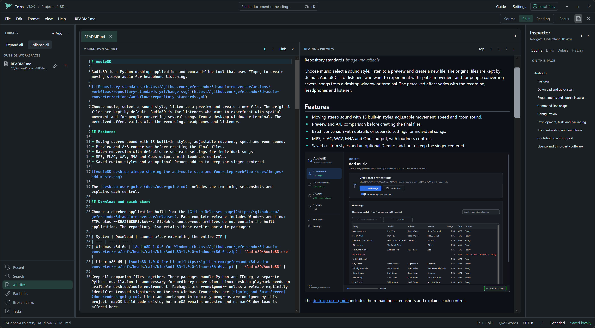

# Tern

Tern is a local-first Markdown editor for Windows with a source editor, native reading preview, workspace search and PDF, HTML and plain-text export.

[](https://github.com/gcfernando/tern-markdown-editor/actions/workflows/repository-standards.yml) [](https://github.com/gcfernando/tern-markdown-editor/actions/workflows/release.yml)

Write notes, maintain project documentation and organize folders of ordinary Markdown files. Local editing needs no account, subscription or activation key. Tern is written in C# with .NET 10 and Avalonia 12; optional URL import, remote images and AI/MCP connections have separate [network and privacy boundaries](docs/privacy.md).

## Features

- Source, Split and Reading modes, document tabs, a reference pane, themes and focus mode.
- Native preview without a browser engine: tables, task lists, footnotes, code, images, front matter, bounded math and supported Mermaid diagrams.
- Library folders and workspaces, outline, backlinks, broken-link repair, statistics, Quick Open and SQLite full-text workspace search.
- Encoding and line-ending preservation, atomic saves, external-change comparison and merge, local saved-text history and recovery checkpoints.
- HTML, PDF and text export, Windows text printing, image insertion and portable local attachment copies on Save As.
- Fifteen beginner lessons and optional, explicitly reviewed AI writing and MCP tool requests.



The screenshot shows an existing note in Split view. See the [user guide](docs/user-guide.md) for interface details and supported rendering limits.

## Download and run

Open [GitHub Releases](https://github.com/gcfernando/tern-markdown-editor/releases) and select a complete release containing **Tern-win-x64.zip** and **SHA256SUMS.txt**. GitHub's source-code ZIP and tarball are source archives, not the packaged application. If those assets are absent, use the [source build instructions](docs/development.md) or a complete earlier release.

1. Download the application ZIP and checksum file from the same release.
2. Compare its SHA-256 with the matching manifest entry:

   ```powershell
   Get-FileHash .\Tern-win-x64.zip -Algorithm SHA256
   ```

3. Extract the entire ZIP to a writable folder and run `Tern.exe`. Keep all companion files together.

The Windows x64 release package is self-contained and bundles its .NET runtime. A development executable under `bin` is a different build and may need an installed matching runtime. The current packaging route is **unsigned**, so Windows may show **Unknown publisher** or a SmartScreen warning. A checksum does not establish a trusted publisher. Read the [release guide](docs/releases.md) for updates, removal and acceptance limits.

## Use Tern

Press `Ctrl+N`, write a heading and a few sentences, then press `Ctrl+S` to choose a Markdown filename. Use `Ctrl+2` for Split view or `Ctrl+3` to read the preview. The [beginner guide](docs/BEGINNER_GUIDE.md) and [practice note](docs/practice/practice-note.md) provide a safe starting point.

| Task | Start with |
| --- | --- |
| Open notes or browse a folder | `Ctrl+O`, `Ctrl+Shift+O` or **+ Add** in the Library |
| Find a note or command | Quick Open (`Ctrl+K`) or Command Palette (`Ctrl+Shift+P`) |
| Search text | Find (`Ctrl+F`), Replace (`Ctrl+H`) or workspace search (`Ctrl+Shift+F`) |
| Add a link or picture | Insert Link (`Ctrl+Shift+K`) or the Format menu |
| Learn or configure a feature | `F1` opens the guide; `Ctrl+,` opens Settings |
| Export or print | File export commands, or Print (`Ctrl+P`) for plain-text printing |

Closing a tab, folder or workspace asks about unsaved changes and does not delete its files. Separate file-management actions can change files on disk. Save As can carry attachments inside the original note's folder; check the [copy rules](docs/user-guide.md#save-as-and-portable-attachments) before moving a collection.

The editor eagerly loads files up to **64 MiB**; this is a memory guard, not a responsiveness guarantee. Preview and export have smaller content/resource budgets and can report truncation. **1 GB editing is unsupported.** PDF font coverage, supported Mermaid syntax and native printing differ from browser output. See [known limits](docs/user-guide.md#known-limits).

## Configuration and local data

Settings controls appearance, fonts, wrapping, layout, shortcuts, session restoration and workspace exclusions. Configuration uses `%APPDATA%\Tern`; local state, recovery and search indexes use `%LOCALAPPDATA%\Tern`. `TERN_DATA_ROOT` selects an isolated root with separate settings, state, recovery and index directories. Back up important notes and state before clearing or replacing them.

Saved AI connection keys use Windows Credential Manager; unsaved keys remain in memory. Optional requests can transmit a complete active note, a question or reviewed tool arguments. Opening a note with remote images can contact image hosts. Read [privacy, credentials and network access](docs/privacy.md) before opening confidential or untrusted content.

## Development and testing

Use Windows and the exact SDK selected by [global.json](https://github.com/gcfernando/tern-markdown-editor/blob/main/global.json), currently **10.0.402**. Run from the repository root:

```powershell
dotnet restore Tern.slnx --locked-mode
dotnet build Tern.slnx -c Release --no-restore -m:1
dotnet test Tern.slnx -c Release --no-build --no-restore -m:1
dotnet run --project src/Tern.Desktop -c Release --no-build
```

Dependencies and lockfiles are pinned, and warnings are errors. Eight test projects cover application, filesystem, rendering, workspace, headless UI and security behavior; benchmarks are separate. The unfiltered test command includes external-corpus and interactive Windows checks that need additional inputs. The reproducible CI gate excludes eight such cases explicitly; it does not establish full native acceptance. See [development](docs/development.md) and the [validation record](docs/BEGINNER_REVIEW_VALIDATION.md).

## Automated releases

The [release workflow](https://github.com/gcfernando/tern-markdown-editor/actions/workflows/release.yml) is configured to build, run its documented automated gate and package Windows x64, then publish a separate main-branch preview after required checks succeed. Preview tags identify the run and source commit; application version remains **1.0.0**. A failed check must not be described as a verified release.

For a local candidate, use `./tools/BuildRelease.ps1`; it publishes, invokes the packaging helper and smokes the extracted application. The legacy `./scripts/publish.ps1` remains available for a local self-contained publish. These have different output directories; the [release guide](docs/releases.md) explains each and the unsigned/manual-acceptance limitations.

## Troubleshooting

- **The app does not start:** extract the whole application ZIP. A lone executable copied from a development build is not the release package.
- **Windows warns about the publisher:** check signing status and checksum. An unsigned package does not establish a trusted Windows publisher; do not disable operating-system protections.
- **An image or diagram is missing:** check the path, network, supported syntax and preview warnings. External local images need the appropriate per-note permission.
- **An export is incomplete:** review readiness and truncation warnings and [export limits](docs/user-guide.md#export-and-print).
- **A note changed on disk or recovery appears:** preserve both versions and use [comparison and recovery](docs/user-guide.md#saving-external-changes-and-recovery) before overwriting anything.
- **An AI endpoint fails:** check protocol, endpoint and model using synthetic text. Provider compatibility and entitlement are separate from Tern's protocol support.

## Contributing and support

Read [CONTRIBUTING.md](CONTRIBUTING.md) and [repository standards](REPOSITORY_STANDARDS.md). Report reproducible problems through [GitHub issues](https://github.com/gcfernando/tern-markdown-editor/issues); follow [SECURITY.md](SECURITY.md) for sensitive reports. Use the [documentation index](documentation.md) or [published documentation](https://gcfernando.github.io/tern-markdown-editor/documentation/) for further guides.

## License

Developed by Gehan Fernando and released under the [MIT License](LICENSE). Dependencies retain their own terms; see [third-party notices](THIRD-PARTY-NOTICES.md).

<a id="highlights"></a>
<a id="build-test-run"></a>
<a id="publish-self-contained-win-x64"></a>
<a id="benchmarks"></a>
<a id="layout"></a>
<a id="documentation"></a>
<a id="closing-documents-and-workspaces"></a>
<a id="known-limitations-summary"></a>

The previous README's detailed workflow and architecture reference is preserved and clarified in the [user guide](docs/user-guide.md) and [development guide](docs/development.md).
