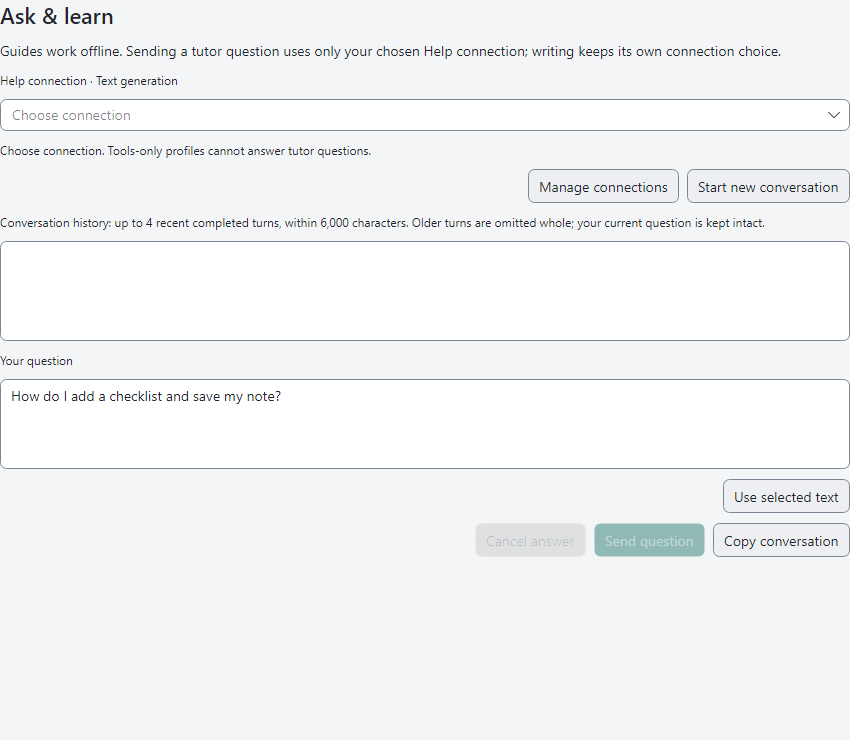

# Beginner guide

Tern works with ordinary text files containing Markdown. Local notes need no account or internet connection; remote pictures, URL imports and optional connections have separate [network behavior](privacy.md).

Press `F1` to open **Learn Tern**. Its fifteen lessons remain open while you practise. Reading a lesson does not save, send or change a note; the action you deliberately choose does that.



## 1. Write your first note

Press `Ctrl+N` and type:

```markdown
# My first note

Today I learned something new.
```

The `#` makes a heading. `Ctrl+2` shows source beside reading preview. Other tabs remain open.

## 2. Open an existing file

Press `Ctrl+O` and choose Markdown. Tern does not convert it into a private file format. Keep a backup when experimenting with important notes. Existing files can still have unsaved edits in their tabs.

## 3. Open a Markdown link

Choose Open from URL from File or **+ Add**. Use a public Markdown-file URL; a GitHub file link can be converted to raw content, while a repository folder or ordinary HTML page is not a note. **Open working copy** uses a complete local cache when available; **Fetch latest** requests a new copy; **Save portable copy…** asks for a destination. The result is editable and does not update its website. Check missing-asset notices before relying on offline access.

## 4. Read without writing marks

Use `Ctrl+1` for Source, `Ctrl+2` for Split or `Ctrl+3` for Reading. Native preview supports bounded Markdown, math and diagrams without executing a web page's scripts.

## 5. Format text

Select words and use `Ctrl+B` for bold or `Ctrl+I` for italic. Format also inserts headings, links, lists, task lists and code. `Ctrl+Shift+K` inserts a link; `Ctrl+Enter` toggles a task.

```markdown
## Things to remember

- One small step
- [ ] A task I can finish
```

## 6. Find words

`Ctrl+F` searches the active note; `Ctrl+H` replaces. Review options before replacing many matches. `Ctrl+Shift+F` searches the indexed workspace, a different scope. Find matches are highlighted in Source, Split and Reading. Find matches are highlighted in Source, Split and Reading.

## 7. Save your work

Press `Ctrl+S` and choose a `.md` filename. Empty drafts can be saved. An explicit filename takes priority over a heading-derived suggestion. Recognize the tab's unsaved indication. On close, Save writes changes, Discard abandons them and Cancel keeps the note open. Undo is useful editing history, not a backup.

## 8. Add a picture

Save a new note first; insertion can open Save and continue afterwards. Use Insert Local Image, paste a copied image file or drop an image into Source. The image form shows a thumbnail, alt text and destination. Copy into note assets suggests a portable copy; uncheck it to link a known original. Cancel keeps your note. Clipboard pixels without a source file need a copy destination. Read the [attachment rules](user-guide.md#pictures-and-local-resources) before moving notes.

## 9. Export a PDF or other format

Choose a File export command, select format and destination and review readiness messages. Format changes require a compatible destination. Inspect the result: content can be truncated, glyphs may need another font and layouts differ. Save editable Markdown separately.

## 10. Print

`Ctrl+P` opens the formatted print preview. Choose All, Current page or Pages in the paginated preview, then Open selected PDF. Press `Ctrl+P` in your PDF reader to choose a printer and settings. Physical printer behavior needs separate acceptance.

## 11. Recover interrupted work

Inspect recovery provenance and compare it with the current file; differing lines are highlighted. Restore into an independent unsaved copy before deciding what to retain (Enter does this). Discarding a checkpoint needs a second confirmation. Unreadable recovery files are offered for inspection or deletion once, then set aside in `recovery\damaged`. Recovery and saved-text history are useful but do not replace backups. Do not discard your only good copy.

## 12. Try a practice note

Copy the [practice note](practice/practice-note.md) into a new note and save your own copy. Change a sentence, check a task, try Undo, switch to Reading and save again. Its example link opens `example.com` only if deliberately followed; the sample contains no remote images.

## 13. Organize a folder or workspace

Open Folder browses an existing directory without metadata. Create Workspace makes a named folder containing `.tern-workspace.json`; Open Workspace restores that context. Use disposable folders while learning real rename, move and delete actions. Closing a folder/workspace does not delete files and asks about unsaved changes. See [workspace details](user-guide.md#folders-workspaces-and-search).

## 14. Decide whether to use AI

AI is optional. Local writing, preview and export do not require an AI account. Providers have their own account, cost and retention terms. Decide whether you may transmit the note; use synthetic text first.

## 15. Connect and review a request

Open Settings → AI connections → Manage AI connections. Follow **Choose service → Configure connection → Validate and save**. Enter a connection name, exact model ID and required key. **Validate connection** sends a fixed test message to check the selected endpoint, model and authentication; it sends no note, but provider usage may apply. Read success or the error, then **Save connection**. Saving alone makes no request and does not prove the settings work. Saved keys use Windows Credential Manager. Select the saved API or Copilot connection through the **AI** entry for writing, or expand **Try your own message (optional)** in setup to review and send a separate question. Select a paragraph in Source and press **Ctrl+Shift+Space**. Choose **Improve selected text** or enter your own instruction. Check **Selected text** and the connection, then choose **Generate for review**. Apply only the changes you want. Undo restores the previous draft. Guide questions do not automatically include your note.

The **AI service** menu includes **GitHub Copilot** and **MCP server** alongside APIs. It offers the appropriate setup fields for your choice. Use **Create connection** for a new profile; select any saved connection to modify, validate or delete it. All saved connections appear through the **AI** entry. Copilot needs installed native copilot.exe, Copilot access and a fine-grained token with Copilot Requests permission. Select an MCP connection through the **AI** entry and choose **Open MCP tools**. Connect and discover explicitly, then review the tool, exact JSON arguments and consent before running it once; external effects may not be undoable. MCP cannot generate a note. The writing composer puts the instruction first and shows the text scope and model below it. If no writing connection is saved, choose **Set up connection**. Copilot requests have an 8,192-character complete-request limit and do not accept @mentions or CLI commands. Live services are not certified merely by local protocol tests. Read [privacy and connections](privacy.md#optional-ai-connections), then continue with the [user guide](user-guide.md).

For the current controls, both themes, recovery and conflict review, see the [GUI task guide](gui-tasks.md). Help → Ask & learn has its own connection choice. It sends no note text by default; Use selected text explicitly previews an optional selection before sending.


### Version 1.0.4 workflows

- **Find:** use Edit → Find to highlight matches in Source, Split or Reading. Move with Next/Previous or select a result to reveal it. Review replacements before applying them.
- **Export:** choose File → Export As… (Ctrl+Shift+E), select HTML, PDF or plain text, choose a destination and export. Open file and Show in folder appear beside the completion status only for the current complete successful export; editing settings or changing format hides them. HTML embeds permitted images; PDF preserves document structure on printable pages. Plain text keeps readable text, lists, code indentation and table layout; it cannot contain fonts, colours or images.
- **Print:** choose File → Print Preview… (Ctrl+P). Navigate the actual PDF pages, choose All, Current page or Pages, then Open selected PDF. Ctrl+P in the PDF reader chooses the printer and copies.
- **Ask & learn:** ask naturally, for example “I need to add a new AI connection, how can I do that?”. Tern ranks relevant installed guide topics instead of requiring every question word to match. Without a connection, or when a provider fails, an explicitly labelled offline answer appears automatically. No notes or selections are attached. Account access, expired tokens and provider permissions still require the account owner; Tern never changes them automatically.
- **Consistent controls:** dialogs share Paper/Midnight colours, inherited text scaling, wrapping fields, keyboard focus and visible primary actions. Compact screens scroll the form while preserving its action area.

### Help, export and guidance improvements

- **Ask & learn:** AI connection and conversation actions sit above the larger question box. Answers render Markdown headings, emphasis, lists, code and tables in one reading area, with the newest answer revealed first. Copy conversation and Start new conversation become available when an answer is visible. What is shared? explains the submitted data. Without a writing connection, Tern answers from installed guides; provider failures also recover to an explicitly labelled offline answer.
- **Export state:** Export opens the file picker automatically when no output is selected. Changing Choose a format retains the folder and filename stem, changes the extension, resets format options and clears completion status and notes. Open file and Show in folder appear only for the current complete successful result. Editing the destination or options, starting another export, or an export failure hides them. Actions share an aligned footer; Export notes start collapsed and only appear when needed.
- **Readable TXT:** paragraphs wrap to a preferred 80-character width. Compact tables stay aligned; wide tables become labelled records. Numbered link references keep long URLs out of prose and retain relative and section destinations. Code indentation, nested lists and Unicode remain intact. Text files cannot display fonts, colours or actual images.
- **PDF badges:** supported inert SVG images use the same bounded native renderer as preview and are embedded as PNG images. Unsupported SVG features still produce an export note instead of silently dropping content. HTML retains permitted SVG images.
- **Next step guidance:** the main window and shared dialog shell show a contextual tip and installed Learn more help. Export tips change for destination selection, progress, success and failure. Ask & learn has its own question and answer guidance.

### Latest screen usability improvements

Ask & learn gives the answer more space once it is ready; the question editor stays available in a compact form for follow-ups. Click a picker result once to choose it, or use Up/Down and Enter. The welcome panel is larger and centered.

In Write with AI, highlight text before opening the panel to use the selection actions. Review the sharing scope and connection, write your instruction, then choose Generate for review. The raw request/JSON section has been removed.

In Review AI suggestion, compare the complete BEFORE and AFTER text. Use Back to improve the instruction, Copy result to copy the full suggestion, Apply changes to accept the proposal, or Close to keep your note unchanged. Insert result preserves the original text and adds the generated content. Applied edits remain unsaved and can be undone. Narrow screens stack the comparison vertically. Disclosure sections use the same themed appearance and keyboard focus cues throughout the app.

For the current onboarding, templates, dialogs, printing and installation steps, see the [illustrated 1.0.5 workflows](workflows-1.0.5.md).
