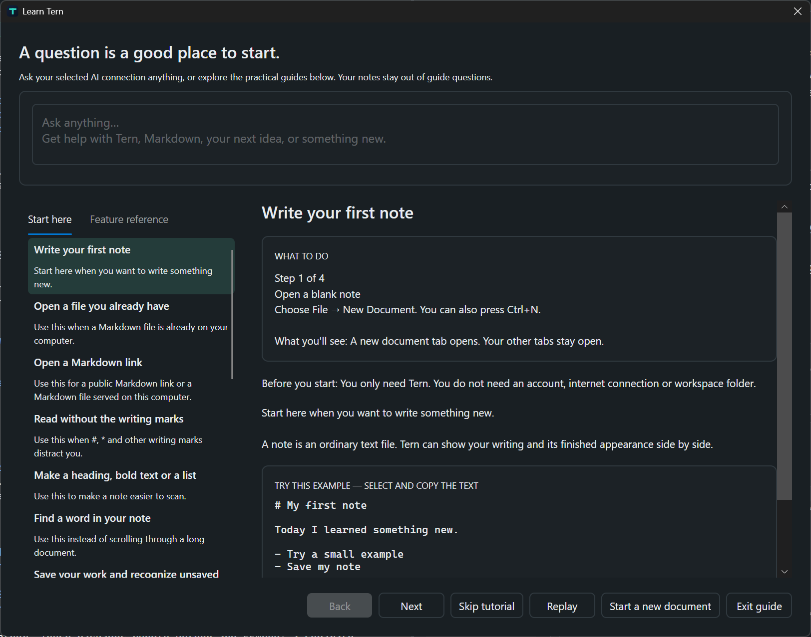

# Beginner guide

Tern works with ordinary text files containing Markdown. Local notes need no account or internet connection; remote pictures, URL imports and optional connections have separate [network behavior](privacy.md).

Press `F1` to open **Learn Tern**. Its fifteen lessons remain open while you practise. Reading a lesson does not save, send or change a note; the action you deliberately choose does that.



## 1. Write your first note

Press `Ctrl+N` and type:

```markdown
# My first note

Today I learned something new.
```

The `#` makes a heading. `Ctrl+2` shows source beside reading preview. Other tabs remain open.

## 2. Open an existing file

Press `Ctrl+O` and choose Markdown. Tern does not convert it into a private file format. Keep a backup when experimenting with important notes. Existing files can still have unsaved edits in their tabs.

## 3. Open a Markdown link

Choose Open from URL from File or **+ Add**. Use a public Markdown-file URL; a GitHub file link can be converted to raw content, while a repository folder or ordinary HTML page is not a note. Open uses a local cache; Download and Open asks for a destination. The result is editable and does not update its website. Check missing-asset notices before relying on offline access.

## 4. Read without writing marks

Use `Ctrl+1` for Source, `Ctrl+2` for Split or `Ctrl+3` for Reading. Native preview supports bounded Markdown, math and diagrams without executing a web page's scripts.

## 5. Format text

Select words and use `Ctrl+B` for bold or `Ctrl+I` for italic. Format also inserts headings, links, lists, task lists and code. `Ctrl+Shift+K` inserts a link; `Ctrl+Enter` toggles a task.

```markdown
## Things to remember

- One small step
- [ ] A task I can finish
```

## 6. Find words

`Ctrl+F` searches the active note; `Ctrl+H` replaces. Review options before replacing many matches. `Ctrl+Shift+F` searches the indexed workspace, a different scope.

## 7. Save your work

Press `Ctrl+S` and choose a `.md` filename. Empty drafts can be saved. An explicit filename takes priority over a heading-derived suggestion. Recognize the tab's unsaved indication. On close, Save writes changes, Discard abandons them and Cancel keeps the note open. Undo is useful editing history, not a backup.

## 8. Add a picture

Save a new note first; insertion can open Save and continue afterwards. Use Insert Local Image, paste a copied image file or drop an image into Source. Adjacent images link immediately. Other locations offer Link original / Copy image / Cancel. Clipboard pixels without a source file need a copy destination. Read the [attachment rules](user-guide.md#pictures-and-local-resources) before moving notes.

## 9. Export a PDF or other format

Choose a File export command, select format and destination and review readiness messages. Format changes require a compatible destination. Inspect the result: content can be truncated, glyphs may need another font and layouts differ. Save editable Markdown separately.

## 10. Print

`Ctrl+P` opens Windows printing for readable plain text, not the exact styled preview. Check the selected printer and settings. Physical printer behavior needs separate acceptance.

## 11. Recover interrupted work

Inspect recovery provenance and compare it with the current file. Restore into an independent unsaved copy before deciding what to retain. Recovery and saved-text history are useful but do not replace backups. Do not discard your only good copy.

## 12. Try a practice note

Copy the [practice note](practice/practice-note.md) into a new note and save your own copy. Change a sentence, check a task, try Undo, switch to Reading and save again. Its example link opens `example.com` only if deliberately followed; the sample contains no remote images.

## 13. Organize a folder or workspace

Open Folder browses an existing directory without metadata. Create Workspace makes a named folder containing `.tern-workspace.json`; Open Workspace restores that context. Use disposable folders while learning real rename, move and delete actions. Closing a folder/workspace does not delete files and asks about unsaved changes. See [workspace details](user-guide.md#folders-workspaces-and-search).

## 14. Decide whether to use AI

AI is optional. Local writing, preview and export do not require an AI account. Providers have their own account, cost and retention terms. Decide whether you may transmit the note; use synthetic text first.

## 15. Connect and review a request

Settings → AI connections manages supported endpoints and models. Saved keys use Windows Credential Manager. Select a connection, review the request and choose the send action. Generate and update note can send the **entire active Markdown plus your question**; the result is one undoable edit and stays unsaved until Save. Guide questions do not automatically include your note.

MCP is a separate manual tool feature: review exact tools and JSON arguments because external effects may not be undoable. Live services are not certified merely by local protocol tests. Read [privacy and connections](privacy.md#optional-ai-connections), then continue with the [user guide](user-guide.md).
