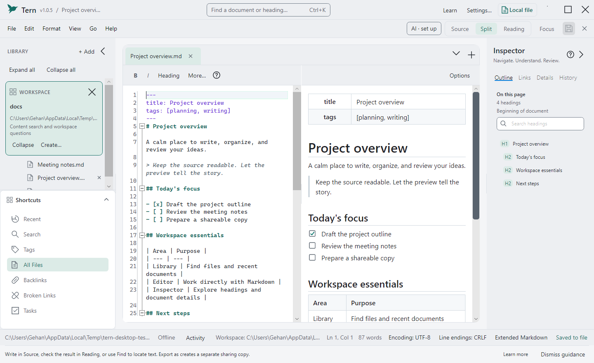
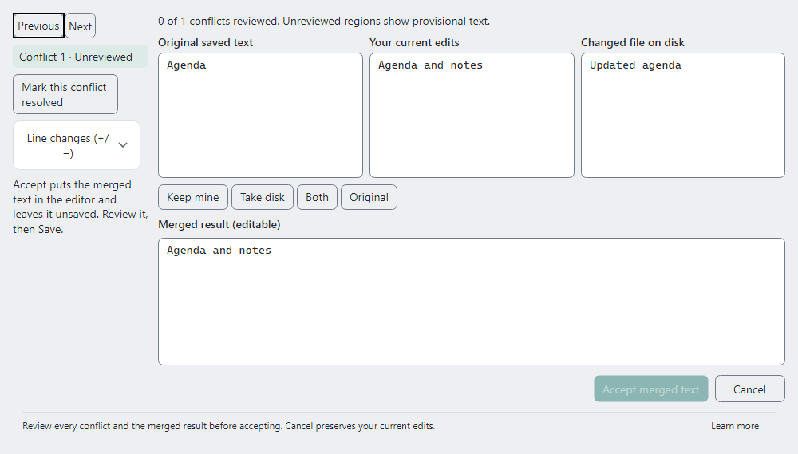
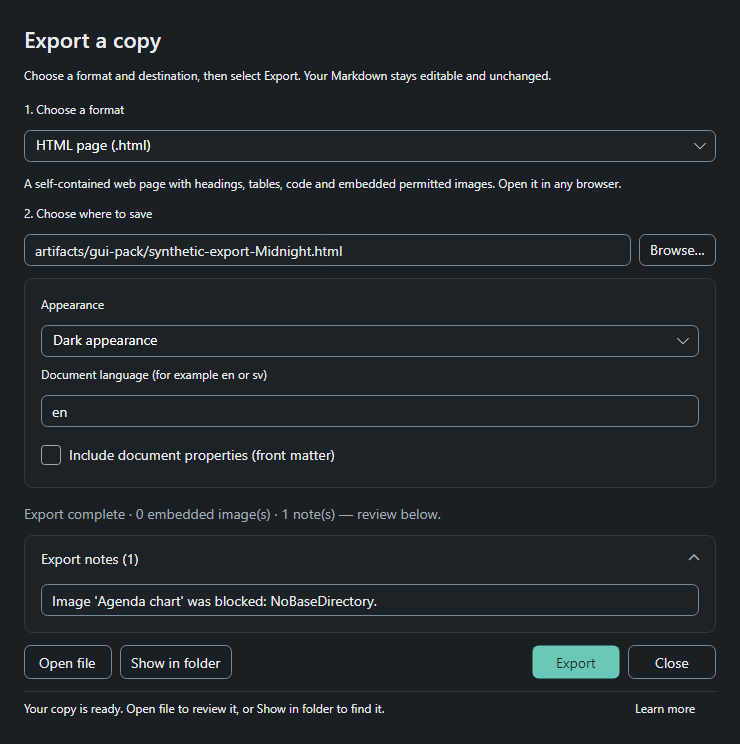
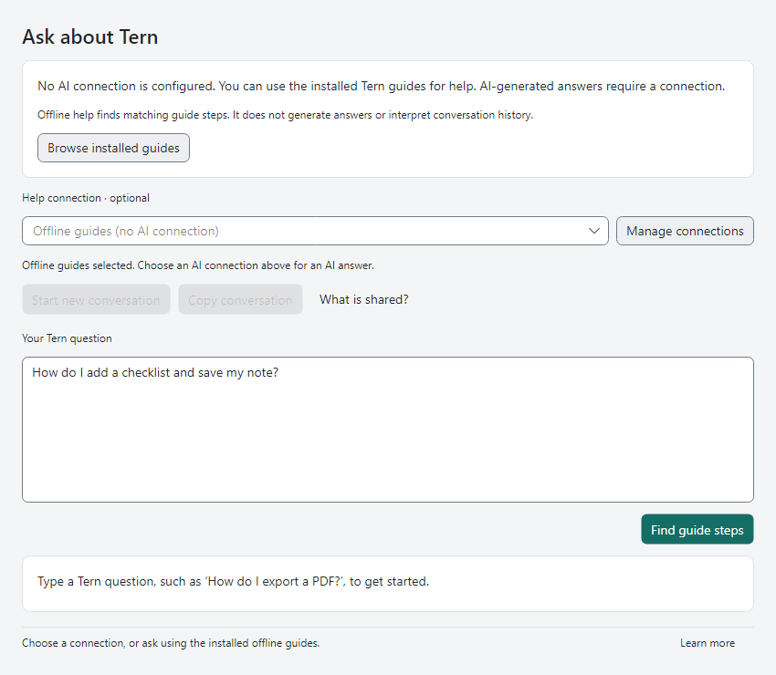
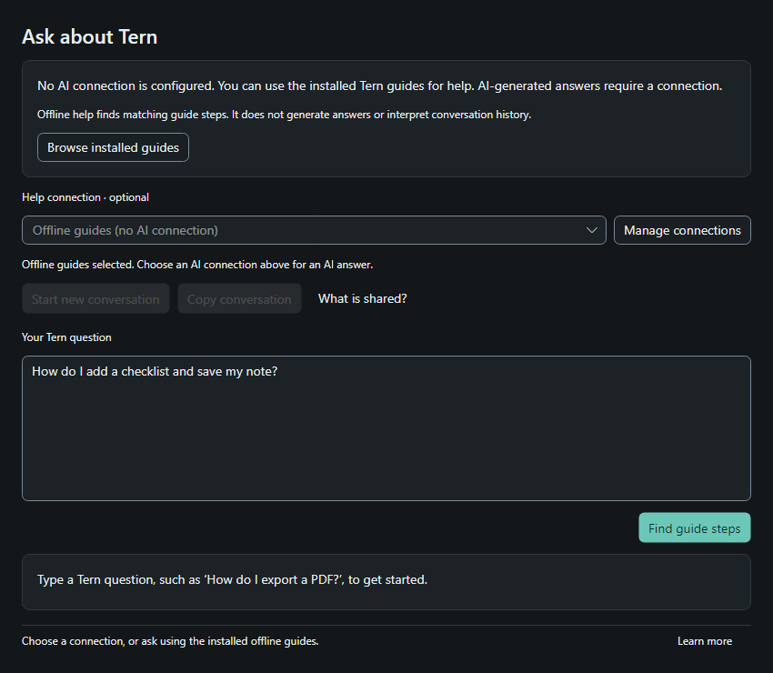

# Current GUI task guide

These controls and screenshots describe the current source checkout, not a newly published release. Captures use the actual Release-build Avalonia controls, synthetic notes, no credentials and no live AI requests. They establish headless layout evidence; native Windows keyboard, DPI, screen-reader and printer acceptance remain unverified.

## Write and find in any mode

Command names now come from the registry across menus, the palette, Welcome and command help. Go exposes document navigation; View exposes zoom, current panel checks and theme choices; File includes Encoding and Open Recent. Unavailable palette rows stay visible with actionable reasons. Library, Inspector, Learn Tern and Edit tags are the common surface names. The latest synthetic captures are in `artifacts\screenshots\latest-gui`; these do not constitute native acceptance.

Create an unsaved **New document**, or use **+ Add** to create a physical file, folder or workspace. The creation form shows the destination and name before writing. Open Folder detects an existing workspace; an ordinary folder is labeled for browsing. Workspace search requires an eligible indexed workspace.

Use Source, Split or Reading. Find (`Ctrl+F`) highlights matches in all three modes. Reading options include Edit source, synchronized scrolling in Split, reading width and navigation. View → Reset Layout restores the panes while keeping your notes, fonts, shortcuts and connections.

Source, Reading, lists and scrolling forms share rounded, themed scrollbar grips with visible hover and pressed states. Ordinary whole-notch wheel input in pixel-scrolling views eases over 100 ms; fractional wheel input and native touchpad gestures keep their platform handling. Shift-wheel scrolls wide content sideways. Reduce Motion or disabled system animations makes optional wheel motion immediate. Dragging a scrollbar, using the keyboard, Find or navigation takes control immediately; a new wheel gesture in either Split pane owns synchronized scrolling. Scrolling does not edit the note or change its Undo history.

To show programming code, use a fenced block with its language, for example `csharp`, `python`, `sql` or `json`. Source/Hybrid, Reading and HTML/PDF export share offline lexical profiles and theme colours. Editing the fence language or a multiline comment refreshes the affected source colours without editing the code. Unknown/omitted fence languages remain plain; colouring does not compile or execute code. Source tabs use your Tab size preference; rendered code uses four-column stops. Reading's **Copy code** preserves original tabs and the complete block, including any part beyond a limited display. Selected displayed text can contain expanded spaces. Reading scrolls wide code sideways; PDF wraps to the page.

Find marks all matches and outlines the active result. It jumps to the current match without moving keyboard focus out of the search box. Use Enter/F3 for Next, Shift+Enter/Shift+F3 for Previous, and Escape to close. **Results** opens clickable matching-line snippets; **Replace** or Ctrl+H reveals replacement controls. Compact layouts use named icon buttons with tooltips, and **⋯** opens case/whole-word/regex options. The counter reports wrapping and limited results. A hidden Markdown destination or syntax match is labelled **Source-only match**, with **Show in Source** to inspect it. Find searches the current note's Markdown source; workspace search is a separate scope.

See the [Find and replace upgrade](search-improvements.md) for search controls, screenshots and scope limits.

At compact sizes, secondary controls move into Options, the AI entry and document details. The Library scrolls so Shortcuts stays reachable. Hiding an inspector does not change its saved visibility preference.

## Add or repair an image

Source has **Table** commands in Format, its context menu and a contextual toolbar. Tab/Shift+Tab navigates cells, or indents/outdents list items outside tables. Spreadsheet text offers aligned table, plain text or cancellation. Ctrl+V converts supported HTML to Markdown; Ctrl+Shift+V keeps plain text. Paste Image as Attachment uses Ctrl+Alt+Shift+F3 by default. See [writing helpers](user-guide.md#tables-lists-paste-and-spelling) for limits and custom shortcuts.

**Settings → Writing and editing → Windows spell checking** enables local prose squiggles and **Spelling** context-menu suggestions. Code, destinations and metadata are excluded; corrections are undoable and never write Windows dictionaries. Large documents are checked near the viewport. Missing dictionaries produce an actionable warning.

Save a draft first. Insert Local Image lets you choose a file and inspect its thumbnail, description (alt text), filename and copy destination. **Copy into document assets (portable)** suggests an assets folder. Uncheck it to link a known original. Clipboard pixels require a copy. Cancel preserves the note; a collision keeps your entered values so you can choose another name. Undo removes the source link and may leave a copied file on disk.

A failed image shows only a known cause. **Locate image…** selects a replacement for a missing local file; only its source destination changes, as an undoable edit. **Retry image** uses the existing approved loader for a failed remote load. **Review image access…** explains the block and opens the source without relaxing resource permissions. Unsupported or corrupt images retain Edit image source. Stale previews and changed notes cannot receive old picker results.

**Inspect image** opens the approved decoded raster with zoom, reset, Escape and focus return. Copy location is available for approved local files. Inspection reuses the bounded decoded image (up to 2,048 pixels); it does not download a larger original. SVG inspection/export beyond existing supported paths remains outside this raster viewer.

## Review code, diagrams and tasks

Recognized code languages are labeled; unknown languages use Plain text. Copy reports success only after the clipboard operation succeeds. Unsupported diagram or formula output retains source and an Edit source action.

**Open larger view** reuses the diagram layout and offers Zoom in, Zoom out, Fit width, Reset and keyboard exit. No note changes occur in the viewer. SVG copy/export is deferred because this GUI change does not add a second serializer.

Reading task checkboxes edit only the intended current marker in a writable note. The edit is undoable and unsaved until Save. Read-only previews expose informational, disabled markers. Workspace task filters show Open, Completed or All and counts from the current eligible workspace data.

Workspace **Tasks** also exposes checkboxes, grouped by file by default. Expand **Task filters** for path/tag filtering or to turn grouping off. A closed target opens in the background; its checkbox change is undoable in that document and needs Save. Stale/read-only task actions preserve text.

## Explore a knowledge workspace

Type `[[` in a saved workspace note for document/alias/heading completion, or choose **Insert Link → Workspace note**. **Library → Tags** shows aggregate document counts and starts scoped tag searches. **Save search** in workspace search adds the exact query to that workspace's Library Shortcuts.

A heading rename offers reviewed incoming-anchor updates. **Edit → Replace in Workspace…** previews literal replacements before applying; open notes keep undoable unsaved changes, closed notes use safe save and History, and changed/duplicate conflicting buffers are not overwritten. Cancel keeps all text. Inspector Links offers **Unlinked mentions** and **Local graph**, a one-hop adjacency view; selecting a result navigates rather than edits.

## Understand saving and recovery

**Saved to file** means the file was saved. **Unsaved · recovery protected** means a checkpoint protects the current revision; it is not a disk save. A save or recovery failure stays visible. Open document save and recovery details to inspect the identity and error, Retry save, Retry recovery checkpoint or Save as.

**Review recovered work** appears at startup after an unclean exit. Lines that differ between the current disk file and the checkpoint are highlighted and counted. Press Enter to Restore as unsaved copy (the default); Save recovered copy… saves it straight away; Ask later keeps the checkpoint for the next start. Discard checkpoint is a red button on the left and needs a second confirmation ("Discard recovered text" / Keep, with Keep as the default). If some recovery files are unreadable, Tern asks once: Show files, Delete damaged files (only the unreadable files; readable checkpoints are never touched) or Keep (moves them to `recovery\damaged`). Either way the message does not return at the next start.

When a file with unsaved edits changes on disk, Tern does not interrupt you: the tab gets a ⚠ "Changed on disk" badge and a bar above the document offers **Compare…**, **Reload** (asks before discarding your edits) and **Keep mine** (the disk version is kept in History). Saving still opens the conflict dialog. **Compare…** puts the merged text in the editor unsaved, so you can review it and Save; a merge started from a Save writes the file when accepted. A change that only switches line endings is not a conflict, and Keep both at the end of a file keeps the two versions on separate lines.

If the drive or network share holding an open file stops answering (sleep, VPN drop), the document shows **Unavailable — will retry** instead of "moved or deleted"; your text is kept, Save waits until the location is back, and Tern checks again when you return to the document. If a file or its folder is renamed or moved in Explorer, a bar offers **Follow** (keep editing at the new location, with history) or **Save here anyway…**. Tern never recreates a vanished folder without asking.

External conflicts begin unreviewed. Compare Original saved text, Your current edits and Changed file on disk. Review every conflict before Accept merged text becomes available. Manual edits count only when you mark that conflict resolved; replacing manual text requires an explicit decision.

## Export and inspect warnings

Choose HTML, PDF or Plain text and a separate destination. PDF exposes paper size, margins and page numbers; HTML exposes theme and language. One activation starts one export. The result lists all known omissions or truncation. **Open file** and **Show in folder** operate on the created output independently of export; a launch failure does not rerun export.

While exporting, **Cancel** stops actual parsing/rendering/writing at cancellation checkpoints and removes the temporary file without replacing an existing target. Closing the busy dialog requests cancellation rather than leaving an export running. After cancellation, choose Export to retry.

**Print preview…** (`Ctrl+P`) shows the formatted PDF pages. Choose All, Current page or Pages, then **Print…** to choose a Windows printer and copies. **Open selected PDF…** is a secondary external-reader option. Merely opening the preview does not print.

## Open from URL

Opening the URL dialog makes no request. **Open working copy** uses a complete cached bundle when available; an incomplete bundle may be fetched again. **Fetch latest** explicitly requests a fresh copy. **Save portable copy…** lets you select the local Markdown and asset destination. Imported notes show URL/cache provenance; editing does not upload changes to the website.

Refresh uses captured note identity and revision. A newer edit blocks a stale result; opening a duplicate requires the existing review decision. Missing resources and request failures remain inspectable. Progress shows phases and actual counts only when known.

## Ask for help or write with AI

F1 opens Learn Tern. **Guides · offline** works without a provider. **Ask & learn** has its own persistent Text generation connection choice. Deleting that profile clears the selection; another provider is not silently chosen. Saved, previously checked and currently reachable are different states.

Tutor requests contain the exact question, local guide facts and up to four recent whole completed turns within 6,000 characters. Old turns are omitted whole. Copilot also has its actual complete-request budget; an oversized question is rejected, not silently truncated. Notes, selected text and file paths are not included. Changing provider starts a new conversation. Cancel, errors and deleted profiles preserve the typed question without adding a successful answer.

Grounded cards offer Show lesson, Open this tool and Try in practice document using only installed catalog items and current command eligibility. **Walk me through** uses a separate unsaved practice note, actual control targets, Back/Next/Pause/Exit and user confirmation of results. A changed tab or workspace pauses it; completing a walkthrough offers a recap and replay.

For writing, review the scope before generation: **Selected text** or **Instruction only** when text is selected, and **Entire document** or **Instruction only** when it is not. **Apply changes** replaces the reviewed range, including any selection; **Insert result** adds a whole-note summary, explanation, task list or instruction-only result without replacing existing text. Both use one undoable, unsaved edit. A response arriving after an edit or tab switch remains available with **Copy result**, but Apply is disabled. **Insert at cursor** opens a fresh insertion review for the current writable note and cursor; nothing changes until you approve **Insert result**.

**Edit → Explore your notes** (default Ctrl+Alt+F2, remappable) opens a separate, resizable nonmodal window. AI is required: with no connection Tern opens **AI Connections**. In Offline mode it stops on the first screen. Press **Open Settings** and turn off Offline mode. Otherwise it uses the AI chosen in the top **AI** menu. Use **Ask → Check your notes → Your answer**. Every screen gives one tip and one main button. No note text is sent until you press **Get my answer**. PDF, note and print create an A4 decision report that you review first.

The toolbar's **AI** entry opens a bounded panel with a labelled connection picker, a concise status summary and expandable **Connection details**. The header and action buttons stay visible while long details scroll vertically. **Write with AI** is the primary action; **Connections** and **Explore your notes** share the same secondary-button structure.

## Settings and activity

The Settings screen contains 61 preferences in 11 shared navigation categories. **Writing and editing** includes Source/Reference whitespace and line-ending markers, a column ruler, visual line spacing, scrolling below the last line and whole-line Copy/Cut behavior. **Reading and views** adds the prose font-family choice. **Workspaces and search** shares the Find bar's saved match-case, whole-word and regular-expression choices and Library Tasks' group-by-file choice; query and replacement text are not saved as preferences. **Files and saving → Export defaults** edits the actual PDF/HTML defaults, resets one format, or stages forgetting remembered export folders. Plain text has no ineffective page/theme controls. Existing notes and exported files are not rewritten by these preferences.

Settings edits remain pending until **Apply**. **Done** applies and closes. **Cancel**, Escape or window close asks before discarding unapplied changes; **Keep editing** is the default, and an earlier successful Apply is kept. Enter in a text field does not apply or close Settings; multiline fields retain normal newlines. Category reset changes pending values only and is disabled while search results span categories. AI profile and credential management uses its own explicit save actions.

Keyboard shortcuts has its own pending copy from both the menu and Settings: **Apply** commits, **Done** commits and closes, and **Cancel** keeps the last Apply. When opened inside Settings, committed shortcut edits remain part of Settings' pending changes until Settings is applied. **Reset all** requires a danger confirmation and still needs Apply or Done.

Dialog footers keep secondary/destructive actions on the left and the safe primary followed by Cancel/Close on the right, wrapping onto another row when needed. A destructive action is never the default. **Clear Recent History** confirms the recent-file, workspace, URL and Reopen Closed Tab scope while preserving pins. Explicitly select **Recent history (including pinned references)** in Reset Tern to remove pins too; documents and open tabs remain unchanged.

Double-click a document tab name to rename it. Enter or moving focus away applies a valid changed name; Escape cancels before applying. Invalid or occupied names stay editable with a visible error border/message and status feedback.

The Activity entry shows separate operation identities, phases, measured counts, outcomes and inspectable errors. Every status-bar message is also recorded there with its severity (Info, Success, Warning, Error). Select the status text in the status bar to open Activity. Info and Success messages stay for at least 6 seconds plus 60 ms per character and are never cleared while the pointer or keyboard focus is on the status text; Warning and Error messages stay until replaced. The message is announced politely by screen readers (assertively for errors). Background problems that need attention appear in a dismissible banner above the document, with action buttons such as Retry or Details when available. Cancellation appears only for operations with a real cancellation callback. History retains up to 50 completed/canceled entries and 100 failures, with the presenter paging 50 entries at a time. Save and recovery failures also remain on the affected note until resolved, independently of session history. Reduced motion retains immediate text feedback.

For installation, use the actual application ZIP from a release, extract it and run `Tern.exe`. GitHub source archives are for building the source, not installation. Packaging, unsigned-publisher warnings, checksums and update/removal limits remain as described in the [release guide](releases.md); this source work makes no new signing or release claim.

## Tern 1.0.5 authoring and release workflows

See the [illustrated 1.0.5 workflows](workflows-1.0.5.md) for the shared Welcome and Help replay, ten templates, compact tags dialog, three link destination types, save-before-image and replacement prompts, separate line endings and encoding, actual PDF page selection and Windows distribution/Explorer steps. The main toolbar AI connection entry remains; the separate editor formatting-toolbar AI button/flyout and the Write with AI Create content starter were removed.

### Network privacy controls (WP18)

Remote images default to Ask. In the document banner choose Load once, or Always for this file for a saved document. Settings → Privacy and network offers Ask, Always and Never; Never overrides existing approvals for preview, export and print. The Offline status-bar toggle blocks remote images, URL import, AI, MCP and Copilot and records the change in Activity. Local editing remains available. Turning Offline off retains the remote-image consent choice.

AI connections → Advanced includes Request timeout (seconds): blank uses 120 seconds remotely or 300 seconds locally; overrides range from 1 to 3,600. AI/MCP use the system proxy; URL imports retain SSRF-protected direct connections. Copilot receives reviewed prompts through standard input, with no note text in process arguments.
