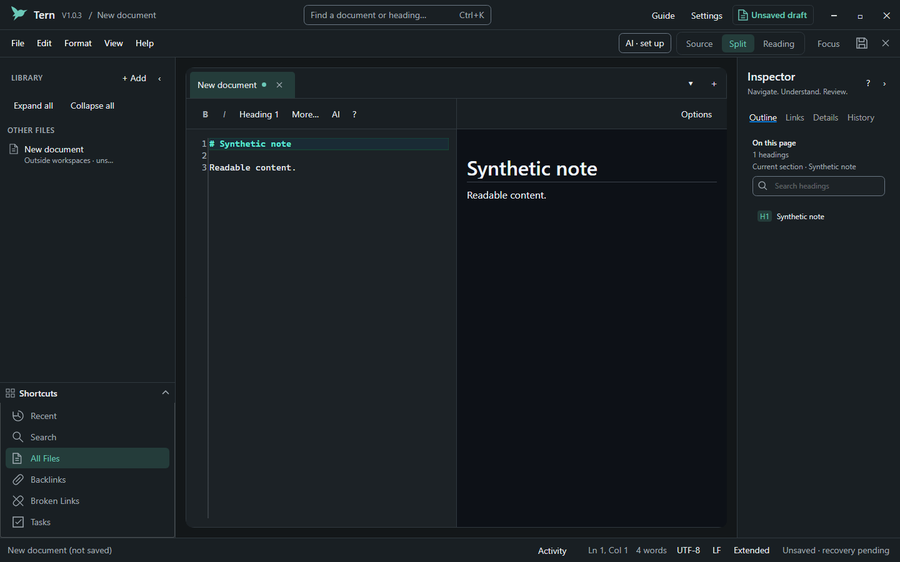
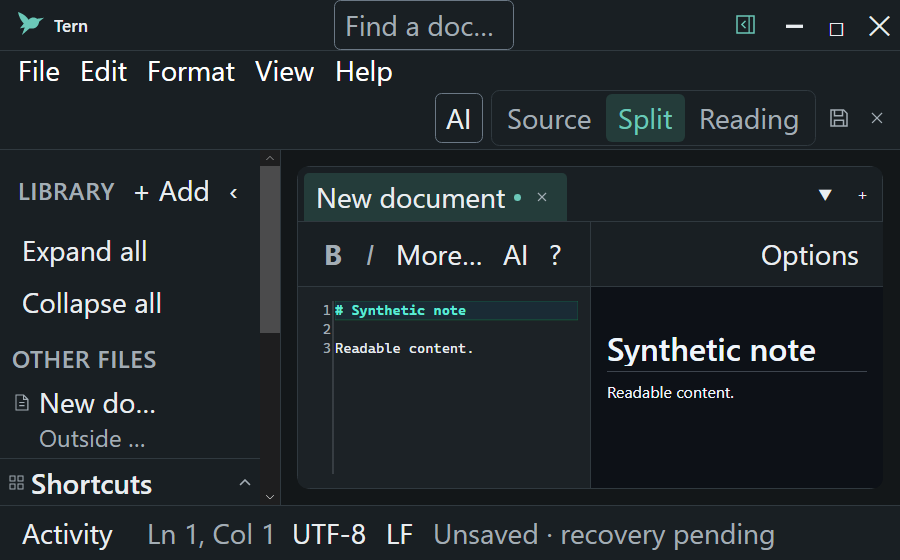
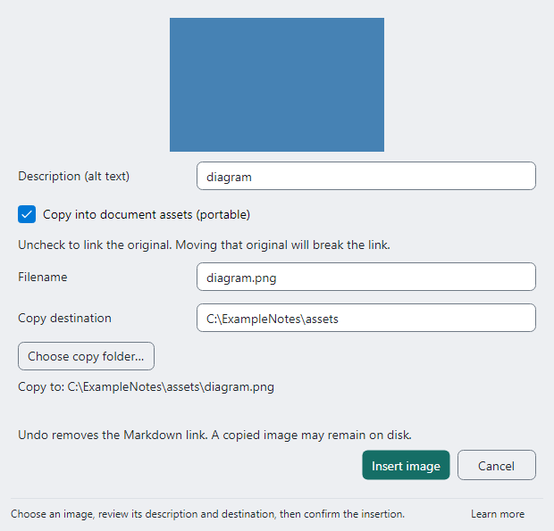
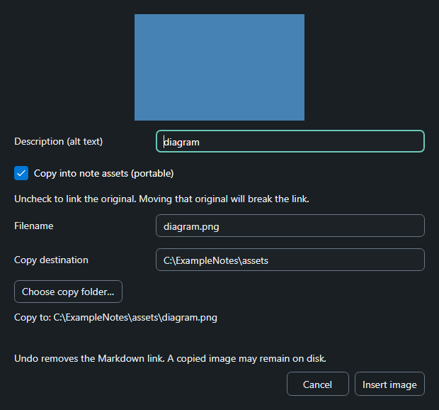
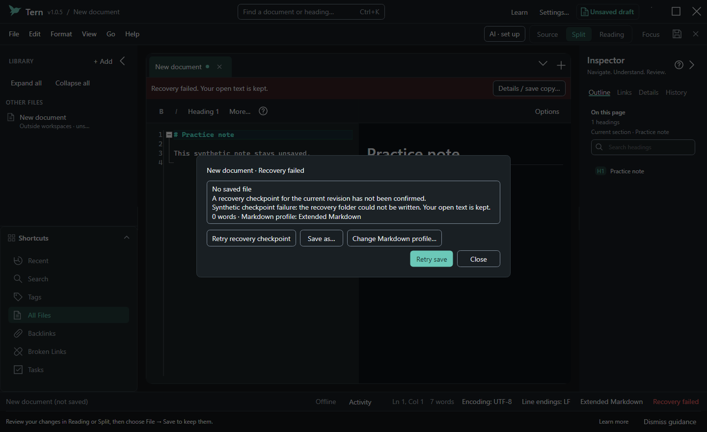
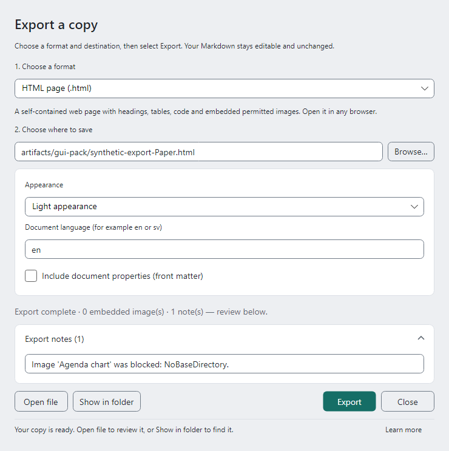

# Current GUI task guide

These controls and screenshots describe the current source checkout, not a newly published release. Captures use the actual Release-build Avalonia controls, synthetic notes, no credentials and no live AI requests. They establish headless layout evidence; native Windows keyboard, DPI, screen-reader and printer acceptance remain unverified.

## Write and find in any mode

Create an unsaved **New document**, or use **+ Add** to create a physical file, folder or workspace. The creation form shows the destination and name before writing. Open Folder detects an existing workspace; an ordinary folder is labeled for browsing. Workspace search requires an eligible indexed workspace.

Use Source, Split or Reading. Find (`Ctrl+F`) highlights matches in all three modes. Reading options include Edit source, synchronized scrolling in Split, reading width and navigation. View → Reset layout restores the panes while keeping your notes, fonts, shortcuts and connections.

Find marks all matches and outlines the active result. It jumps to the current match without moving keyboard focus out of the search box. Use Enter/F3 for Next, Shift+Enter/Shift+F3 for Previous, and Escape to close. **Results** opens clickable matching-line snippets; **Replace** or Ctrl+H reveals replacement controls. Compact layouts use named icon buttons with tooltips, and **⋯** opens case/whole-word/regex options. The counter reports wrapping and limited results. A hidden Markdown destination or syntax match is labelled **Source-only match**, with **Show in Source** to inspect it. Find searches the current note's Markdown source; workspace search is a separate scope.

See the [Find and replace upgrade](search-improvements.md) for search controls, screenshots and scope limits.

At compact sizes, secondary controls move into Options, the AI entry and document details. The Library scrolls so Shortcuts stays reachable. Hiding an inspector does not change its saved visibility preference.

## Add or repair an image

Save a draft first. Insert Local Image lets you choose a file and inspect its thumbnail, description (alt text), filename and copy destination. **Copy into note assets (portable)** suggests an assets folder. Uncheck it to link a known original. Clipboard pixels require a copy. Cancel preserves the note; a collision keeps your entered values so you can choose another name. Undo removes the source link and may leave a copied file on disk.

A failed image shows only a known cause. **Locate image…** selects a replacement for a missing local file; only its source destination changes, as an undoable edit. **Retry image** uses the existing approved loader for a failed remote load. **Review image access…** explains the block and opens the source without relaxing resource permissions. Unsupported or corrupt images retain Edit image source. Stale previews and changed notes cannot receive old picker results.

**Inspect image** opens the approved decoded raster with zoom, reset, Escape and focus return. Copy location is available for approved local files. Inspection reuses the bounded decoded image (up to 2,048 pixels); it does not download a larger original. SVG inspection/export beyond existing supported paths remains outside this raster viewer.

## Review code, diagrams and tasks

Recognized code languages are labeled; unknown languages use Plain text. Copy reports success only after the clipboard operation succeeds. Unsupported diagram or formula output retains source and an Edit source action.

**Open larger view** reuses the diagram layout and offers Zoom in, Zoom out, Fit width, Reset and keyboard exit. No note changes occur in the viewer. SVG copy/export is deferred because this GUI change does not add a second serializer.

Reading task checkboxes edit only the intended current marker in a writable note. The edit is undoable and unsaved until Save. Read-only previews expose informational, disabled markers. Workspace task filters show Open, Completed or All and counts from the current eligible workspace data.

## Understand saving and recovery

**Saved to file** means the file was saved. **Unsaved · recovery protected** means a checkpoint protects the current revision; it is not a disk save. A save or recovery failure stays visible. Open document save and recovery details to inspect the identity and error, Retry save, Retry recovery checkpoint or Save as.

External conflicts begin unreviewed. Compare Original saved text, Your current edits and Changed file on disk. Review every conflict before Accept merged text becomes available. Manual edits count only when you mark that conflict resolved; replacing manual text requires an explicit decision.

## Export and inspect warnings

Choose HTML, PDF or Plain text and a separate destination. PDF exposes paper size, margins and page numbers; HTML exposes theme and language. One activation starts one export. The result lists all known omissions or truncation. **Open file** and **Show in folder** operate on the created output independently of export; a launch failure does not rerun export.

**Print text…** (`Ctrl+P`) prints readable plain text through Windows. For paginated styled output, export PDF and inspect the resulting artifact.

## Open from URL

Opening the URL dialog makes no request. **Open working copy** uses a complete cached bundle when available; an incomplete bundle may be fetched again. **Fetch latest** explicitly requests a fresh copy. **Save portable copy…** lets you select the local Markdown and asset destination. Imported notes show URL/cache provenance; editing does not upload changes to the website.

Refresh uses captured note identity and revision. A newer edit blocks a stale result; opening a duplicate requires the existing review decision. Missing resources and request failures remain inspectable. Progress shows phases and actual counts only when known.

## Ask for help or write with AI

F1 opens Learn Tern. **Guides · offline** works without a provider. **Ask & learn** has its own persistent Text generation connection choice. Deleting that profile clears the selection; another provider is not silently chosen. Saved, previously checked and currently reachable are different states.

Tutor requests contain the exact question, local guide facts and up to four recent whole completed turns within 6,000 characters. Old turns are omitted whole. Copilot also has its actual complete-request budget; an oversized question is rejected, not silently truncated. Notes and paths are not included by default. **Use selected text** explicitly attaches the displayed selection to the next question; remove it before sending to exclude it. Changing provider starts a new conversation and clears shared selection. Cancel, errors and deleted profiles preserve the typed question without adding a successful answer.

Grounded cards offer Show lesson, Open this tool and Try in practice note using only installed catalog items and current command eligibility. **Walk me through** uses a separate unsaved practice note, actual control targets, Back/Next/Pause/Exit and user confirmation of results. A changed tab or workspace pauses it; completing a walkthrough offers a recap and replay.

For writing, review **Selected text**, **Entire note** or **Instruction only** and the exact request before Generate for review. **Apply changes** replaces the reviewed range; **Insert result** inserts new content. Both use one undoable, unsaved edit and reject stale replies. Workspace questions let you exclude passages before Send reviewed request; excluded passages are not sent and citations must still belong to the selected workspace.

The toolbar's **AI** entry opens a bounded panel with a labelled connection picker, a concise status summary and expandable **Connection details**. The header and action buttons stay visible while long details scroll vertically. **Write with AI** is the primary action; **Connections** and **Ask workspace** share the same secondary-button structure.

## Settings and activity

Settings edits remain pending until **Apply**. **Done** applies and closes. **Cancel** or Escape discards unapplied changes; it keeps an earlier successful Apply. Category reset changes pending values only. AI profile and credential management uses its own explicit save actions.

The Activity entry shows separate operation identities, phases, measured counts, outcomes and inspectable errors. Cancellation appears only for operations with a real cancellation callback. History retains up to 50 completed/canceled entries and 100 failures, with the presenter paging 50 entries at a time. Save and recovery failures also remain on the affected note until resolved, independently of session history. Reduced motion retains immediate text feedback.

For installation, use the actual application ZIP from a release, extract it and run `Tern.exe`. GitHub source archives are for building the source, not installation. Packaging, unsigned-publisher warnings, checksums and update/removal limits remain as described in the [release guide](releases.md); this source work makes no new signing or release claim.

## Tern 1.0.5 authoring and release workflows

See the [illustrated 1.0.5 workflows](workflows-1.0.5.md) for the shared Welcome and Help replay, ten templates, compact tags dialog, three link destination types, save-before-image and replacement prompts, separate line endings and encoding, actual PDF page selection and Windows distribution/Explorer steps. The main toolbar AI connection entry remains; the separate editor formatting-toolbar AI button/flyout and the Write with AI Create content starter were removed.
