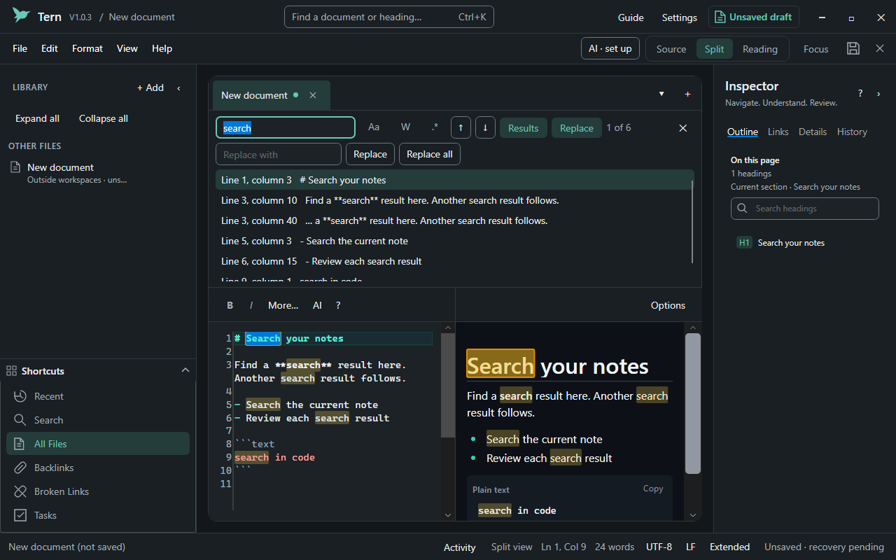
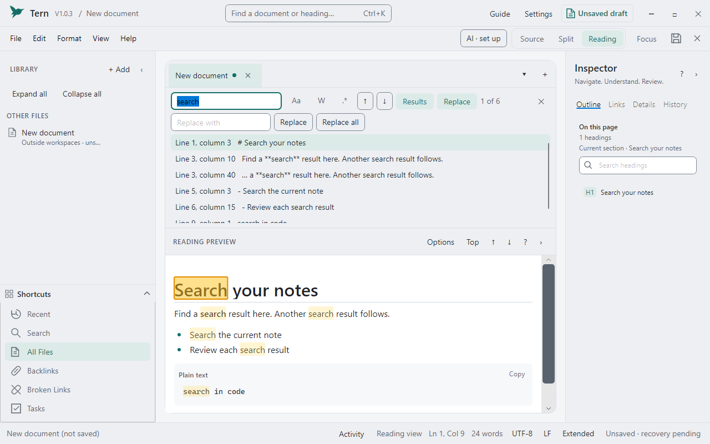

# Find and replace

Use Find to locate text in the current note in Source, Split or Reading mode.

## Using Find

Press **Ctrl+F**, type your search, and Tern selects a result near your current position. Reading starts from its visible position rather than the hidden source editor's selection. All source matches with visible text are highlighted in Source, Split and Reading; the active result has a stronger outline. Next navigation uses the result list, so moving the editor caret does not accidentally skip a result.

- **Enter / F3:** next match. **Shift+Enter / Shift+F3:** previous match.
- **Results:** expand matching-line snippets; select one to jump directly there. Enter in the result list returns focus to the search box. Escape closes Find and returns focus to the document.
- **Aa / W / .*:** match case, whole word and regular expression. Compact layouts put these under **⋯**. The Results and Replace icon buttons retain tooltips and accessible names.
- **Ctrl+H / Replace:** show replacement controls. Replace all is one undoable edit and does not save the file. Changed documents/options, closed Find, incomplete results and timed-out matching prevent inappropriate bulk replacements.
- The counter shows **3 of 28**, **Wrapped**, explicit no-results/regex errors, or **+ (limited)** when the match limit is reached.

## Navigation and engine changes

Matching, painting and navigation share one current document/revision result set. Superseded searches are canceled; stale results cannot activate or replace text. An edit recomputes highlights instead of leaving them cleared. Preview rebuilding restores the current search and queues an exact reveal after layout, guarded against later queries and tab changes.

Reading realizes the matching block and brings the actual glyph rectangle into view, including long wrapped paragraphs, nested code scrollers and collapsed details. Source mappings are cached per leaf and current source; binary lookup skips earlier matches. CRLF, inline-code delimiters, formatted leaf text, decoded HTML entities and escaped punctuation preserve source positions. Unsupported projections never guess a location on unrelated text.

Pattern compilation/matching runs away from the UI thread. Scanning and result construction check cancellation. Ordinary in-note Find omits large before/after replacement previews, while workspace replacement keeps them. Whole-word boundaries include combining marks. Zero-width regex results remain navigable; regex work retains its bounded timeout. Existing 5,000-match per-file limits remain visible, and incomplete results cannot be replaced in bulk.

## Scope and limits

Find searches the note's **Markdown source**. It does not synthesize a plain-text phrase across formatting markers. A destination, delimiter or other source-only result has no corresponding rendered glyph; Reading labels it **Source-only match** and offers **Show in Source**. Zero-width regex results select a source position rather than a word-sized rectangle. Workspace full-text search remains a separately labelled scope and keeps its existing index/ranking behavior.
