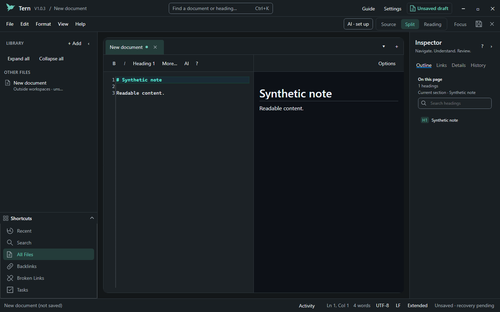

# Tern user guide

Tern edits ordinary Markdown files on Windows with a native preview. Start with the [beginner lessons](BEGINNER_GUIDE.md) for a first note. The [README](../README.md) covers downloads; [privacy](privacy.md) explains network behavior.

## Interface and modes

The Library holds files, folders and workspaces. Tabs select the active note. The canvas shows Source (`Ctrl+1`), Split (`Ctrl+2`) or Reading (`Ctrl+3`). The optional inspector presents outline, backlinks, broken links and statistics. A read-only reference pane helps compare another document without replacing the editor.

Selecting an existing file or tab does not reorder the Library's **Other files** list. New references are appended; removing a reference removes its row, and explicit pins stay first. **Recent** remains most-recently-opened first. Library positions are retained while the window is open, including when switching away from All Files and back.

An empty named workspace offers **New note here**, **Import existing files** and **Learn workspaces**. Import copies selected files without changing the originals or replacing existing names; partial failures are listed in Activity. Creating a note puts focus in Source after the file opens. A first save offers **Show in folder** without opening another dialog.

Middle-click a tab to close it through the normal unsaved-changes confirmation. Its context menu also offers **Copy Path**, **Reveal in File Explorer** and **Reopen Closed Tab**. Library row menus act on that file or folder, not relative tab positions; Recycle Bin actions remain last and separated.

Use File, Edit, Format, View, Go and Help to discover actions. **+ Add** opens a form with a destination and name for physical files or folders. **New document** creates an unsaved draft. Quick Open (`Ctrl+K`) finds a note; Command Palette (`Ctrl+Shift+P`) finds an action. View → Reset Layout restores panes without changing notes, fonts or shortcuts.

Use **Tab** and **Shift+Tab** to move through controls in either direction. Open dialogs and overlays keep keyboard focus within their own controls. Press **Escape** to close an overlay (Activity, save details, Quick Start); while one is open the window behind it, its menus and keyboard shortcuts are inactive. The **?** help buttons are always available. Use **F6** or **Shift+F6** to move between visible areas in the main window, including the Library, document tabs, Source, Reading, and the selected Inspector tab. To resize a pane, tab to its divider and press the arrow keys. In Markdown Source, Tab can indent text.

## Open and edit local files

Use `Ctrl+O`, `Ctrl+Shift+O` or **+ Add**. The editor preserves detected encoding, BOM and LF/CRLF/CR line endings. New notes initially use UTF-8 without a BOM and CRLF; **Settings → Files and saving** can change defaults for future files. Opening a file is not a request to normalize its text. Source editing includes syntax highlighting, undo/redo, formatting and find/replace. Broken-link repair is an undoable source edit.

For a code example, put its language after the opening fence, such as `csharp`, `python` or `sql`. Source and Hybrid Source now use the same offline lexical language profiles as Reading and HTML/PDF export. Keywords, literals, comments and declarations have distinct theme colours; changing a fence language or a multiline comment updates the affected source lines. This is lexical highlighting, not a compiler, validator or automatic formatter: existing code, indentation and line endings are preserved, and code is never executed. An omitted or unknown fence language uses plain presentation.

Supported profiles cover HTML/XHTML, XML, SVG, Python, SQL, Bash/shell, PowerShell, Dockerfile, C#, JavaScript, TypeScript, Java, C, C++, PHP, Go, Rust, Kotlin, Swift, CSS, JSON/JSONC, YAML, TOML, INI and Kusto/KQL. Common aliases include `cs`, `c#`, `js`, `ts`, `py`, `python3`, `sh`, `zsh`, `ps1`, `pwsh`, `c++`, `golang`, `rs`, `kt`, `kts`, `yml`, `tsql`, `postgresql` and `mysql`. Profiles use their own keyword case and comment/literal rules; they do not provide semantic type analysis or every language extension.

Source tabs retain your configured **Writing and editing → Tab size**. Reading code panels and HTML/PDF code use four-column tab stops for presentation. **Copy code** retains the full original code and raw tabs; selecting displayed Reading text can copy its expanded spaces. Find still maps displayed code back to the original note, including repeated words after tabs. Long code lines scroll horizontally in Reading; PDF wraps them to its page. Extremely large examples may use plain tails or a limited display while **Copy code** keeps the complete original code.

Per-document positions and compatible session records can restore context. Restoration cannot restore a file removed by another program. The eager-load ceiling is 64 MiB; a file below it can still be expensive to parse or render. Preview has a separate smaller budget under [known limits](#known-limits).

Opening another file from Explorer adds it to the running Tern window for the same Windows user and application data directory. It does not restore the old session again. Open tabs, workspace/folder sections and selection are saved after a 500 ms pause in those changes, not only at exit. Very recent changes can still precede that save; unsaved document text uses separate recovery checkpoints.

On restore, documents whose saved disk content changed since the previous session are listed together in Activity with **Review**. Touching a file without changing its bytes does not count. Older session records without a stored baseline cannot establish that comparison. Recovery review remains separate from this summary.

## Tables, lists, paste and spelling

With the cursor in a Markdown table, use **Format → Table**, the contextual **Table** toolbar or the Source context menu to insert/delete rows and columns, move columns, align, sort or format cells. **Tab / Shift+Tab** moves between cells; Tab after the final cell adds a row. Each modifying action is one Undo step.

Pasting consistent CSV or TSV with at least two rows offers **Paste as table**, **Paste plain text** or **Cancel**. Quoted cells may include commas, tabs and line breaks. **Paste as Table** is also available as a command. In list items, **Tab / Shift+Tab** indents/outdents without removing markers; **Format → Indent / Outdent** works on selected lines.

Normal **Paste** (`Ctrl+V`) converts HTML headings, lists, links, emphasis, code and simple tables to Markdown. Scripts and active content are removed; images keep their alternative text without authorizing a remote fetch. Merged/nested tables and oversized HTML are refused with guidance rather than silently shortened. **Paste Plain Text** (`Ctrl+Shift+V`) bypasses HTML and spreadsheet conversion. **Paste Image as Attachment** defaults to `Ctrl+Alt+Shift+F3`; customized shortcuts remain configurable.

**Settings → Writing and editing → Windows spell checking** uses the installed Windows dictionary for the current language, entirely locally. Misspelled prose has a wavy underline; right-click at the word and choose **Spelling** for undoable suggestions. Code spans/blocks, link destinations and front matter are excluded. Checking is debounced while typing and limited to a 64,000-character window around the visible area (up to 512 issues per window); scrolling checks the next area. If the language dictionary is missing, Tern reports it; install spelling support in Windows Settings or disable the preference. Windows dictionary files are never modified by corrections.

Scrollbar grips share a rounded appearance in Source, Reading, lists and scrolling forms, with colours that follow the theme and visible hover and pressed states. Whole-notch mouse-wheel input in pixel-scrolling views moves smoothly over a short 100 ms interval. Fractional wheel input and native touchpad gestures keep their usual platform handling, and lists that scroll by item retain their native units and virtualization. Use Shift-wheel for horizontal scrolling over wide content. Reduce Motion or disabled system animations makes optional wheel motion immediate. Scrollbar dragging, keyboard movement, Find and navigation take control immediately; in synchronized Split view, the latest wheel gesture controls the paired panes. These changes affect the view only, leaving note text and Undo history intact.

## Advanced Source and Outline

**Settings → Writing and editing → Hybrid Source display** is off by default. When enabled, Source shows local image thumbnails and task checkboxes, scales headings and dims Markdown markers outside the caret line. Move the caret onto a decorated line to edit its original Markdown. Task clicks are guarded, unsaved edits with one Undo step. Thumbnails reuse Reading's local resource restrictions and decoder budgets and never request remote images; blocked or invalid pictures show an explicit unavailable state.

Right-click a heading in **Outline** to fold/unfold, move the section up/down or promote/demote it. Movement includes all subsections in one Undo step; promotion/demotion refuses changes outside heading levels 1–6. The same actions are in **Format → Section**. Source's folding gutter does not modify Markdown.

Selecting text shows its word count in the status bar, including compact layouts. **Details** shows net words added since opening the document and an optional goal from positive front matter `target-words: 1000`. Saving does not reset that session baseline.

When Git is installed, Library dots distinguish **Changed since last commit** and **Untracked in Git**. Status refreshes every five seconds and after tree refreshes. **File → History and recovery → Compare with Last Git Commit…** compares HEAD with the current Source snapshot, including unsaved text, in a read-only window. Added files have an empty committed side. Tern does not stage, commit, run external diffs or change Git configuration; untrusted-repository protections still apply.

## Templates and daily notes

**File → New from Template…** (`Ctrl+Shift+I`) is also available from **+ Add** and the Command Palette, including while another document is open. It creates a separate unsaved draft named from the template and today's date. Existing documents and template files are unchanged. `{{date}}` and `YYYY-MM-DD` become the local ISO date, `{{time}}` becomes local 24-hour `HH:mm`, and `{{title}}` becomes the dated draft title.

Add your own `.md` files to `%APPDATA%\Tern\templates`, or to `.tern\templates` inside the active workspace. With `TERN_DATA_ROOT`, the user folder is `<data root>\settings\templates`. The picker identifies each user template's source. Loading is nonrecursive, limited to 100 templates per folder and 1 MiB per template; linked, online-only, unreadable or oversized inputs are skipped with explanations in Activity.

**File → Open Today's Note** (`Ctrl+Shift+0`) creates `Journal\YYYY-MM-DD.md` in the active named workspace using Daily Journal, or opens the existing file without replacing it. Reopening an already open daily note preserves its unsaved edits. A browsed folder must first be made a workspace. `Ctrl+Shift+N` remains New File in Folder.

Unavailable shortcuts explain what is needed in the status bar and Activity rather than silently doing nothing.

## Discover commands and recent documents

Menus, the palette, Welcome and command help use the same command names. File keeps common new, open, save, export, print and document-closing actions directly available. **Folders and workspaces**, **Document actions**, **History and recovery**, and **Encoding and line endings** group the less frequent file operations. Edit separates undo, clipboard, selection, search, AI and Settings. Format groups heading changes and table creation/editing in their named submenus; View separates modes, layout, themes, zoom and screen-reader actions. **Library views** selects the sidebar content, while the checked **Library** command shows or hides the panel. **Learn** opens **Learn Tern…**; **View → Library** and **View → Inspector** show or hide those panels, with check marks showing their current visibility. **Edit tags…** opens the Inspector's tag editor.

F1, contextual help, Settings and Shortcuts reuse one Learn Tern window and navigate to the requested topic. **Dismiss guidance** hides the main-window tip across restarts; **Settings → Panels and guidance → Show next-step guidance** restores it. Dialog guidance is independent. Settings, Shortcuts and Learn Tern use compact layouts when available width is below the scaled 900-pixel breakpoint.

Click an Inspector tag to search the document's workspace. Workspace search shows clickable `tag:`, `title:`, `path:`, `"phrase"` and `-exclude` examples below its input. Inspector **Links → Linked from** opens a backlink's source line without replacing the Library's file tree.

### Workspace knowledge tools

In a saved workspace note, type `[[` to choose another document, an alias or a `#heading`. Filter the completion list and press Enter; Escape leaves the typed brackets alone. **Insert Link → Workspace note** offers the same targets, with optional link text. Tern checks that the chosen target still resolves before inserting one undoable edit.

**Library → Tags** lists tags and document counts; choosing one runs a `tag:` search. In workspace search, **Save search** pins the exact query under Library **Shortcuts**, only for that workspace. Its remove action forgets the query, not documents. Counts and search results can be incomplete while workspace preparation is still running.

**Library → Tasks** has real checkboxes. **Task filters** offers a path substring, an exact document tag and grouping by file; the existing selector switches Open, Completed or All tasks. Toggling a closed note opens it in the background without saving. Undo in that note reverts the change; Save writes it. Changed task text, moved notes and read-only documents cannot receive an old list action.

Renaming a heading offers **Review anchor updates** when incoming anchors need repair. The review shows exact before/after text and never applies automatically. A newer heading edit invalidates the old offer. **Edit → Replace in Workspace…** separately previews literal text replacements, including unsaved open text. An empty replacement removes matches. Incomplete previews are refused. Open documents receive undoable edits and require Save; closed files use safe save with History and offer guarded Undo. Changed contents and divergent duplicate buffers remain untouched, with an explicit conflict report.

Inspector **Links → Unlinked mentions** finds title/alias text in documents that do not already link to this note. **Local graph** shows its one-hop incoming/outgoing neighbours as an accessible adjacency list; choosing a neighbour opens it. These views do not modify notes. The same tools are available under **View → Library views**, in the palette and in customizable Shortcuts.

**Go** contains Quick Open, Go to Line, Go to Heading, Next/Previous Tab and Reopen Closed Tab. **View** includes zoom controls and **Theme → Follow System, Paper, Linen, Mist, Midnight, Graphite or Harbor**. Switch Theme always changes the currently displayed appearance, including when following Windows. **File → Encoding and line endings** contains reopen, save-encoding and line-ending choices. Edit includes Cut, Copy, Paste and Select All with customizable shortcuts; Cut removes text only after copying succeeds.

**File → Open Recent** lists the ten latest files, five workspaces and up to five URL references. Opening the submenu does not open files or make requests. **More…** opens the full Recent view; **Clear Recent History…** stays last and confirms before removing unpinned references. Pinned items, physical documents and open tabs are kept.

The Command Palette lists unavailable commands too, with their actionable reasons. Selecting one does not execute it or dismiss the palette. Settings and export choices show readable names such as **GitHub Flavored Markdown (GFM)**, **PDF document** and **Follow system**, without changing their saved enum values.

### What Tern's messages mean

- **Information (i):** something you may want to know.
- **Success (✓):** what you asked for is done.
- **Warning (!):** Tern needs your attention. Check the message and follow its next step.
- **Error (×):** something did not work. Read the message, fix what it names and try again.

Message boxes and the status bar show each level with a color and a symbol. Warnings and errors stay until a new message replaces them. Select the status bar message to see earlier messages in Activity.

## Appearance and readable interface text

**View → Theme → Follow System** follows Windows appearance changes while Tern is open, including its menus, editor and reading preview. Paper, Linen, Mist, Midnight, Graphite and Harbor stay the same until you change them. Checkboxes, radio buttons, progress indicators, print-preview canvas and Find highlights use the same theme palette.

Windows contrast themes take precedence over those choices while active. Tern uses the system text, background, borders, selection and focus colours, then restores the selected normal theme when contrast ends.

In **Edit → Settings… → Theme and accessibility**, change **Interface text scale** and choose **Apply** to update application text and already open dialogs. Caption text cannot shrink below 11 device-independent pixels; older smaller saved scales are clamped on loading. Source and preview font sizes remain independent unless **Also scale editor and preview text** is enabled. Pane dividers show a contrasting grip on hover or keyboard focus; tab to a divider and use arrow keys to resize.

## Saving, external changes and recovery

`Ctrl+S` saves, `Ctrl+Shift+S` chooses Save As and `Ctrl+Shift+F10` saves all. Empty drafts can be saved. An explicitly chosen draft filename takes precedence over a heading-derived suggestion.

Saving uses staged/atomic replacement and detects competing disk changes. Tern reports failures and preserves detected displaced competing versions; this is not universal filesystem compare-and-swap across every filesystem or third-party editor. Inspect the external-change comparison or three-way merge before overwriting either version. Clean-document auto-reload is configurable.

**Reload (`F5`)** explicitly reads the disk version even when automatic reload is disabled. If the note has unsaved edits, the danger confirmation defaults to Cancel; accepting discards those edits.

Encoding-protected content cannot silently overwrite its original bytes. A separate UTF-8 copy is possible after confirming that displayed text may contain replacement characters. Inspect that copy and retain the original when exact recovery matters.

Local recovery checkpoints are scheduled after an idle interval. On startup, inspect provenance and compare recovered text, restore into an independent unsaved copy, save separately, discard or defer. Corrupt records are reported and preserved. Saved-text history is another local aid. Neither feature replaces independent backups of notes and attachments.

**Settings → Files and saving → Save real files after idle** defaults off. When enabled, writable saved documents use normal atomic Save and conflict checks after the configured 30–3,600 seconds without edits. Each edit restarts the delay. Untitled/read-only documents still need explicit saving; failed or cancelled saves wait for another edit or explicit Save.

**File → Open Recent → Recently Discarded Drafts…** offers Don't save copies from the last seven days. Reopening creates a separate unsaved draft and never overwrites the original. Expired readable copies are cleaned on startup and when opening the shelf. If a required safety copy cannot be written, closing stops and the note remains open. Private notes deliberately have no discarded-draft safety copy.

**File → History and recovery → History Privacy** contains confirmed file/workspace history clearing and **Change Workspace Privacy…**. Save or close dirty workspace documents first. Private mode removes associated secondary copies, disables future History/recovery/discarded copies and keeps search in memory. Original notes are not encrypted. Unreadable/unassociated older copies are reported rather than silently declared removed. See [privacy](privacy.md#protected-secondary-copies-and-private-workspaces) for limitations.

### Save As and portable attachments

Save As can copy referenced local files and linked Markdown dependencies **inside the original note's folder**, preserving their current bytes. Limits are **512 files**, **64 MiB per file** and **256 MiB total**. A conflicting attachment is retained and the note save is refused rather than replacing it silently.

Existing references outside that folder are not an unrestricted recursive copy request. Save As and Save copy list them and offer **Save without copying**, **Rewrite links to absolute**, or **Cancel** (the default). Skipping keeps the links unchanged and warns which may break; absolute links keep pointing to the originals but are not portable and can disclose local folder names. The same choice applies inside copied Markdown dependencies; original files remain unchanged. Inspect the copied collection before removing its original. URL-import bundles have different limits.

## Pictures and local resources

Save a new draft before inserting a picture; Tern can open Save and continue insertion afterwards. Insert Local Image and Paste Image as Attachment use a form with a thumbnail, editable description (alt text), filename and destination. **Copy into document assets (portable)** suggests an assets folder. Uncheck it to link the original when a source file is known. Moving the original can break a link. If the file already exists, Tern asks first; **Replace** sends the old image to the Recycle Bin. Undo removes the Markdown link but may leave a copied attachment on disk.

| Choice | Effect |
| --- | --- |
| Link original | Insert a path to the original; moving it can break the image |
| Copy into document assets (portable) | Choose a destination and link the saved copy; Tern asks before replacing an existing file |
| Cancel | Leave the note unchanged by that insertion |

Insert Local Image first checks for copied image files; otherwise it opens a picker. Paste Image as Attachment uses the same location rules for copied files. Clipboard pixels without a source filename need a destination. Source-area drops and clipboard payloads are distinct OS interactions requiring native acceptance.

Explicitly selected external image files can retain preview permission **per note and exact file** after reopening. This does not authorize every file in their folders. Other resources remain constrained by document/workspace context and resource policy.

Remote images default to **Ask**. Use the document banner to **Load once** or **Always for this file**. **Settings → Privacy and network → Remote images** offers Ask before loading, Always load remote images or Never load remote images; the same choice applies to preview, export and print. The status-bar **Offline** toggle blocks remote images, URL import, AI, MCP and Copilot. Local editing and local resources remain available. Clicked external links have a separate setting. See [remote images](privacy.md#remote-images).

## Open from URL

Use File or **+ Add** → Open from URL. **Open working copy** uses a complete managed cache when available; **Fetch latest** requests a new copy; **Save portable copy…** chooses where to save the file and assets. Imported Markdown opens as an editable unsaved copy. Editing or saving it does not upload changes back to the website.

The [current GUI task guide](gui-tasks.md#open-from-url) shows the current URL choices and their effects.

The loader accepts HTTP/HTTPS Markdown-file URLs, converts public GitHub file links to raw content and permits explicitly entered localhost URLs. Repository directories, issue pages, sign-in pages and arbitrary HTML pages are not Markdown documents. Public requests are constrained against private-network destinations, credential-bearing URLs and unsafe redirects.

The document limit is **10,000,000 bytes**. Directly referenced supported assets can form a bundle of up to **128 assets** and **100,000,000 bytes total**; this is not a recursive website crawler. Supported extensions include Markdown, common raster images, bounded SVG, PDF, text, CSV, JSON, YAML, ZIP and Office files. Download support does not mean those attachments are executed or rendered.

Previously imported documents and their local cached assets remain readable offline. Offline mode blocks starting or refreshing URL imports, including Recent URL actions. With Offline mode off, complete cached bundles reopen without another download. Partial downloads identify missing assets and can retry on reopening. Online Recent entries represent deliberate reloads, not ongoing synchronization. Verify the bundle before depending on offline access or sharing a portable copy.

## Folders, workspaces and search

Open Folder detects an existing named or legacy workspace; an ordinary folder opens for browsing without creating metadata and without a content index (Quick Open still finds file names). To add content search, backlinks, broken-link checks and tasks to a browsed folder, choose File → Folders and workspaces → Make Folder a Workspace… (also on the folder's section menu and tree context menu). Tern asks first, then adds only a small `.tern-workspace.json` file; no document is moved or changed, and deleting that file undoes it. Folders inside an existing workspace cannot be promoted. Workspace search uses an eligible indexed workspace. Create Workspace makes a new named directory containing `.tern-workspace.json`. Capability labels distinguish these contexts. `.tern-workspace.json` holds only the workspace name and settings; your open tabs and layout are remembered per user in Tern's local state folder, so a shared or read-only workspace is never modified when you close it. If Tern cannot save that layout on exit it offers Retry, Exit anyway or Cancel. If the search index or live updates fail, a banner offers Rescan and Rebuild.

Independent roots stack in the Library, while `Company/HR` remains nested. Creation from a context menu targets that directory; the same form lets you inspect or change the destination.

**Managing files and folders.** Right-click a file or folder in the Library:

- **Rename… / Rename Folder…** renames in place. Existing names are refused.
- **Move to… / Move Folder to…** (also **File → Document actions → Move Document…**) opens a list of folders in the same workspace. You can also drag a row onto a folder. Tern never overwrites: if the destination already has that name, nothing happens. A folder that is, or contains, an open workspace root, and folder links (junctions or symlinks), cannot be moved or renamed here.
- **Duplicate / Duplicate Folder** (also **File → Document actions → Duplicate Document**) creates `name copy.ext` beside the original. The copy is a new document: it has no version history, but keeps linked-image permissions and view settings.
- **Move to Recycle Bin…** / **Move Folder to Recycle Bin…** sits last in the menu in red. For a folder, the confirmation shows how many files are inside and how many open or unsaved documents will be closed; unsaved edits inside it are lost, and the folder can be restored from the Recycle Bin.
- **Delete** on a focused eligible Library row opens the same confirmation for that row, not the active editor tab. The file confirmation includes its full path and initially focuses **Cancel**, so Enter cancels; Escape or closing the confirmation without approving also keeps the file and edits. Delete inside the editor or a Library text field remains text editing. Recycling failures keep application references and are reported explicitly; Tern never falls back to permanently deleting the original.

After a rename or move, Tern offers a link-review dialog with the proposed relative-link repairs in other documents; nothing is rewritten until you accept. Open tabs, Recent entries, saved version history, crash-recovery copies, the closed-tab list, link-graph data and linked-image permissions follow the item to its new path. Save As does the same for the file you saved from. If one of those migrations cannot complete, the status bar reports it as a warning and the file operation itself is still done. Practice on disposable folders because every Library action operates on disk.

Document rename planning runs in the background without blocking saves to other notes. File-delete confirmation also leaves other files available. Before moving or recycling, Tern rechecks the reviewed identity and edits; changes during planning/confirmation abort instead of applying an obsolete decision.

Double-click a document tab's name for an inline rename. Enter or leaving the field applies a valid changed name; Escape cancels the edit. Invalid or occupied names remain visible and editable with an error border, message and status feedback.

The scanner includes `.md`, `.markdown`, `.mdown` and `.mkd` by default, with optional text inclusion. Standard exclusions include `.git`, `node_modules`, `.obsidian`, `bin` and `obj`. `.ternignore` and settings exclusions narrow scanning. Directory links are not followed by default; permitted traversal remains constrained to the workspace. Default scanning and document loading share a **64 MiB** ceiling; a workspace can deliberately choose a lower scan limit. A watched file that grows beyond the configured limit leaves the searchable snapshot and returns after it shrinks.

Workspace search uses a local SQLite full-text index. Active-note find/replace and workspace search have different scopes. Indexes can be rebuilt; they are not document backups. Outline, backlinks and broken links depend on recognized syntax and available workspace files.

Press `Ctrl+F` to find text in the current note. All matches are highlighted in Source, Split and Reading, with a stronger outline for the active result. Search starts near your current position and automatically brings that result into view. `Enter`/`F3` moves forward; `Shift+Enter`/`Shift+F3` moves backward. The counter shows the current result and announces wrapping. **Results** shows clickable matching-line snippets. Use `Aa`, `W` and `.*` for case, whole-word and regular-expression matching; compact windows put these options under **⋯**. Invalid regexes and no matches have explicit messages. `Escape` closes Find and returns focus to the document.

`Ctrl+H` or the **Replace** toggle opens replacement controls. Tab moves directly from Find to Replace; **Ctrl+Alt+Enter**, only while focus is in the Find bar, runs Replace all as one undoable change without saving the file. Incomplete or timed-out results cannot be replaced in bulk; the disabled Replace all tooltip explains limited results. Find searches the Markdown source, so destinations and syntax hidden in Reading can also match: **Source-only match → Show in Source** reveals those results. Search does not combine words separated by Markdown formatting markers into a new plain-text phrase. Compact Results/Replace icons have tooltips and accessible names.

In **Inspector → Outline**, use **Search headings** and select a result to jump to that section. The H1–H6 labels indicate heading depth. In **Inspector → Links**, search by label, path, or domain. Each result shows the destination and link status. Select it to jump to the source line.

In **Inspector → History**, choose **Open version history** to compare a dated version with your current draft. Tern keeps the version already on disk the first time you save over it (labelled "Original"), a version after every save, and the external version replaced when you choose Keep mine. Damaged entries are set aside and shown as unreadable; they never block saving. **Open as copy** creates a separate unsaved tab and keeps your original file and draft available. The two panes highlight changed lines, count the changes and have **Previous change** / **Next change** buttons. **Replace current document** puts the selected version into the open tab as a single undoable step. History also works for a recovered draft (it shows the original file's versions, with **Replace open original** when that file is open). Tern keeps up to 30 versions from the last hour, then one per hour for a day, one per day for 30 days and one per week after that. **Settings → Version history size** caps the space used for each document. When you move a document to the Recycle Bin its history is kept for 30 days and returns if you restore the file. After a link-repair review, **Undo link updates** (status banner) reverts the updated files that have not changed since; each file's earlier text is also in its history.

Replacing an image attachment sends the old image to the Recycle Bin and lists the notes that reference it. **File → History and recovery → Recovered Save Fragments…** (Ctrl+Alt+Shift+F4) lists leftover save backups and temporary files in the current folder (a banner also offers it after opening a folder); stale temporary files are removed automatically, backups are only listed so you can compare, open as a copy or move them to the Recycle Bin.

History has a per-document storage budget (32 MiB by default), not a guaranteed number of versions. It keeps up to 30 versions from the last hour, then hourly/daily/weekly versions while space permits. Large documents keep fewer versions. If one stored version exceeds the budget, new history is unavailable and Save reports a warning; increase **Version history size** in Settings. Existing saved versions remain available. History is separate from saving your document and from recovery.

Recovery checkpoints use UTF-8 for valid Unicode and can protect a 60 MiB ASCII document. Older checkpoints remain readable; unpaired UTF-16 surrogates are preserved using the legacy format. Idle checkpoint delay scales from 1.2 seconds to at most 10 seconds for large notes to reduce repeated full-document writes. A 10-second maximum scheduling interval also protects continuous editing; actual completion still depends on storage. These checkpoints are not a substitute for saving or external backups.

## Close without deleting

| Action | Result |
| --- | --- |
| Tab × or `Ctrl+W` | Close the document after its save decision |
| Close & forget reference | Close associated tabs after save decisions, then remove the reference |
| Close Workspace, `Ctrl+Shift+W` or workspace × | Close its documents and release its context; unrelated notes remain open |
| Expanded folder × | Close its documents and collapse it; retain the folder entry |
| Close All Documents, `Ctrl+Shift+F11` | Close tabs while retaining the workspace |
| Forget recent entry | Remove the reference while leaving open tabs alone |

Save/Discard/Cancel decisions complete before a group closes. Cancel preserves affected tabs and references. Closing does not delete files; separate file-management actions do. Window close also asks about unsaved changes.

**Clear Recent History** asks before clearing unpinned recent files, workspaces, URLs and the Reopen Closed Tab list. Pins, documents and open tabs are kept. To remove pins as well, use **Reset Tern** and explicitly reset **Recent history (including pinned references)**.

## Export and print

HTML, PDF and text exports share document/resource readiness checks. A format change keeps the selected folder and filename stem while changing its extension and clearing old completion actions. Read truncation, resource and unsupported-character warnings and inspect output before sharing. Export does not replace saving editable Markdown.

Choose **File → Export As… (`Ctrl+Shift+E`)** to open **Export a copy**, then select HTML, PDF or plain text and choose **Export**. If no destination is selected, the file picker opens automatically and the selected output is exported without another Export click. **Browse…** can also choose a destination first. PDF paper size, margins and page numbers and HTML appearance/language are in the same window. Document properties are optional and excluded by default.

After a successful export, Tern remembers the options separately for HTML, PDF and text, and remembers the last output folder separately for each workspace. The next export still requires selecting a destination; remembering preferences never silently overwrites an earlier output.

While an export runs, **Cancel** stops the actual exporter and removes its temporary output without replacing an existing target. Closing the busy dialog requests cancellation and waits for it to stop. After cancellation the same window can retry. If publication has already finished, the completed export is reported instead.

- **HTML:** self-contained output embeds supported resources within limits and sanitizes unsupported active content. It is not a screenshot of the native view.
- **PDF:** bundled PDFsharp generates pages locally, with font/Unicode and layout constraints. Preparing remote images can still require network access.
- **Text:** produces readable text without the full styled Markdown layout.
- **Print preview… (`Ctrl+P`):** shows the formatted document in Tern. Select **All**, **Current page** or **Pages**, then **Print…** to choose a Windows printer and copies. Only the selected formatted pages are sent. **Open selected PDF…** is a secondary option for an external reader. Opening the preview does not send a print job.

Resources must remain accessible under their local/remote policies. The PDF path bounds page count and image resources. A successful export call does not prove that every intended glyph, diagram and attachment is present; inspect the final artifact.

In **Help → Ask & learn**, choose an example or ask about using Tern. Questions without a matching installed guide topic are stopped locally. The assistant receives a Tern-only help instruction and installed guide facts. Help uses the AI chosen in the top **AI** menu. Conversation actions sit above the question box, and **What is shared?** explains the submitted data. Your notes, selected text and file paths are never attached. Each question starts a fresh AI request with that question and the relevant installed guide facts; earlier questions and answers are not sent. Include the context you need in your current question. General knowledge and content generation belong in a separate AI application.

## Settings and local data

For large notes, choose **Source** while editing to defer preview work, then return to **Split** or **Reading**. Workspace links update shortly after typing stops. Large searches and searches involving unsaved text run in the background; typing a new query cancels the obsolete request. If a preview reports truncation, the saved Markdown remains complete. Large merges can show broader conflicts to keep their memory use bounded.

Online imports fetch at most four dependencies at once and stop after a two-minute overall deadline. Assets stay in the local cache for offline use. Superseded snapshots older than seven days are cleaned at startup, while current snapshots and open tabs are protected. The **Learn Tern** includes **Large notes and background updates** with these instructions.

Settings (`Ctrl+,`) controls the theme, fonts, reading width, wrapping, line numbers, indentation, layout, session restoration, shortcuts and exclusions. New documents default to Extended Markdown and Split view. Shortcut preferences can override the defaults below.

| Data | Default location |
| --- | --- |
| Settings and connection metadata | `%APPDATA%\Tern` |
| Local state | `%LOCALAPPDATA%\Tern` |
| Recovery | `%LOCALAPPDATA%\Tern\recovery` |
| Search indexes | `%LOCALAPPDATA%\Tern\index` |
| Saved connection secrets | Windows Credential Manager, separate from those folders |

`TERN_DATA_ROOT` selects a root containing `settings`, `state`, `recovery` and `index`. Backing up it does not back up Windows Credential Manager credentials. Apply persists settings; Cancel asks before discarding unapplied values. Unknown settings enum values default only the affected preference, retaining shortcuts. Startup retries transient locks for up to three seconds without calling the file corrupt. A malformed settings file is preserved with a unique timestamped `.corrupt` name, then the last-good `settings.json.bak` is restored if available; otherwise defaults are reported honestly. A one-time Warning explains recovery. If the original or backup cannot be read/preserved, automatic settings writes are blocked rather than overwriting unread preferences. Resolve access and restart or successfully reload before saving.

**Trim trailing whitespace on save** protects fenced/indented code and front matter, and normalization reaches your buffer only after a successful save of that revision. Failures, conflicts and cancellation leave your current text unchanged. Files containing NUL characters, including BOM-less UTF-16LE, open read-only with **Reopen with encoding** guidance; UTF-16LE is suggested first. Choosing an encoding reads the existing bytes without changing the original file.

In **Settings → Windows integration**, **Remove Explorer integration** removes only Tern's current-user entries. Existing defaults, UserChoice and other applications are preserved. Registration/removal takes effect immediately, independently of pending preference edits.

Settings changes are pending until **Apply**. **Done** applies and closes. **Cancel**, Escape and window close ask before discarding unapplied changes; **Keep editing** is the default. Enter in a text field does not close Settings. Category reset is disabled while a search filter is active. AI connection and credential management has its own explicit save actions.

**Writing and editing** also controls visible space, tab and line-ending markers in Source and read-only Reference. These guides never enter saved Markdown. The optional column ruler starts at column 80 and can be placed from 40 to 240; it does not insert line breaks. **Source line spacing** adjusts visual line height from 1 to 2, initially 1.16. **Scroll below the last Source line** controls extra scrolling space, without adding blank lines. **Copy or cut the current line without a selection** starts enabled; disable it when Copy and Cut should require a selection. An explicit selection keeps its usual behavior, and Cut remains undoable.

**Reading and views → Reading font** chooses a separate prose font or fallback family list. Code blocks, math, Source and PDF output keep their own typography. **Workspaces and search** includes the in-note Find case, whole-word and regular-expression preferences and **Group Library tasks by file**. The Find bar and task-view controls update those same saved choices. Find patterns and replacement text are not saved in Settings, and workspace full-text query syntax stays separate. Applying changed Find options refreshes the open search; review the new matches before replacing text.

**Files and saving → Export defaults** lets you edit PDF paper size, margins, page numbers and front-matter properties, or HTML appearance, language and front-matter properties. Each format keeps its own values. Plain text has no page/theme controls. **Reset selected export format defaults** affects only the chosen format. **Forget remembered export folders** stages clearing previous destinations; Apply commits it, Cancel keeps the last applied values, and no exported files are deleted. Export still asks for a destination.

Settings navigation has a fixed, task-based order rather than following the first setting found in the catalog. **Theme and accessibility** controls appearance and motion; **Writing and editing** contains source typography, spelling, indentation and Markdown defaults; **Reading and views** contains preview typography, width, synchronized scrolling and the startup view; **Panels and guidance** controls the window's panes and tips. **Files and saving**, **Workspaces and search**, and **Privacy and network** separate storage behavior, project search and external access permissions. Knowledge assistant, Keyboard shortcuts, AI connections and Windows integration have their own destinations. The compact category picker uses the same order and names as the sidebar. Search accepts both a setting name and its category; resetting a category affects only that category's pending preferences.

**Settings → Files and saving → Default encoding (new files)** and **Default line endings (new files)** apply to the next blank document, template, daily note or newly created file, including creation inside an already open workspace. UTF-8 without a BOM and CRLF are the initial defaults. UTF-8 can optionally include a BOM; UTF-16 and UTF-32 new files always include one so they reopen reliably. Other encodings do not use a BOM. A legacy file without a BOM may need **File → Encoding and line endings → Reopen with Encoding…** on a later open because automatic detection cannot infer every code page. Characters that cannot be represented produce a save/creation error rather than replacement characters.

Applying these defaults never converts existing tabs, existing daily notes or restored text. Use **File → Encoding and line endings** to convert the current document explicitly. **Settings → Theme and accessibility → Theme** is the same saved preference as View's theme controls and is used at startup; Apply updates open windows. **Default view** is a startup preference, while workspace layouts can restore their own mode.

Keyboard shortcuts also uses **Apply**, **Done** and **Cancel**, regardless of its entry point. Edits stay private until applied; Cancel keeps the last successful Apply. From Settings, shortcut changes applied in the nested editor still need Settings Apply or Done. **Reset all** requires confirmation and leaves the defaults pending until applied. Failed persistence keeps the editor open with its pending edits for retry.

AI is optional. Read [protocols, credentials and reviewed text](privacy.md#optional-ai-connections) before using sensitive content.

### Set up an AI connection

Open **Edit → Settings → AI connections → Manage AI connections**. The wizard keeps its navigation and main actions together at the bottom.

1. **Choose service:** use the **AI service** menu for OpenAI API, Anthropic API (Claude), Ollama (local), DeepSeek API, **Custom AI Connection**, **GitHub Copilot** or **MCP server**. The choice enables the appropriate setup and fields. **Setup guide ↗** opens official documentation for the selected service, including GitHub Copilot authentication and the MCP 2025-11-25 Streamable HTTP specification. **Create connection** starts a new profile; the shared saved-connections list lets you select an existing one to modify or delete.
2. **Configure connection:** enter a recognizable connection name, the exact model ID and any required API key. Use **Advanced** for a custom documented endpoint or protocol. **Back** retains entered values.
3. **Validate and save:** review the destination, then choose **Validate connection**. This sends Tern's test instructions and the fixed message `Reply with exactly: OK.` using the selected endpoint, model and key. No document is attached; provider usage or charges may apply. Read the success or error before choosing **Save connection**.

Saving stores metadata locally and secrets in Windows Credential Manager. Saving, reopening and navigating send no request; saving an untested connection does not prove that it works. Selecting any saved connection keeps you on Choose service and selects its service type. Choose **Configure connection** to open its saved settings, then modify, validate and save changes. **Delete connection** asks for confirmation before removing its saved settings and credential. **Create connection** starts a fresh setup. The compact **AI** entry opens the saved connection selector. Profiles identify Text generation or Tools capabilities; Help uses the same global AI choice.

If validation fails, check the key and API permissions for authentication errors, the exact model ID and account access for unavailable-model errors, and the endpoint, TLS certificate and server/network for connection errors. Correct the setting with **Back** and validate again. A successful test describes that request; it does not guarantee future availability.

For a separate setup check, expand **Try your own message (optional)**, review the exact text and destination, check consent and choose **Send request**. For note editing, choose a Text generation connection in **AI** and use **Write with AI**. Before **Generate for review**, check the scope: **Selected text** or **Instruction only** when text is selected, and **Entire document** or **Instruction only** when it is not. **Improve selected text**, **Summarize**, **Explain**, **Extract tasks** and **Proofread** fill an editable instruction. The sharing scope and destination are shown before generation. Compare original and proposed Markdown; **Apply changes** replaces the reviewed text, including any selection, and **Insert result** adds a whole-note summary, explanation, task list or instruction-only result without replacing existing text. Both are unsaved, undoable changes. **Copy result** copies the full suggestion; Close or Escape leaves the note unchanged.

Double-click empty space on the tab bar to open a blank **New document**. The AI scope picker stays visible even without a selection. **Instruction only** shares no note text and inserts a result. The review’s **Back** action keeps your instruction for revision.

In **Write with AI**, choose a starter such as **Summarize**, **Explain**, **Extract tasks** or **Proofread**. Summaries, explanations and checklists use **Insert result** below the source; **Apply changes** is reserved for replacement proposals. A newer edit blocks stale proposals.

A late response after editing or switching tabs is kept for review and **Copy result**, not discarded. Stale Apply is disabled. **Insert at cursor** re-anchors the result to the current editable note and opens another review; explicitly choose **Insert result** to insert it as one undoable change. Another edit or tab change invalidates that new approval too.

Use **Edit → Explore your notes** (default **Ctrl+Alt+F2**, remappable in Keyboard Shortcuts), or the same entry in the AI menu, to ask a question in everyday language and get a short AI answer from your own notes, with a link to every source. It opens in a separate, resizable window without reducing the editor's space.

**AI is required.** If no AI connection exists, Tern opens **AI Connections** first. If Offline mode is on, Tern stops on the first screen. Press **Open Settings** and turn off Offline mode. If one exists, Tern uses the AI selected in the top **AI** menu. Change it there, in the one global place.

Every screen asks one thing, gives one **Tip** and has one main button. If a button is grey, the reason and the fix appear right above it.

1. **Ask.** Type a question or choose one of the 12 suggestions, replace any [bracket] word, then press **Find my notes** or **Ctrl+Enter**. If the question is too broad, AI suggests clearer ones.
2. **Check your notes.** Tern searches file names, headings and note text, then ticks the notes that fit best. AI interprets your question and suggests useful search words, then uses the names and headings of possible notes to choose which to tick and says why. A question in everyday language is not treated as a set of exact search filters; use advanced search syntax only when you want those filters. Every ticked note is shown, and **Show more** lists other possible notes. Untick anything private, or press **Add a note** to include another note from this folder. Tern remembers your choices until you start a new question. No note text is sent until you press **Get my answer**, and AI reads only the notes you keep ticked.
3. **Read your answer.** **Found in** opens the notes it used. **You may also want to read** lists related notes. If nothing is found, Tern explains the search result: no readable matching note was found, the folder is not fully read, files could not be read, files are left out, or their type is not supported. It then gives the next step, and AI adds advice and better questions. Tern prepares and checks the complete report against its current evidence before it is ready to share, and explains anything that needs attention. **Copy for email** builds an executive summary from that checked report on this computer without asking AI again. A search with no matches does not establish that every note was read or that the information is absent from the whole folder. For questions about recent changes, Tern reads the newest version in the note and treats a file's saved date as different from a release date.
4. **Share it.** Choose **Copy for email**, **Save as PDF**, **Add to my note** or **Print**, then **Use this checked report**. The report opens without another AI request. Use **Preview report** for a formatted view, then tick **I reviewed this report** and choose the output action. You can change the format on this screen too. Print uses the Windows default printer.

**One complete report.** Tern prepares and checks the report once before it is ready. Review it before using a sharing format. Switching between email, PDF, note and print reuses the same checked result; it does not reread the notes or ask AI again. Changing report content or source notes requires a new check. The PDF starts with an executive summary on page 1: purpose, main findings or recommendation, essential figures, conditions, risks and the next action. A decision is requested only when the notes and your question call for one. Later pages contain detailed findings, meaningful **bold keywords**, exact supporting quotations, sources, calculations and their inputs, conflicting information, limitations and next actions. The final decision or review record leaves clear space for signatures and a date; a blank record is not an approval.

Choose **Done** after completing all the formats you want. Tern automatically removes that task's checkpoint and releases its cached source text, report and prepared PDF. **Ask a new question** also finishes and clears the previous task. Saved PDFs, inserted notes and other saved outputs are kept. Closing Explore keeps unfinished work for later; its window releases its local cache, while the protected checkpoint (or Private workspace memory) keeps the task until completion.

Each source reference identifies the note, its heading and line location. Tern checks quoted words and locations against the source text and checks whether that source has changed. Facts from notes, calculations, proposed targets and recommendations are kept distinct. Missing information and unread material are stated; Tern must not invent costs, dates, quotations or approvals. AI checks the whole report, including your edits, before the report is ready. These checks help you review the evidence; they do not prove every conclusion is true. Choose **Preview report** to read the formatted full report. **Edit more report details** opens extra fields. After editing, press **Check report**; it checks the changes without exporting. Once the report is checked, tick **I reviewed this report** and use your chosen output.

If the report check finds problems, the screen gives a short explanation. Expand **What needs checking** for more detail, or choose **Ask AI to correct these issues** if you want help. Only that click sends the current full report, the listed issues and the current notes in a fresh request. Tern checks exact quotations and source evidence, then checks the whole proposed report again. A successful correction opens a new draft: read it and tick **I reviewed this report** again before sharing. It never exports automatically. If correction fails or your report, notes or connection changes during it, your existing wording and issues are kept. If you edit the report yourself, press **Check report** again before asking AI to correct it.

**Save as PDF** and **Print** use the full report. Once it is ready, **Save PDF** opens the destination picker without another AI request. The PDF has readable type, page numbers and space to complete the final record by hand. **Add to my note** keeps the complete content and section order in Markdown, including bold keywords, tables, quotations and source references. Markdown page breaks depend on the view and export settings.

**Copy for email** uses your latest reviewed report, rather than just the short answer. It builds a subject, greeting, executive summary, key conditions and next action, followed by a signoff, from the checked report on this computer. Detailed findings and the evidence register remain in the full report. Copying does not send the report to AI again or add new AI wording. Review the copied message and paste it into your email app yourself. Tern does not send it or attach a file; add the full PDF yourself if needed.

### Return to unfinished Explore work

Closing Explore keeps an unfinished question, note choices, answer, report edits and pending output for that workspace. Reopening returns to the last stage without contacting AI. In a normal workspace, Tern keeps a protected local checkpoint so the task can return after restarting the app. In a **Private** workspace, unfinished Explore work stays only in memory while Tern is open; closing Tern removes it.

Copying, saving, adding to a note or printing does not finish the task, so you can use another format. Choose **Done** when you have finished. With no unfinished task, the next opening starts at a clean question screen. **Ask a new question** starts a new task.

If a request was interrupted, your work is kept and **Retry** lets you try that step again. It never restarts automatically. If source notes changed or disappeared, Tern keeps your wording and asks you to choose **Refresh notes** before reusing the evidence. Changing workspace, AI connection or Offline mode also requires the task's source access and connection limits to be checked again. Changed or missing sources block reuse of a ready report. A task never borrows evidence from another workspace.

### Every AI request starts fresh

This applies to AI requests from Explore, writing, the prompt panel, Help, Learn Tern, report preparation and connection tests. Copying an email from a ready report is local and makes no AI request. Each AI step receives Tern's instructions, your current request and only the current task material needed for that step. Earlier questions, assistant replies and conversation transcripts are not added. A report step may receive this task's note parts, extracted facts or edited draft explicitly so it can complete the current job. Retries also start fresh. If AI stops before finishing a large report, Tern completes smaller independent sections and combines their checked findings and source evidence. Each section fits the selected connection's character limit; the final report is checked before it is ready. Restoring unfinished work on your computer does not resume a provider conversation or send anything automatically.

Tern keeps its rules separate from your request and source material. Note text is material to examine, rather than instructions for the AI to obey. Include any context you want answered in the current question. This controls what Tern sends; the selected service's own retention policy still applies.

### Characters to send at one time

Every AI connection saves its own **Characters to send at one time** value, just below Model in its setup screen. It starts at **256,000**. Enter a whole number from **8,000 to 1,000,000**, then save the connection. Older connections without a saved value receive 256,000 once. Connections with a saved value keep it. An empty or invalid value shows a red message and blocks saving. MCP servers provide tools and do not have this field.

All AI screens use the selected connection's saved value, including Help, Learn Tern and connection test messages. It covers all instruction and data text in the complete request, including Tern's rules and connection-test instructions. A saved value of 50,000 means 50,000 characters in total, so your own text must leave room for those instructions. Choosing another AI uses that connection's own value.

Explore reads all ticked notes for answers and reports, sending smaller parts when needed and combining what it read. It shows progress such as “AI will read 161,000 characters in 2 parts” and reports its coverage afterwards. Each question can read up to **1,000,000 characters**. Above that total, Tern names each unread note or the unread end of a note. Simple one-fact questions may start with the best sections; if those do not answer it, AI reads all the ticked notes within that total before saying it was not found. Ask for “all versions” or “from version 1 to latest” to cover a version range.

If the service refuses the size, Explore halves the request size, down to 8,000 characters, and suggests a lower setting. It does not change your saved value. Write with AI keeps the text together: if the complete request is too large, its button stays grey and explains how much fits. Select less text or raise the connection's value. Your note changes only after you review and apply a result.

### Save GitHub Copilot or MCP settings

**GitHub Copilot:** have Copilot access and native `copilot.exe` installed. In GitHub, create a fine-grained token owned by your personal account with the **Copilot Requests** account permission; **Copilot Chat** is unnecessary. In the Copilot wizard, choose or name a connection, enter the token, leave Model at `auto` for a first test, and check the native executable in Advanced. Continue to **Validate and save**. **Validate connection** sends the fixed test message through the CLI; **Save connection** stores metadata and protects the token in Windows Credential Manager. The saved Copilot connection is also available for **Write with AI** and guide questions from the main toolbar. Writing sends a fixed validation test before the chosen text and instruction, and may reuse that successful check for up to 30 seconds with the exact same connection and credentials. Provider usage may apply to both requests. A changed note or connection during validation blocks generation. The complete Copilot request must fit this connection's saved Characters to send at one time value, including the note and instruction; @mentions and CLI commands are not accepted. For a separate question in **Try connection**, paste only your question, review it, check consent and choose **Send reviewed text**. This separate question does not attach the note.

**MCP servers:** obtain a full Streamable HTTP endpoint with MCP 2025-11-25 compatibility and any required bearer token from the server owner. Configure a name, HTTPS address (HTTP allowed on loopback) and optional token. In **Validate and save**, **Connect and discover tools** initializes the server and lists tools without running one. Save the connection, then select it in the main toolbar and choose **Open MCP tools**. The workspace loads the selected saved server without contacting it. Choose **Connect and discover tools**, then use **Review tools** to read a tool description/schema and enter exact JSON object arguments. Review possible external effects before consent and **Run reviewed tool**. Results are not applied to notes. When MCP is selected in the writing panel, note-generation controls are disabled and **Open MCP tools** is offered instead. OAuth and stdio are unsupported.

Both integration wizards offer a saved-connections picker with **New connection** and **Delete saved connection**. Reopening saved settings makes no request. Changing a saved destination clears a restored token for reentry. Cancel stops waiting; it cannot recall transmitted text or undo a server tool's effects.

## Keyboard reference

| Shortcut | Default action |
| --- | --- |
| `Ctrl+N` / `Ctrl+O` / `Ctrl+Shift+O` | New / open files / open folder |
| `Ctrl+S` / `Ctrl+Shift+S` / `Ctrl+Shift+F10` | Save / Save As / Save All |
| `Ctrl+W` / `Ctrl+Shift+W` / `Ctrl+Shift+F11` | Close note / workspace / all documents |
| `Ctrl+Shift+T` | Reopen a closed document |
| `Ctrl+1` / `Ctrl+2` / `Ctrl+3` | Source / Split / Reading |
| `Ctrl+K` / `Ctrl+Shift+P` | Quick Open / Command Palette |
| `Ctrl+F` / `Ctrl+H` / `Ctrl+Shift+F` | Find / Replace / workspace search |
| `Ctrl+G` / `Ctrl+Shift+H` | Go to line / heading |
| `Ctrl+B` / `Ctrl+I` / `Ctrl+E` | Bold / italic / inline code |
| `Ctrl+Shift+K` / `Ctrl+Enter` | Insert link / toggle task |
| `Ctrl+Shift+V` / `Ctrl+P` | Paste Plain Text / print preview |
| `Ctrl+Shift+Y` / `Ctrl+Shift+5` | Saved-text history / reference pane |
| `Ctrl+Shift+B` / `Ctrl+Shift+6` / `F8` | Library / inspector / focus mode |
| `Ctrl+,` / `Ctrl+/` / `F1` | Settings / shortcuts / guide |
| `Ctrl+Shift+Space` | Optional AI writing request in a supported document context |

## Known limits

- Eager loading is bounded at 64 MiB. **1 GB editing is unsupported**, and maximum-size responsiveness is not guaranteed.
- Preview budgets include 4,000,000 source characters, 250,000 nodes, depth 48 and a cooperative build-time limit. The underlying Markdown parse is not interruptible at every step. Preview/export can truncate before the file ceiling; heed warnings.
- Math and Mermaid are bounded native renderers, not complete browser LaTeX/Mermaid engines. Supported diagram families include flowcharts, sequence, entity relationship, state, class, mind map, pie and Gantt; unsupported syntax produces a notice.
- Local, embedded and remote images have distinct byte, dimension, path and format bounds. Scripts and active HTML/SVG content are not executed as browser content.
- Live AI, Copilot CLI and MCP compatibility needs separate verification; local fixtures do not certify every provider, model or entitlement.
- Physical clipboard/drop, printers, DPI, assistive technology, installed offline operation, performance and signing require native acceptance. See the [release ledger](V1_RELEASE_LEDGER.md).

Return to the [documentation index](../documentation.md).

### Version 1.0.4 workflows

- **Find:** use Edit → Find to highlight matches in Source, Split or Reading. Move with Next/Previous or select a result to reveal it. Review replacements before applying them.
- **Export:** choose File → Export As… (Ctrl+Shift+E), select HTML, PDF or plain text, choose a destination and export. Open file and Show in folder appear beside the completion status only for the current complete successful export; editing settings or changing format hides them. HTML embeds permitted images; PDF preserves document structure on printable pages. Plain text keeps readable text, lists, code indentation and table layout; it cannot contain fonts, colours or images.
- **Print:** choose File → Print Preview… (Ctrl+P). Navigate actual PDF pages with the page number or previous/next buttons. Choose All, Current page or Pages, then Print… for the Windows printer dialog. Open selected PDF… instead hands only those pages to an external reader. Temporary handoff PDFs are removed on preview close; startup also removes generated previews older than one day. A reader holding a file open can prevent deletion, which Tern reports.
- **Ask & learn:** ask naturally, for example “I need to add a new AI connection, how can I do that?”. Tern ranks relevant installed guide topics instead of requiring every question word to match. Without a connection, or when a provider fails, an explicitly labelled offline answer appears automatically. No notes or selections are attached. Account access, expired tokens and provider permissions still require the account owner; Tern never changes them automatically.
- **Consistent controls:** dialogs share Paper/Midnight colours, inherited text scaling, wrapping fields, keyboard focus and visible primary actions. Compact screens scroll the form while preserving its action area.

### Help, export and guidance improvements

- **Ask & learn:** Help uses the AI chosen in the top **AI** menu. Conversation actions sit above the larger question box. Answers render Markdown headings, emphasis, lists, code and tables in one reading area, with the newest answer revealed first. Copy conversation and Start new conversation become available when an answer is visible. What is shared? explains the submitted data. Without a writing connection, Tern answers from installed guides; provider failures also recover to an explicitly labelled offline answer.
- **Export state:** changing Choose a format retains the destination folder/stem, changes the extension, loads that format's saved options and clears completion status and notes. Open file and Show in folder appear only for the current complete successful result. Editing the destination or options, starting another export, or an export failure hides them. Actions share an aligned footer; Export notes start collapsed and only appear when needed.
- **Readable TXT:** paragraphs wrap to a preferred 80-character width. Compact tables stay aligned; wide tables become labelled records. Numbered link references keep long URLs out of prose and retain relative and section destinations. Code indentation, nested lists and Unicode remain intact. Text files cannot display fonts, colours or actual images.
- **PDF badges:** supported inert SVG images use the same bounded native renderer as preview and are embedded as PNG images. Unsupported SVG features still produce an export note instead of silently dropping content. HTML retains permitted SVG images.
- **Next step guidance:** the main window and shared dialog shell show a contextual tip and installed Learn more help. Export tips change for destination selection, progress, success and failure. Ask & learn has its own question and answer guidance.
- **Recoverable failures:** a failed Recent URL offers Retry or Open from URL; failed AI writing offers Retry generation and connection management without applying text; failed Reading preview shows an inline Rebuild preview action. These actions remain in Activity after dismissing a banner. A successful retry removes only its own obsolete error banner, not an unrelated problem.

### Latest screen usability improvements

Ask & learn gives the answer more space once it is ready; the question editor stays available in a compact form for follow-ups. Click a picker result once to choose it, or use Up/Down and Enter. The welcome panel is larger and centered.

In Write with AI, highlight text before opening the panel to use the selection actions. Review the sharing scope and connection, write your instruction, then choose Generate for review. The raw request/JSON section has been removed.

In Review AI suggestion, compare the complete BEFORE and AFTER text. Use Back to improve the instruction, Copy result to copy the full suggestion, Apply changes to accept the proposal, or Close to keep your note unchanged. Insert result preserves the original text and adds the generated content. Applied edits remain unsaved and can be undone. Narrow screens stack the comparison vertically. Disclosure sections use the same themed appearance and keyboard focus cues throughout the app.

## Version 1.0.5 workflows

See the [illustrated 1.0.5 workflows](workflows-1.0.5.md) for onboarding, ten starter templates, tags and metadata, link destinations, image insertion, line endings, print page selection, Windows distribution and Explorer, and offline Ask & learn. The same instructions are available in the installed Learn Tern through Help or F1.

## Keyboard layouts, small screens and high DPI

- No default shortcut uses Ctrl+Alt with a letter, digit or punctuation key, because many layouts (Polish, German, Hungarian and others) produce characters with AltGr, which Windows reports as Ctrl+Alt. If you assign such a shortcut, Shortcuts warns you, and Tern ignores it while AltGr is held so typing still works.
- Settings saved with the previous defaults move to the new defaults automatically. Shortcuts you chose yourself are kept. Reset uses Ctrl+Alt+Shift+F9 and Clear Recent uses Ctrl+Alt+Shift+F8, chords that cannot be typed by accident.
- The window fits the screen's working area, scales its minimum size with the UI scale and starts maximized when the default size does not fit (for example 1366x768 at 150%).
- Below about 1000 effective pixels wide the Library collapses automatically; use Ctrl+Shift+B or Expand Library to show it. Below 600 pixels tall the chrome condenses, and first launch opens in Source view.
- Settings → Theme and accessibility → "Also scale editor and preview text" (off by default) makes the UI scale also enlarge document text, so one setting fits 150%/200% displays. With it off, editor and preview sizes are controlled only by their own font-size settings.

### Workspace document sizes

Workspace scanning and disk text providers use the same **64 MiB** default limit as the editor. A document between 16 and 64 MiB remains visible in the Library and Quick Open and can participate in link analysis and indexing. Explicit smaller scan limits still apply. This is a size guard; history/recovery retention and editing responsiveness have separate limits.

The Library becomes available after scanning, before content search and links finish preparing. Its section shows preparation progress and **Cancel indexing**. Cancelling keeps the tree and filename Quick Open; content results are explicitly incomplete until **Rescan** finishes.

Online-only files keep their filenames in the Library and name search, with an **online-only** marker. Automatic content indexing and link reads skip them rather than downloading their contents. Make a file available locally and rescan for full content results, or explicitly open it when you want its contents. Online-only `.ternignore` and workspace-definition files are not downloaded during scanning; scan notices explain unavailable rules or names. Native OneDrive Files On-Demand validation remains pending.

### Screen-reader feedback

**View → Read Current Line** (Ctrl+Alt+Shift+F1) reads the caret's line and column followed by at most 2,000 source characters, explicitly reporting a shortened line. **View → Read Document Status** (Ctrl+Alt+Shift+F2) reports the document name, saved/unsaved and read-only state, current line and total lines, and the last analyzed word count or an updating message. Both commands are remappable in Shortcuts and available in the command palette. They keep the source and focus unchanged and do not copy source text into Activity.

Caret feedback uses a polite status region. Source automation provides the canonical editable Value, with full-value change notifications coalesced after 500 ms of idle rather than every keystroke. Picker fields identify their purpose, wizard actions say Next step / Previous step / Save connection, and first-note checklist names include done/not done; broken links also have text independent of colour.

Avalonia's public peer currently exposes Value, not TextPattern/text ranges. These control properties and commands do not guarantee what a particular screen reader announces: native Narrator/NVDA reading, caret movement, save/export feedback and focus return still require acceptance on Windows.
