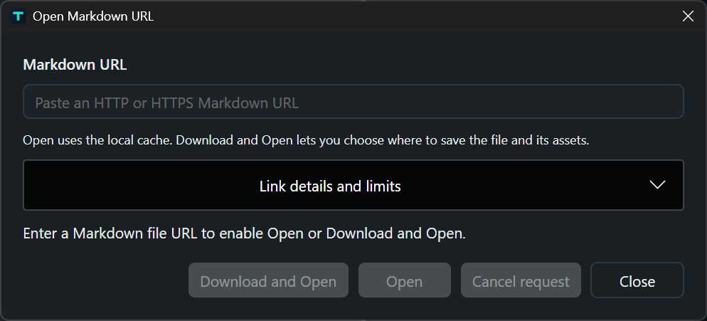
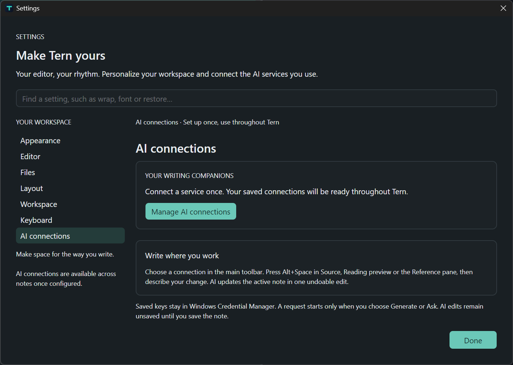

# Tern user guide

Tern edits ordinary Markdown files on Windows with a native preview. Start with the [beginner lessons](BEGINNER_GUIDE.md) for a first note. The [README](../README.md) covers downloads; [privacy](privacy.md) explains network behavior.

## Interface and modes

The Library holds files, folders and workspaces. Tabs select the active note. The canvas shows Source (`Ctrl+1`), Split (`Ctrl+2`) or Reading (`Ctrl+3`). The optional inspector presents outline, backlinks, broken links and statistics. A read-only reference pane helps compare another document without replacing the editor.

Use File, Edit, Format, View and Help to discover actions. **+ Add** asks where a new file or folder belongs. Quick Open (`Ctrl+K`) finds a note; Command Palette (`Ctrl+Shift+P`) finds an action. Focus mode (`F8`), Library/inspector toggles, resizable panes and reading-width settings adapt the writing space.

## Open and edit local files

Use `Ctrl+O`, `Ctrl+Shift+O` or **+ Add**. The editor preserves detected encoding, BOM and LF/CRLF/CR line endings; new notes default to CRLF. Opening a file is not a request to normalize its text. Source editing includes syntax highlighting, undo/redo, formatting and find/replace. Broken-link repair is an undoable source edit.

Per-document positions and compatible session records can restore context. Restoration cannot restore a file removed by another program. The eager-load ceiling is 64 MiB; a file below it can still be expensive to parse or render. Preview has a separate smaller budget under [known limits](#known-limits).

## Saving, external changes and recovery

`Ctrl+S` saves, `Ctrl+Shift+S` chooses Save As and `Ctrl+Alt+S` saves all. Empty drafts can be saved. An explicitly chosen draft filename takes precedence over a heading-derived suggestion.

Saving uses staged/atomic replacement and detects competing disk changes. Tern reports failures and preserves detected displaced competing versions; this is not universal filesystem compare-and-swap across every filesystem or third-party editor. Inspect the external-change comparison or three-way merge before overwriting either version. Clean-document auto-reload is configurable.

Encoding-protected content cannot silently overwrite its original bytes. A separate UTF-8 copy is possible after confirming that displayed text may contain replacement characters. Inspect that copy and retain the original when exact recovery matters.

Local recovery checkpoints are scheduled after an idle interval. On startup, inspect provenance and compare recovered text, restore into an independent unsaved copy, save separately, discard or defer. Corrupt records are reported and preserved. Saved-text history is another local aid. Neither feature replaces independent backups of notes and attachments.

### Save As and portable attachments

Save As can copy referenced local files and linked Markdown dependencies **inside the original note's folder**, preserving their current bytes. Limits are **512 files**, **64 MiB per file** and **256 MiB total**. A conflicting attachment is retained and the note save is refused rather than replacing it silently.

Existing references outside that folder are not an unrestricted recursive copy request. Keep the note in its original folder or move required attachments inside first. Inspect the copied collection before removing its original. URL-import bundles have different limits.

## Pictures and local resources

Save a new draft before inserting a picture; Tern can open Save and continue insertion afterwards. Selecting, dropping or pasting a copied image file beside the Markdown note links it immediately. Sources in other folders offer:

| Choice | Effect |
| --- | --- |
| Link original | Insert a path to the original; moving it can break the image |
| Copy image | Choose a destination and link the saved copy; existing files remain protected |
| Cancel | Leave the note unchanged by that insertion |

Insert Local Image first checks for copied image files; otherwise it opens a picker. Paste Image as Attachment uses the same location rules for copied files. Clipboard pixels without a source filename need a destination. Source-area drops and clipboard payloads are distinct OS interactions requiring native acceptance.

Explicitly selected external image files can retain preview permission **per note and exact file** after reopening. This does not authorize every file in their folders. Other resources remain constrained by document/workspace context and resource policy.

Public remote image URLs can be requested automatically during preview or resource preparation. The setting controlling clicked external links does not disable those requests. See [remote images](privacy.md#remote-images).

## Open from URL

Use File or **+ Add** → Open from URL. **Open** uses a managed cache; **Download and Open** chooses where to save the file and assets. Imported Markdown opens as an editable unsaved copy. Editing or saving it does not upload changes back to the website.

The loader accepts HTTP/HTTPS Markdown-file URLs, converts public GitHub file links to raw content and permits explicitly entered localhost URLs. Repository directories, issue pages, sign-in pages and arbitrary HTML pages are not Markdown documents. Public requests are constrained against private-network destinations, credential-bearing URLs and unsafe redirects.

The document limit is **10,000,000 bytes**. Directly referenced supported assets can form a bundle of up to **128 assets** and **100,000,000 bytes total**; this is not a recursive website crawler. Supported extensions include Markdown, common raster images, bounded SVG, PDF, text, CSV, JSON, YAML, ZIP and Office files. Download support does not mean those attachments are executed or rendered.

Complete cached bundles reopen offline. Partial downloads identify missing assets and can retry on reopening. Online Recent entries represent deliberate reloads, not ongoing synchronization. Verify the bundle before depending on offline access or sharing a portable copy.

## Folders, workspaces and search

Open Folder browses a physical directory without creating metadata. Create Workspace makes a new named directory containing `.tern-workspace.json`; Open Workspace restores that context. Compatible legacy workspace/session records remain supported.

Independent roots stack in the Library, while `Company/HR` remains nested. Context creation targets the clicked directory; global Add asks whether to use the selected location or an outside location. Use disposable folders to learn rename, move, duplicate and delete: those actions operate on disk.

The scanner includes `.md`, `.markdown`, `.mdown` and `.mkd` by default, with optional text inclusion. Standard exclusions include `.git`, `node_modules`, `.obsidian`, `bin` and `obj`. `.ternignore` and settings exclusions narrow scanning. Directory links are not followed by default; permitted traversal remains constrained to the workspace. Default scanning skips individual files above **16 MiB**, independently of the editor's open ceiling.

Workspace search uses a local SQLite full-text index. Active-note find/replace and workspace search have different scopes. Indexes can be rebuilt; they are not document backups. Outline, backlinks and broken links depend on recognized syntax and available workspace files.

## Close without deleting

| Action | Result |
| --- | --- |
| Tab × or `Ctrl+W` | Close the document after its save decision |
| Open file × in Library | Close associated tabs and remove the reference after save decisions |
| Close Workspace, `Ctrl+Shift+W` or workspace × | Close its documents and release its context; unrelated notes remain open |
| Expanded folder × | Close its documents and collapse it; retain the folder entry |
| Close All Documents, `Ctrl+Alt+W` | Close tabs while retaining the workspace |
| Remove Recent/Quick Open reference | Remove the reference while leaving open tabs alone |

Save/Discard/Cancel decisions complete before a group closes. Cancel preserves affected tabs and references. Closing does not delete files; separate file-management actions do. Window close also asks about unsaved changes.

## Export and print

HTML, PDF and text exports share document/resource readiness checks. A format change requires a new compatible destination. Read truncation, resource and unsupported-character warnings and inspect output before sharing. Export does not replace saving editable Markdown.

- **HTML:** self-contained output embeds supported resources within limits and sanitizes unsupported active content. It is not a screenshot of the native view.
- **PDF:** bundled PDFsharp generates pages locally, with font/Unicode and layout constraints. Preparing remote images can still require network access.
- **Text:** produces readable text without the full styled Markdown layout.
- **Print (`Ctrl+P`):** uses Windows' print dialog and readable plain text, not pixel-for-pixel Markdown preview.

Resources must remain accessible under their local/remote policies. The PDF path bounds page count and image resources. A successful export call does not prove that every intended glyph, diagram and attachment is present; inspect the final artifact.

## Settings and local data

Settings (`Ctrl+,`) controls System/Midnight/Paper appearance, fonts, reading width, wrapping, line numbers, indentation, layout, session restoration, shortcuts and exclusions. New documents default to Extended Markdown and Split view. Shortcut preferences can override the defaults below.

| Data | Default location |
| --- | --- |
| Settings and connection metadata | `%APPDATA%\Tern` |
| Local state | `%LOCALAPPDATA%\Tern` |
| Recovery | `%LOCALAPPDATA%\Tern\recovery` |
| Search indexes | `%LOCALAPPDATA%\Tern\index` |
| Saved connection secrets | Windows Credential Manager, separate from those folders |

`TERN_DATA_ROOT` selects a root containing `settings`, `state`, `recovery` and `index`. Backing up it does not back up Windows Credential Manager credentials. Settings writes are staged; malformed settings can be preserved as `.corrupt` while defaults are used and the problem is reported.

AI is optional. Read [protocols, credentials and reviewed text](privacy.md#optional-ai-connections) before using sensitive content.

### Set up an AI connection

Open **Edit → Settings → AI connections → Manage AI connections**. The wizard keeps its navigation and main actions together at the bottom.

1. **Choose service:** use the **AI service** menu for OpenAI API, Anthropic API (Claude), Ollama (local), Other compatible API, **GitHub Copilot** or **MCP server**. The choice enables the appropriate setup and fields. **Setup guide ↗** opens official documentation for the selected service, including GitHub Copilot authentication and the MCP 2025-11-25 Streamable HTTP specification. **Create connection** starts a new profile; the shared saved-connections list lets you select an existing one to modify or delete.
2. **Configure connection:** enter a recognizable connection name, the exact model ID and any required API key. Use **Advanced** for a custom documented endpoint or protocol. **Back** retains entered values.
3. **Validate and save:** review the destination, then choose **Validate connection**. This sends the fixed message `Reply with exactly: OK.` using the selected endpoint, model and key. No document is attached; provider usage or charges may apply. Read the success or error before choosing **Save connection**.

Saving stores metadata locally and secrets in Windows Credential Manager. Saving, reopening and navigating send no request; saving an untested connection does not prove that it works. Selecting any saved connection keeps you on Choose service and selects its service type. Choose **Configure connection** to open its saved settings, then modify, validate and save changes. **Delete connection** asks for confirmation before removing its saved settings and credential. **Create connection** starts a fresh setup. Every saved API, Copilot and MCP connection appears in the main toolbar.

If validation fails, check the key and API permissions for authentication errors, the exact model ID and account access for unavailable-model errors, and the endpoint, TLS certificate and server/network for connection errors. Correct the setting with **Back** and validate again. A successful test describes that request; it does not guarantee future availability.

For a separate question, expand **Try your own message (optional)**, review the exact text and destination, check consent and choose **Send request**. For note editing, select a saved API or Copilot connection in the main toolbar and use **Write with AI**. The larger writing panel places the connection and destination first, provides a multiline instruction editor, and keeps actions at the bottom. Expand **Review the exact request** before **Generate & update note**; this sends the active note and instruction. The result is one undoable edit and is not saved to disk automatically.

### Save GitHub Copilot or MCP settings

**GitHub Copilot:** have Copilot access and native `copilot.exe` installed. In GitHub, create a fine-grained token owned by your personal account with the **Copilot Requests** account permission; **Copilot Chat** is unnecessary. In the Copilot wizard, choose or name a connection, enter the token, leave Model at `auto` for a first test, and check the native executable in Advanced. Continue to **Validate and save**. **Validate connection** sends the fixed test message through the CLI; **Save connection** stores metadata and protects the token in Windows Credential Manager. The saved Copilot connection is also available for **Write with AI** and guide questions from the main toolbar. Writing first sends a fixed validation test and then the active note and instruction; provider usage may apply to both requests. A changed note or connection during validation blocks generation. The complete Copilot request is limited to 8,192 characters, including the note and instruction; @mentions and CLI commands are not accepted. For a separate question in **Try connection**, paste only your question, review it, check consent and choose **Send reviewed text**. This separate question does not attach the note.

**MCP servers:** obtain a full Streamable HTTP endpoint with MCP 2025-11-25 compatibility and any required bearer token from the server owner. Configure a name, HTTPS address (HTTP allowed on loopback) and optional token. In **Validate and save**, **Connect and discover tools** initializes the server and lists tools without running one. Save the connection, then select it in the main toolbar and choose **Open MCP tools**. The workspace loads the selected saved server without contacting it. Choose **Connect and discover tools**, then use **Review tools** to read a tool description/schema and enter exact JSON object arguments. Review possible external effects before consent and **Run reviewed tool**. Results are not applied to notes. When MCP is selected in the writing panel, note-generation controls are disabled and **Open MCP tools** is offered instead. OAuth and stdio are unsupported.

Both integration wizards offer a saved-connections picker and **Manage saved connections** with **New connection** and **Delete saved connection**. Reopening saved settings makes no request. Changing a saved destination clears a restored token for reentry. Cancel stops waiting; it cannot recall transmitted text or undo a server tool's effects.

## Keyboard reference

| Shortcut | Default action |
| --- | --- |
| `Ctrl+N` / `Ctrl+O` / `Ctrl+Shift+O` | New / open files / open folder |
| `Ctrl+S` / `Ctrl+Shift+S` / `Ctrl+Alt+S` | Save / Save As / Save All |
| `Ctrl+W` / `Ctrl+Shift+W` / `Ctrl+Alt+W` | Close note / workspace / all documents |
| `Ctrl+Shift+T` | Reopen a closed document |
| `Ctrl+1` / `Ctrl+2` / `Ctrl+3` | Source / Split / Reading |
| `Ctrl+K` / `Ctrl+Shift+P` | Quick Open / Command Palette |
| `Ctrl+F` / `Ctrl+H` / `Ctrl+Shift+F` | Find / Replace / workspace search |
| `Ctrl+G` / `Ctrl+Shift+H` | Go to line / heading |
| `Ctrl+B` / `Ctrl+I` / `Ctrl+E` | Bold / italic / inline code |
| `Ctrl+Shift+K` / `Ctrl+Enter` | Insert link / toggle task |
| `Ctrl+Alt+V` / `Ctrl+P` | Paste Image as Attachment / print |
| `Ctrl+Alt+H` / `Ctrl+Alt+2` | Saved-text history / reference pane |
| `Ctrl+Shift+B` / `Ctrl+Alt+B` / `F8` | Library / inspector / focus mode |
| `Ctrl+,` / `Ctrl+/` / `F1` | Settings / shortcuts / guide |
| `Alt+Space` | Optional AI writing request in a supported document context |

## Known limits

- Eager loading is bounded at 64 MiB. **1 GB editing is unsupported**, and maximum-size responsiveness is not guaranteed.
- Preview budgets include 4,000,000 source characters, 250,000 nodes, depth 48 and a cooperative build-time limit. The underlying Markdown parse is not interruptible at every step. Preview/export can truncate before the file ceiling; heed warnings.
- Math and Mermaid are bounded native renderers, not complete browser LaTeX/Mermaid engines. Supported diagram families include flowcharts, sequence, entity relationship, state, class, mind map, pie and Gantt; unsupported syntax produces a notice.
- Local, embedded and remote images have distinct byte, dimension, path and format bounds. Scripts and active HTML/SVG content are not executed as browser content.
- Live AI, Copilot CLI and MCP compatibility needs separate verification; local fixtures do not certify every provider, model or entitlement.
- Physical clipboard/drop, printers, DPI, assistive technology, installed offline operation, performance and signing require native acceptance. See the [release ledger](V1_RELEASE_LEDGER.md).

Return to the [documentation index](../documentation.md).
