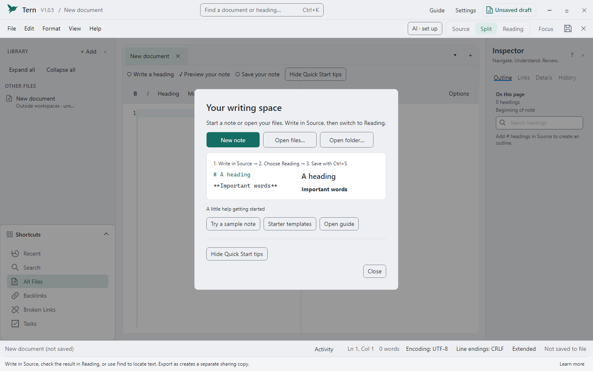
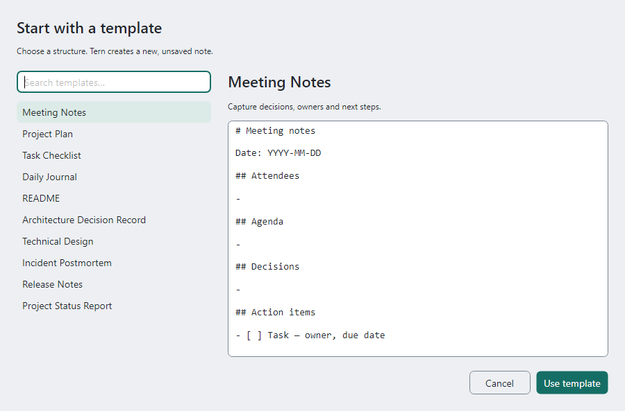
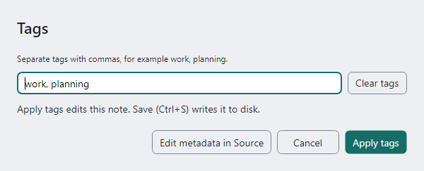
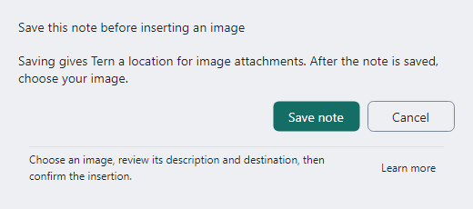
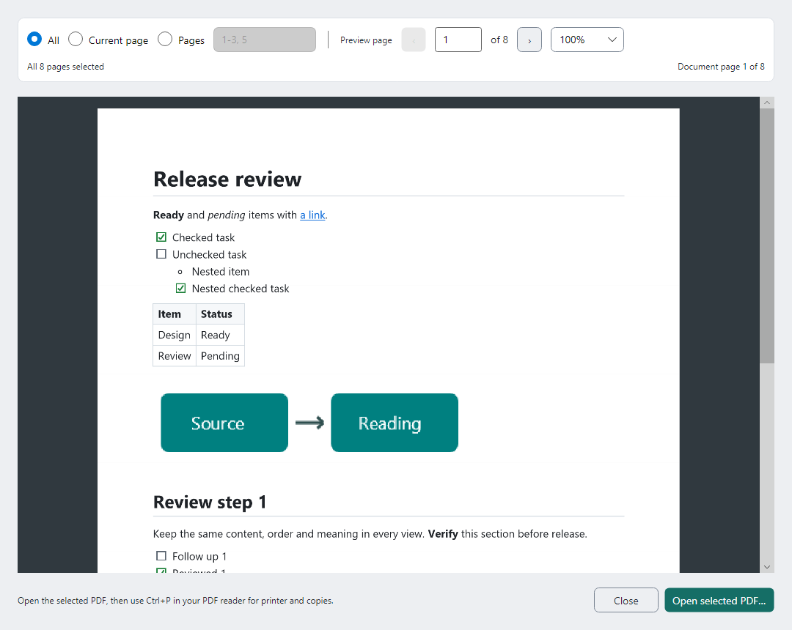
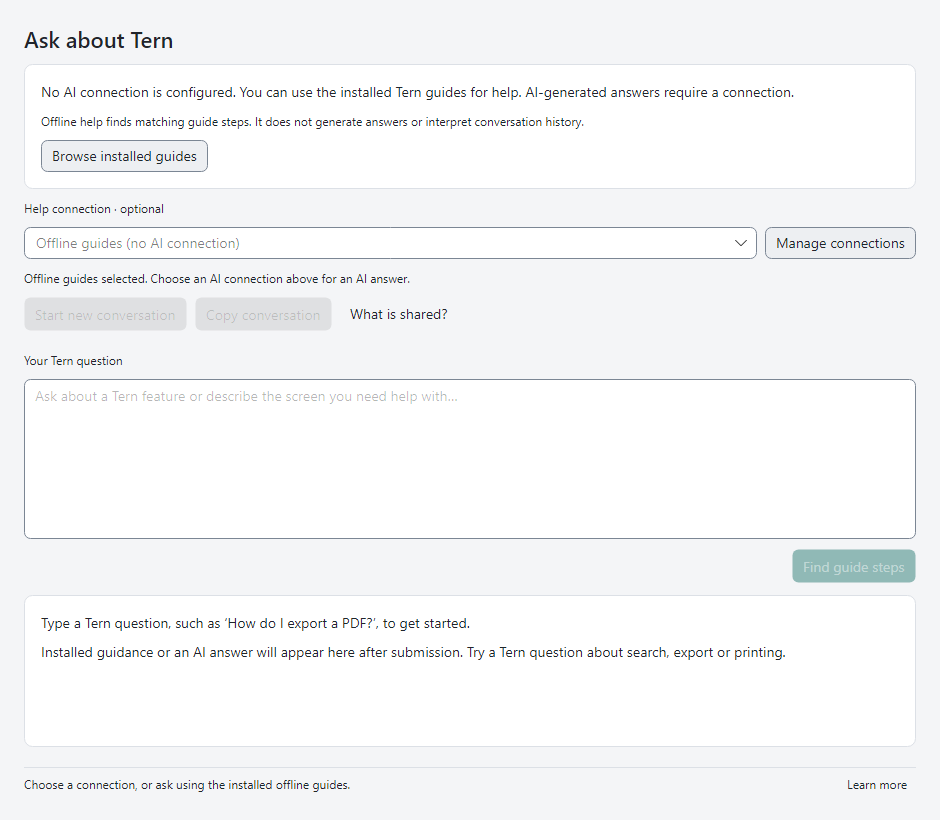

# Tern 1.0.5 workflows

## Start, replay and templates

1. In Welcome choose **New note**, **Open files…** or **Open folder…**.
2. Choose **Try a sample note** or **Starter templates** for a starting point. Search the catalog, inspect its preview and choose **Use template**.
3. The catalog contains Meeting Notes, Project Plan, Task Checklist, Daily Journal, README, Architecture Decision Record, Technical Design, Incident Postmortem, Release Notes and Project Status Report.
4. **Hide Quick Start tips** hides teaching in Welcome and the editor, including after restart. Sample notes, templates and the guide remain available in the empty workspace. Its **Tern Quick Start…** shortcut reopens the full card. **Help → Tern Quick Start** revisits it without clearing your preference.

## Tags and metadata

1. Open **Edit note metadata** and enter comma-separated tags, for example `work, planning`.
2. Edit the field or choose **Clear tags**. **Apply tags** edits the current note in memory and preserves unrelated supported metadata.
3. **Save** (`Ctrl+S`) writes the file. **Edit metadata in Source** remains available, including complex metadata requiring manual edits.

## Links

1. Choose **Format → Insert Link** and select **Web address**, **Local file** or **Heading in this note**.
2. Enter a complete HTTP(S) address, save the note and choose an existing local file, or select an existing heading. Web validation does not fetch content.
3. Enter optional link text and choose **Insert link** once validation succeeds. The label defaults to the destination or heading.

## Images

1. Choose **Insert Local Image**. Unsaved notes first show **Save this note before inserting an image**, with **Save note** and **Cancel**, before any file picker.
2. Complete Save As successfully to continue. Cancellation, save failure or changing the intended note stops insertion.
3. Choose the image and destination. If the destination exists, review its full path and explicitly choose **Replace file**, or **Cancel** to keep it. A file changed after confirmation is refused.
4. Review Reading and save the Markdown. Undo removes the link; copied files remain on disk.

## Line endings

New blank notes, samples and templates use **CRLF**. Existing files retain detected line endings. Use the status bar **Line endings** control to choose CRLF, LF or CR, then save. **Encoding**, such as UTF-8, is separate.

## Print selected pages

1. Choose **File → Print preview…** (`Ctrl+P`). Tern generates one PDF snapshot and displays its actual page boundaries.
2. Navigate with **Preview page** or the previous/next buttons. Choose **Fit page**, **100%** or **150%** zoom. The **Document page** label identifies the original page.
3. Choose **All**, **Current page** (the displayed page), or **Pages** such as `1-3, 5`. Malformed, empty, descending, zero and out-of-range selections block output. Duplicate pages are included once, in original order. Standard hyphens and pasted en/em dashes are accepted. A valid range immediately updates the preview; navigation visits only those selected pages. Changing the selection clears the previous output message, and an outdated selection is never opened while a new PDF is being prepared.
4. Choose **Open selected PDF…**. The file contains exactly those original pages. Press `Ctrl+P` in your PDF reader for printer and copies. Tern does not submit a job automatically. Check driver margins and scaling before physical printing.
5. Close and reopen the preview to capture later editor changes.

## Installation and Explorer

- **MSI:** open `Tern-1.0.5.msi`. Choose **Next**, review the MIT license and accept it to continue. Choose an installation folder; the default is `%LOCALAPPDATA%\Programs\Tern`. Choose **Start menu** and **desktop** shortcuts (Start menu is selected initially; desktop is optional). Review the choices and choose **Install**. On completion, leave **Launch Tern** selected to open the app when you choose **Finish**. Setup installs for your Windows account, shows the Tern icon in Installed apps and registers .md support without changing your default. Uninstall through Windows Installed apps. A newer wizard build also replaces the earlier 1.0.5 installer.
- **Standalone Tern.exe:** runs the editor directly. It bundles the runtime, native dependencies, installed guides and notices. Native libraries extract on first use. About → Guides and licenses expands documentation on demand.
- **Portable ZIP:** extract the complete archive and run its **Tern.exe**. Keep all adjacent files together.
- For standalone and portable use, choose **Settings → Windows integration → Register this copy** at a stable path. Register again after moving it.
- Right-click one `.md` file in any Explorer folder and choose **Open with Tern**. The classic action is under **Show more options** on Windows 11 configurations using the newer menu. No folder or unrelated-file entries are added.
- To double-click with Tern, choose Tern yourself in Windows **Open with** or **Default apps**. Installation preserves the existing choice. Quoted commands support paths with spaces.

## Ask & learn offline

Without an AI connection, the panel explains this before submission. **Find guide steps** searches installed guide topics; it does not generate a conversation, inspect arbitrary notes or answer general questions. **Browse installed guides** opens the catalog and **Manage connections** opens configuration. AI-generated answers require a compatible configured text connection and explicit submission.

**Help → Feature Guide and Tutorials** or `F1` opens the installed guide without a network connection.

