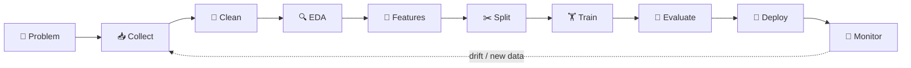
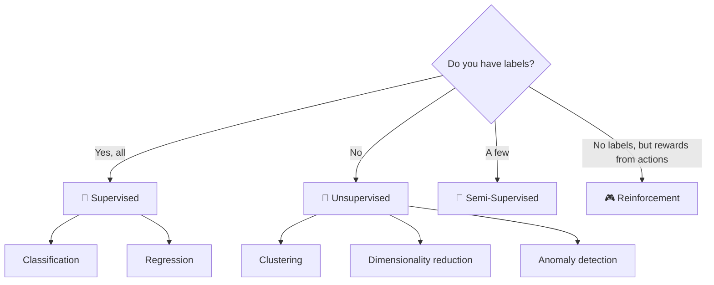

<div align="center">

# 🧪 The Practical Data Science Handbook
### From raw data ➜ clean features ➜ trained model ➜ production 🚀
**10% theory · 90% runnable Python**


<br>


</div>

---

## 🎨 How to read this handbook

| Icon | Meaning | Icon | Meaning |
|:---:|---|:---:|---|
| 📖 | **Theory** – the 10% you must know | 🛠️ | **How to do it** – step-by-step code |
| ✅ | **How to validate** – prove it worked | ⏰ | **When to use** – decision rules |
| 📍 | **Where to use** – real-world domains | ⚠️ | **Pitfall** – common mistake |
| 💡 | **Pro tip** | 🧾 | **Dataset** – realistic data built in code |

> [!TIP]
> 💡 Code is **self-contained per section**: the first block creates the dataset, the following blocks reuse it — run them top-to-bottom in a notebook. Sections 1.4 → 1.10 form one end-to-end project; save the `features.py` and `app.py` blocks as files next to your notebook.

### ⚙️ One-time setup

```bash
pip install "pandas>=2.1" "numpy>=1.26" "scikit-learn>=1.5" scipy matplotlib seaborn joblib \
            fastapi uvicorn httpx pydantic phonenumbers ucimlrepo requests
```

---

## 🗺️ Table of Contents

- [🔄 1. Data Science Pipeline](#sec-1-data-science-pipeline)
   - [🎯 1.1 Problem Definition](#sec-1-1-problem-definition)
   - [📥 1.2 Data Collection](#sec-1-2-data-collection)
   - [🧹 1.3 Data Cleaning & Preprocessing](#sec-1-3-data-cleaning-preprocessing)
      - [🕳️ 1.3.1 Handle Missing Values](#sec-1-3-1-handle-missing-values)
      - [👯 1.3.2 Remove Duplicates](#sec-1-3-2-remove-duplicates)
      - [🧩 1.3.3 Fix Inconsistent Data](#sec-1-3-3-fix-inconsistent-data)
      - [🚨 1.3.4 Handle Outliers](#sec-1-3-4-handle-outliers)
      - [⚖️ 1.3.5 Normalize or Standardize Data](#sec-1-3-5-normalize-or-standardize-data)
      - [🏷️ 1.3.6 Convert Categorical Data](#sec-1-3-6-convert-categorical-data)
      - [📝 1.3.7 Text Data Cleaning](#sec-1-3-7-text-data-cleaning)
      - [✅❌ 1.3.8 Handle Boolean Data](#sec-1-3-8-handle-boolean-data)
      - [📅 1.3.9 Handle Date/Time Data](#sec-1-3-9-handle-date-time-data)
      - [🔢 1.3.10 Handle Large Numbers](#sec-1-3-10-handle-large-numbers)
      - [🧬 Data Types, Issues & Preprocessing Techniques](#sec-data-types-issues-preprocessing-techniques)
      - [⚖️ Data – 8 Scaling & Transformation Techniques](#sec-data-8-scaling-transformation-techniques)
      - [🧭 Which Technique Should You Use?](#sec-which-technique-should-you-use)
   - [🔍 1.4 Exploratory Data Analysis (EDA)](#sec-1-4-exploratory-data-analysis-eda)
   - [🧪 1.5 Feature Engineering & Feature Selection](#sec-1-5-feature-engineering-feature-selection)
   - [✂️ 1.6 Data Splitting](#sec-1-6-data-splitting)
   - [🏋️ 1.7 Model Selection & Training](#sec-1-7-model-selection-training)
   - [📏 1.8 Model Evaluation](#sec-1-8-model-evaluation)
   - [🚀 1.9 Model Deployment](#sec-1-9-model-deployment)
   - [📡 1.10 Model Monitoring & Maintenance](#sec-1-10-model-monitoring-maintenance)
- [🗃️ 2. Data Sets](#sec-2-data-sets)
   - [💼 2.1 Salary & Experience Dataset](#sec-2-1-salary-experience-dataset)
   - [🚢 2.2 Titanic Dataset](#sec-2-2-titanic-dataset)
   - [🏠 2.3 House Prices Dataset (Ames, Iowa)](#sec-2-3-house-prices-dataset-ames-iowa)
   - [🌸 2.4 Iris Dataset](#sec-2-4-iris-dataset)
   - [💵 2.5 UCI Adult Income Dataset](#sec-2-5-uci-adult-income-dataset)
   - [🍷 2.6 Wine Quality Dataset](#sec-2-6-wine-quality-dataset)
   - [🏚️ 2.7 Boston Housing Dataset](#sec-2-7-boston-housing-dataset)
   - [✍️ 2.8 MNIST Dataset](#sec-2-8-mnist-dataset)
   - [🛍️ 2.9 Customer Segmentation Dataset (Mall Customers)](#sec-2-9-customer-segmentation-dataset-mall-customers)
   - [📞 2.10 Bank Marketing Dataset](#sec-2-10-bank-marketing-dataset)
   - [❤️ 2.11 Heart Disease Dataset (Cleveland)](#sec-2-11-heart-disease-dataset-cleveland)
   - [👕 2.12 Fashion-MNIST](#sec-2-12-fashion-mnist)
   - [📱 2.13 Google Play Store Dataset](#sec-2-13-google-play-store-dataset)
- [🤖 3. Machine Learning Categories](#sec-3-machine-learning-categories)
   - [🎯 3.1 Supervised Learning](#sec-3-1-supervised-learning)
   - [🧭 3.2 Unsupervised Learning](#sec-3-2-unsupervised-learning)
   - [🧩 3.3 Semi-Supervised Learning](#sec-3-3-semi-supervised-learning)
   - [🎮 3.4 Reinforcement Learning](#sec-3-4-reinforcement-learning)
   - [📊 Summary of Machine Learning Categories](#sec-summary-of-machine-learning-categories)
   - [🧠 Machine Learning Algorithms (Every Data Scientist Must Know)](#sec-machine-learning-algorithms-every-data-scientist-must-know)

---

<a id="sec-1-data-science-pipeline"></a>
# 🔄 1. Data Science Pipeline



---

<a id="sec-1-1-problem-definition"></a>
## 🎯 1.1 Problem Definition

### 📖 Theory (10%)
> Translate a **business question** into an **ML task** (classification / regression / clustering …), a **target**, a **unit of prediction**, a **metric**, and a **success threshold**. If you can't write these down, you can't build or evaluate a model.

### 🛠️ How to do Problem Definition

#### 🔹 Step 1 – Write the problem as a structured spec

```python
from dataclasses import dataclass, field

@dataclass
class ProblemSpec:
    business_question: str
    ml_task: str              # "binary_classification", "regression", "clustering", ...
    target: str
    unit_of_prediction: str
    prediction_horizon: str
    primary_metric: str       # must be a valid scikit-learn scorer name
    success_threshold: float
    constraints: list = field(default_factory=list)

churn_spec = ProblemSpec(
    business_question="Which subscribers will cancel in the next 30 days so the retention team can call them?",
    ml_task="binary_classification",
    target="churned_30d",
    unit_of_prediction="one row per active subscriber per month",
    prediction_horizon="30 days",
    primary_metric="recall",
    success_threshold=0.70,
    constraints=["retention team can call max 500 customers/week",
                 "protected attributes (age, gender) must not be features"],
)
print(churn_spec)
```

#### 🔹 Step 2 – Build the dataset the spec describes 🧾

```python
import numpy as np
import pandas as pd

rng = np.random.default_rng(42)
n = 5_000
subs = pd.DataFrame({
    "tenure_months": rng.integers(1, 72, n),
    "monthly_fee": rng.choice([9.99, 14.99, 19.99, 29.99], n, p=[0.4, 0.3, 0.2, 0.1]),
    "support_tickets_90d": rng.poisson(1.2, n),
})
logit = -2.2 - 0.03 * subs.tenure_months + 0.04 * subs.monthly_fee + 0.45 * subs.support_tickets_90d
subs["churned_30d"] = (rng.random(n) < 1 / (1 + np.exp(-logit))).astype(int)
print(subs.head(), "\nChurn rate:", subs.churned_30d.mean().round(3))
```

### ✅ How to validate Problem Definition

#### 🔹 Check the spec against the data

```python
from sklearn.metrics import get_scorer_names

def validate_spec(spec: ProblemSpec, df: pd.DataFrame) -> list[str]:
    issues = []
    if spec.target not in df.columns:
        return [f"Target '{spec.target}' not found in data"]
    y = df[spec.target]
    if spec.ml_task == "binary_classification":
        if y.nunique() != 2:
            issues.append(f"Binary task but target has {y.nunique()} classes")
        if y.value_counts().min() < 100:
            issues.append("Fewer than 100 rare-class examples → hard to learn and evaluate")
    if spec.primary_metric not in get_scorer_names():
        issues.append(f"'{spec.primary_metric}' is not a valid sklearn scorer")
    return issues

print(validate_spec(churn_spec, subs) or "✅ Spec is consistent with the data")
```

#### 🔹 Check the problem is learnable: baseline vs. simple model

```python
from sklearn.dummy import DummyClassifier
from sklearn.linear_model import LogisticRegression
from sklearn.model_selection import cross_val_score

X, y = subs.drop(columns="churned_30d"), subs["churned_30d"]
candidates = {
    "always 'no churn'": DummyClassifier(strategy="most_frequent"),
    "logistic (balanced)": LogisticRegression(class_weight="balanced", max_iter=1000),
}
for name, model in candidates.items():
    score = cross_val_score(model, X, y, cv=5, scoring=churn_spec.primary_metric).mean()
    print(f"{name:22s} {churn_spec.primary_metric}={score:.2f}  meets target: {score >= churn_spec.success_threshold}")
```

> [!NOTE]
> 📌 If a simple model can't beat the dummy baseline, revisit the target definition or collect better features **before** trying fancy models.

### ⏰ When to use Problem Definition
| Situation | Why |
|---|---|
| 🆕 Start of every project | Prevents building the wrong model |
| 🔁 Stakeholders disagree on "success" | Forces a measurable threshold |
| 📉 Model is "accurate" but useless | Usually the metric didn't match the business cost |

### 📍 Where to use Problem Definition
- 🏦 **Banking** – "fraud yes/no within 1 s" → binary classification, metric = recall at fixed precision
- 🛒 **Retail** – "units sold next week" → regression, metric = MAE
- 🏥 **Healthcare** – "readmission within 30 days" → classification, recall-oriented
- 📺 **Media** – "group users by taste" → clustering, metric = silhouette + business review

---

<a id="sec-1-2-data-collection"></a>
## 📥 1.2 Data Collection

### 📖 Theory (10%)
> Data comes from **files** (CSV, Excel, Parquet), **databases** (SQL), **APIs** (JSON), and **logs/streams**. Collection = load + join + record *where/when* it came from, so the dataset is reproducible.

### 🛠️ How to do Data Collection

#### 🔹 From CSV files 🧾

```python
import io
import pandas as pd

csv_text = """order_id,customer_id,order_date,amount_usd
1001,C01,2026-09-01,34.90
1002,C02,2026-09-01,129.00
1003,C01,2026-09-03,15.50
1004,C03,2026-09-04,72.25
1005,C04,2026-09-05,310.00
1006,C02,2026-09-07,45.10
"""
orders = pd.read_csv(io.StringIO(csv_text), parse_dates=["order_date"])   # same call works with "orders.csv"
print(orders.dtypes)
```

#### 🔹 From a SQL database

```python
import sqlite3

con = sqlite3.connect(":memory:")                # use your DB URL / SQLAlchemy engine in real life
pd.DataFrame({
    "customer_id": ["C01", "C02", "C03", "C05"],
    "name": ["Olivia Brown", "Liam Smith", "Emma Wilson", "Noah Taylor"],
    "country": ["UK", "US", "US", "DE"],
    "signup_date": ["2025-11-02", "2026-01-15", "2026-03-30", "2026-05-12"],
}).to_sql("customers", con, index=False)

customers = pd.read_sql(
    "SELECT customer_id, name, country, signup_date FROM customers WHERE signup_date >= ?",
    con, params=("2025-01-01",), parse_dates=["signup_date"],
)
con.close()
print(customers)
```

#### 🔹 From a JSON API response (nested data)

```python
api_response = {
    "data": [
        {"customer_id": "C01", "loyalty": {"tier": "gold", "points": 1200}},
        {"customer_id": "C02", "loyalty": {"tier": "silver", "points": 430}},
        {"customer_id": "C03", "loyalty": {"tier": "bronze", "points": 85}},
    ]
}
loyalty = pd.json_normalize(api_response["data"], sep="_")
print(loyalty)          # columns: customer_id, loyalty_tier, loyalty_points
```

#### 🔹 From a live public API (Open-Meteo, no key needed)

```python
import requests

resp = requests.get(
    "https://api.open-meteo.com/v1/forecast",
    params={"latitude": 52.52, "longitude": 13.41, "hourly": "temperature_2m"},
    timeout=10,
)
resp.raise_for_status()
weather = pd.DataFrame(resp.json()["hourly"]).assign(time=lambda d: pd.to_datetime(d["time"]))
print(weather.head())
```

#### 🔹 Combine sources into one analysis table

```python
dataset = (orders
           .merge(customers, on="customer_id", how="left", validate="many_to_one", indicator=True)
           .merge(loyalty, on="customer_id", how="left", validate="many_to_one"))
dataset["_source_loaded_at"] = pd.Timestamp.now(tz="UTC")      # lineage for reproducibility
print(dataset)
```

### ✅ How to validate Data Collection

#### 🔹 Schema check (version-proof dtype checks)

```python
from pandas.api import types as ptypes

EXPECTED = {
    "order_id": ptypes.is_integer_dtype,
    "customer_id": lambda s: ptypes.is_string_dtype(s) or ptypes.is_object_dtype(s),
    "order_date": ptypes.is_datetime64_any_dtype,
    "amount_usd": ptypes.is_float_dtype,
}
problems = [c for c, check in EXPECTED.items() if c not in orders or not check(orders[c])]
print("✅ schema OK" if not problems else f"❌ bad columns: {problems}")
```

#### 🔹 Join completeness, row counts, freshness

```python
unmatched = dataset.loc[dataset["_merge"] == "left_only", "customer_id"].unique()
print("Orders without customer master data:", list(unmatched))           # C04 → upstream gap
assert len(dataset) == len(orders), "Join changed the row count!"
print("Newest order:", dataset.order_date.max().date(),
      "| days old:", (pd.Timestamp("2026-09-10") - dataset.order_date.max()).days)
```

### ⏰ When to use each collection method
| Source | Use when | Watch out for |
|---|---|---|
| 📄 CSV / Excel | One-off exports, small data | Encodings, separators, dates as text |
| 🗄️ SQL | Data lives in an operational DB/warehouse | Filter in SQL, not pandas, for big tables |
| 🌐 API | Third-party or real-time data | Rate limits, pagination, timeouts |
| 🪵 Logs/streams | Event-level behaviour | Volume, late/duplicate events |

### 📍 Where to use Data Collection
- 🛒 E-commerce: orders (SQL) + clickstream (logs) + weather (API) for demand forecasting
- 🏭 Manufacturing: sensor streams + maintenance records (Excel)
- 📣 Marketing: CRM export (CSV) + ad-platform API

---

<a id="sec-1-3-data-cleaning-preprocessing"></a>
# 🧹 1.3 Data Cleaning & Preprocessing

> [!IMPORTANT]
> 🔒 **Golden rule:** anything *learned* from data (medians, scalers, encoders) must be **fit on training data only** and then applied to validation/test — use scikit-learn `Pipeline`/`ColumnTransformer` to guarantee this.

---

<a id="sec-1-3-1-handle-missing-values"></a>
## 🕳️ 1.3.1 Handle Missing Values

### 📖 Theory (10%)
> Missing values are **MCAR** (completely random), **MAR** (depends on other columns, e.g. older patients skip a lab test) or **MNAR** (depends on the missing value itself, e.g. very high blood pressure not recorded). The type decides the strategy.

### 🧾 Dataset – patient records with realistic missingness

```python
import numpy as np
import pandas as pd

rng = np.random.default_rng(7)
n = 1_000
age = rng.integers(18, 90, n).astype(float)
bmi = rng.normal(27, 4.5, n).round(1)
patients = pd.DataFrame({
    "age": age,
    "sex": rng.choice(["F", "M"], n),
    "bmi": bmi,
    "systolic_bp": (100 + 0.45 * age + 0.5 * bmi + rng.normal(0, 10, n)).round(),
    "cholesterol": (150 + 0.6 * age + 1.2 * bmi + rng.normal(0, 20, n)).round(),
    "smoker": rng.choice(["yes", "no"], n, p=[0.22, 0.78]),
})
full_patients = patients.copy()                                         # ground truth for validation

patients.loc[rng.random(n) < 0.08, "bmi"] = np.nan                                   # MCAR
patients.loc[(patients.age > 65) & (rng.random(n) < 0.35), "cholesterol"] = np.nan   # MAR
patients.loc[(patients.systolic_bp > 150) & (rng.random(n) < 0.30), "systolic_bp"] = np.nan  # MNAR
patients.loc[rng.random(n) < 0.05, "smoker"] = np.nan
```

### 🛠️ How to do Handle Missing Values

#### 🔹 1. Detect and quantify

```python
report = pd.DataFrame({
    "missing": patients.isna().sum(),
    "missing_%": (patients.isna().mean() * 100).round(1),
    "dtype": patients.dtypes.astype(str),
}).sort_values("missing_%", ascending=False)
print(report)
```

#### 🔹 2. Drop rows / columns

```python
rows_ok = patients.dropna(subset=["smoker"])                          # target/critical field missing → drop row
cols_ok = patients.loc[:, patients.isna().mean() < 0.40]              # drop columns with ≥ 40 % missing
print(len(patients), "→", len(rows_ok), "rows |", patients.shape[1], "→", cols_ok.shape[1], "cols")
```

#### 🔹 3. Simple imputation (median / most frequent) inside a pipeline

```python
from sklearn.compose import ColumnTransformer
from sklearn.impute import SimpleImputer

num_cols = ["age", "bmi", "systolic_bp", "cholesterol"]
cat_cols = ["sex", "smoker"]

simple_imputer = ColumnTransformer([
    ("num", SimpleImputer(strategy="median"), num_cols),
    ("cat", SimpleImputer(strategy="most_frequent"), cat_cols),
], verbose_feature_names_out=False).set_output(transform="pandas")

patients_simple = simple_imputer.fit_transform(patients)
print(patients_simple.isna().sum().sum(), "missing left")
```

#### 🔹 4. Group-wise imputation (median per sex)

```python
patients_grp = patients.copy()
patients_grp["bmi"] = patients.groupby("sex")["bmi"].transform(lambda s: s.fillna(s.median()))
print(patients.groupby("sex")["bmi"].median())
```

#### 🔹 5. KNN imputation (uses similar patients)

```python
from sklearn.impute import KNNImputer
from sklearn.pipeline import make_pipeline
from sklearn.preprocessing import StandardScaler

knn = make_pipeline(StandardScaler(), KNNImputer(n_neighbors=5))
scaled_filled = knn.fit_transform(patients[num_cols])
scaler = knn.named_steps["standardscaler"]
patients_knn = pd.DataFrame(scaler.inverse_transform(scaled_filled), columns=num_cols, index=patients.index)
print(patients_knn.head())
```

#### 🔹 6. Iterative (model-based / MICE-style) imputation

```python
from sklearn.experimental import enable_iterative_imputer  # noqa: F401  (activates the API)
from sklearn.impute import IterativeImputer

iter_imp = IterativeImputer(max_iter=10, random_state=0)
patients_iter = pd.DataFrame(iter_imp.fit_transform(patients[num_cols]), columns=num_cols, index=patients.index)
print(patients_iter.describe().round(1))
```

#### 🔹 7. Keep the "was missing" signal (critical for MNAR)

```python
indicator_imputer = SimpleImputer(strategy="median", add_indicator=True).set_output(transform="pandas")
with_flags = indicator_imputer.fit_transform(patients[num_cols])
print(with_flags.columns.tolist())     # ... 'missingindicator_systolic_bp', ...
```

#### 🔹 8. Time-series gaps: forward-fill vs interpolation

```python
room_temp = pd.Series(
    [21.4, 21.6, np.nan, np.nan, 22.3, 22.1, np.nan, 21.8],
    index=pd.date_range("2026-07-01 08:00", periods=8, freq="15min"), name="temp_c",
)
print(pd.DataFrame({
    "raw": room_temp,
    "ffill": room_temp.ffill(),                       # last known value (status fields, prices)
    "linear": room_temp.interpolate(),                # smooth physical signals
    "time": room_temp.interpolate(method="time"),     # irregular timestamps
}))
```

### ✅ How to validate Missing Value handling

#### 🔹 1. Nothing left missing

```python
assert patients_simple.isna().sum().sum() == 0
assert patients_iter.isna().sum().sum() == 0
print("✅ no missing values remain")
```

#### 🔹 2. Distribution didn't get distorted

```python
compare = pd.DataFrame({
    "original_std": patients[num_cols].std(),
    "median_imp_std": patients_simple[num_cols].std(),
    "iterative_std": patients_iter.std(),
}).round(2)
print(compare)        # median imputation shrinks the spread most → biased variance
```

#### 🔹 3. Accuracy test: hide known values, impute, measure error

```python
complete = full_patients[num_cols]
mask = rng.random(len(complete)) < 0.15
corrupted = complete.copy()
corrupted.loc[mask, "cholesterol"] = np.nan
truth = complete.loc[mask, "cholesterol"]

methods = {
    "median": SimpleImputer(strategy="median"),
    "knn": make_pipeline(StandardScaler(), KNNImputer(n_neighbors=5)),
    "iterative": IterativeImputer(random_state=0),
}
for name, imp in methods.items():
    filled = imp.fit_transform(corrupted)
    if name == "knn":
        filled = imp.named_steps["standardscaler"].inverse_transform(filled)
    est = pd.DataFrame(filled, columns=num_cols, index=corrupted.index).loc[mask, "cholesterol"]
    print(f"{name:10s} RMSE = {np.sqrt(((est - truth) ** 2).mean()):.1f} mg/dL")
```

#### 🔹 4. Diagnose the missingness type (MCAR vs MAR)

```python
from scipy.stats import mannwhitneyu

missing_chol = patients["cholesterol"].isna()
stat, p = mannwhitneyu(patients.loc[missing_chol, "age"], patients.loc[~missing_chol, "age"])
print(f"Age of rows with vs without cholesterol differs: p={p:.2e} → {'MAR (depends on age)' if p < 0.05 else 'consistent with MCAR'}")
```

### ⏰ When to use which strategy
| Situation | Strategy |
|---|---|
| < 5 % missing, MCAR | Drop rows or median/mode |
| MAR, correlated features exist | KNN / Iterative imputer |
| MNAR (missingness is informative) | Impute **+ missing indicator** |
| Column > 40–60 % missing | Drop column or keep only the indicator |
| Time series | `ffill` (states) / `interpolate` (signals) |
| Target missing | Drop row (never impute the target) |

### 📍 Where to use
- 🏥 Healthcare – lab values not ordered for every patient (MAR)
- 📊 Surveys – people skip income questions (MNAR)
- 🏭 IoT – sensor dropouts (interpolate)
- 💳 Finance – optional application fields (indicator flags)

---

<a id="sec-1-3-2-remove-duplicates"></a>
## 👯 1.3.2 Remove Duplicates

### 📖 Theory (10%)
> Duplicates are **exact** (same row twice), **key** duplicates (same ID, different versions) or **fuzzy** (same entity, different spelling). They inflate counts, bias models and leak between train/test.

### 🧾 Dataset – CRM customer export

```python
import pandas as pd

crm = pd.DataFrame({
    "customer_id": [1, 2, 2, 3, 3, 4, 5, 6, 7, 8],
    "name": ["Olivia Brown", "Liam Smith", "Liam Smith", "Emma Wilson", "Emma Wilson",
             "Noah Taylor ", "noah taylor", "Ava Johnson", "Ava Jonson", "Mia Davies"],
    "email": ["olivia.brown@gmail.com", "liam.smith@yahoo.com", "liam.smith@yahoo.com",
              "emma.w@outlook.com", "emma.w@outlook.com", "NOAH.TAYLOR@gmail.com",
              "noah.taylor@gmail.com ", "ava.johnson@gmail.com", "ava.j@gmail.com", "mia.d@icloud.com"],
    "city": ["London", "Manchester", "Manchester", "Leeds", "Bristol",
             "London", "london", "Leeds", "Leeds", "York"],
    "updated_at": pd.to_datetime(["2026-01-10", "2026-02-02", "2026-02-02", "2026-01-15", "2026-06-20",
                                  "2026-03-01", "2026-03-05", "2026-04-11", "2026-04-12", "2026-05-30"]),
    "lifetime_value": [1200, 340, 340, 560, 610, 80, 95, 430, 120, 760],
})
```

### 🛠️ How to do Remove Duplicates

#### 🔹 1. Exact duplicates

```python
print("Exact duplicate rows:", crm.duplicated().sum())
print(crm[crm.duplicated(keep=False)])
crm_1 = crm.drop_duplicates()
```

#### 🔹 2. Same key, keep the latest version

```python
crm_2 = (crm_1.sort_values("updated_at")
              .drop_duplicates(subset="customer_id", keep="last"))
print(crm_2.loc[crm_2.customer_id == 3])      # Emma's Bristol record (most recent) survives
```

#### 🔹 3. Normalize keys to reveal hidden duplicates

```python
crm_3 = crm_2.assign(
    email_key=crm_2.email.str.strip().str.lower(),
    name_key=crm_2.name.str.strip().str.lower(),
    city=crm_2.city.str.strip().str.title(),
)
print(crm_3[crm_3.duplicated("email_key", keep=False)][["customer_id", "name", "email_key"]])
```

#### 🔹 4. Merge duplicates instead of dropping (keep the value!)

```python
crm_4 = (crm_3.sort_values("updated_at")
              .groupby("email_key", as_index=False)
              .agg(customer_id=("customer_id", "min"),
                   name=("name", "last"),
                   city=("city", "last"),
                   updated_at=("updated_at", "max"),
                   lifetime_value=("lifetime_value", "sum"),
                   merged_ids=("customer_id", lambda s: sorted(s.tolist()))))
print(crm_4)
```

#### 🔹 5. Fuzzy duplicates (typos) within the same city

```python
from difflib import SequenceMatcher
from itertools import combinations

candidates = []
for city, grp in crm_4.groupby("city"):
    for (i, a), (j, b) in combinations(grp["name"].str.lower().items(), 2):
        score = SequenceMatcher(None, a, b).ratio()
        if score >= 0.85:
            candidates.append((city, crm_4.at[i, "name"], crm_4.at[j, "name"], round(score, 2)))
print(pd.DataFrame(candidates, columns=["city", "name_a", "name_b", "similarity"]))  # send to human review
```

### ✅ How to validate Duplicate removal

```python
assert crm_4["email_key"].is_unique, "duplicate emails remain"
assert crm_4["customer_id"].is_unique, "duplicate IDs remain"

# Money must be preserved: total LTV after = total before, minus only the exact/obsolete copies
expected_ltv = crm_2["lifetime_value"].sum()
assert crm_4["lifetime_value"].sum() == expected_ltv
print(f"Rows: {len(crm)} → {len(crm_1)} (exact) → {len(crm_2)} (key) → {len(crm_4)} (entity) ✅")
```

### ⏰ When to use
| Duplicate type | Action |
|---|---|
| Exact copies (double import) | `drop_duplicates()` |
| Same ID, multiple versions | Keep latest (`sort` + `keep="last"`) |
| Same person, multiple accounts | Normalize key + aggregate |
| Spelling variants | Fuzzy match ➜ human review, never auto-delete |

### 📍 Where to use
- 🧑‍💼 CRM / marketing lists (don't email someone twice)
- 🏥 Patient master data (merging records is safety-critical)
- 🪵 Event logs (at-least-once delivery creates repeats)
- 🧪 ML datasets (duplicates across train/test inflate scores)

---

<a id="sec-1-3-3-fix-inconsistent-data"></a>
## 🧩 1.3.3 Fix Inconsistent Data

### 📖 Theory (10%)
> The same fact written in different ways – **spelling/casing**, **synonyms**, **units**, **formats**, or **impossible values**. Fix by normalizing → mapping to a canonical vocabulary → validating against allowed values/ranges.

### 🧾 Dataset – international orders export

```python
import numpy as np
import pandas as pd

orders = pd.DataFrame({
    "order_id": range(1, 11),
    "country": ["USA", "U.S.A.", "united states", " US", "Germany", "germany", "DE", "Deutschland", "UK", "United Kingdom"],
    "weight": ["12 kg", "26.4 lbs", "5000 g", "3.2kg", "7 KG", "15 lb", "800g", "2.5 kg", "11 lbs", "4 kg"],
    "phone": ["+1 (415) 555-0132", "415.555.0198", "1-415-555-0101", "4155550177", "+49 30 123456",
              "030-123457", "+49 30 123458", "0049 30 123459", "+44 20 7946 0958", "020 7946 0959"],
    "status": ["Delivered", "delivered", "DELIVERED", "shipped", "Shipped ", "in transit", "In-Transit",
               "cancelled", "canceled", "Delivered"],
    "customer_age": [34, 41, -1, 29, 250, 38, 52, 0, 45, 31],
})
```

### 🛠️ How to do Fix Inconsistent Data

#### 🔹 1. Normalize text and map synonyms to a canonical value

```python
COUNTRY_MAP = {
    "usa": "United States", "u.s.a.": "United States", "united states": "United States", "us": "United States",
    "germany": "Germany", "de": "Germany", "deutschland": "Germany",
    "uk": "United Kingdom", "united kingdom": "United Kingdom",
}
key = orders["country"].str.strip().str.lower()
orders["country_clean"] = key.map(COUNTRY_MAP)
print(orders[["country", "country_clean"]])
```

#### 🔹 2. Standardize categories (status)

```python
orders["status_clean"] = (orders["status"].str.strip().str.lower()
                          .str.replace("-", " ", regex=False)
                          .replace({"canceled": "cancelled"}))
print(orders["status_clean"].value_counts())
```

#### 🔹 3. Convert mixed units to one unit

```python
UNIT_TO_KG = {"kg": 1.0, "g": 0.001, "lb": 0.45359237, "lbs": 0.45359237}
parts = orders["weight"].str.strip().str.lower().str.extract(r"^(?P<value>\d+(?:\.\d+)?)\s*(?P<unit>kg|g|lbs?)$")
orders["weight_kg"] = (parts["value"].astype(float) * parts["unit"].map(UNIT_TO_KG)).round(3)
print(orders[["weight", "weight_kg"]])
```

#### 🔹 4. Standardize phone numbers to E.164

```python
import phonenumbers

REGION = {"United States": "US", "Germany": "DE", "United Kingdom": "GB"}

def to_e164(raw: str, region: str):
    try:
        num = phonenumbers.parse(raw, region)
        return phonenumbers.format_number(num, phonenumbers.PhoneNumberFormat.E164)
    except phonenumbers.NumberParseException:
        return None

orders["phone_e164"] = [to_e164(p, REGION[c]) for p, c in zip(orders["phone"], orders["country_clean"])]
print(orders[["phone", "phone_e164"]])
```

#### 🔹 5. Replace impossible values

```python
valid_age = orders["customer_age"].between(16, 110)
orders["customer_age_clean"] = orders["customer_age"].where(valid_age)        # invalid → NaN, then impute (1.3.1)
print(orders.loc[~valid_age, ["order_id", "customer_age"]])
```

#### 🔹 6. Lock the vocabulary with a categorical dtype

```python
orders["status_clean"] = pd.Categorical(orders["status_clean"],
                                        categories=["shipped", "in transit", "delivered", "cancelled"])
```

### ✅ How to validate Consistency

```python
ALLOWED_COUNTRIES = set(COUNTRY_MAP.values())
checks = {
    "unmapped countries": orders["country_clean"].isna().sum(),
    "unknown countries": (~orders["country_clean"].isin(ALLOWED_COUNTRIES)).sum(),
    "unparsed weights": orders["weight_kg"].isna().sum(),
    "weights outside 0.01–100 kg": (~orders["weight_kg"].between(0.01, 100)).sum(),
    "phones not E.164": (~orders["phone_e164"].fillna("").str.match(r"^\+\d{8,15}$")).sum(),
    "status outside vocabulary": orders["status_clean"].isna().sum(),
    "invalid ages (set to NaN)": orders["customer_age_clean"].isna().sum(),
}
for name, count in checks.items():
    print(f"{'✅' if count == 0 else '⚠️'} {name}: {count}")
```

### ⏰ When to use
| Symptom | Fix |
|---|---|
| `value_counts()` shows near-identical labels | Normalize + mapping dict |
| Numbers stored with units ("5 kg") | Regex extract + conversion table |
| IDs/phones/postcodes in many formats | Library parser (e.g. `phonenumbers`) |
| Physically impossible values | Range rule ➜ NaN ➜ impute |
| New unexpected labels keep appearing | Validation check in the pipeline |

### 📍 Where to use
- 🌍 Multi-country e-commerce, logistics (units, countries, phones)
- 📋 Free-form forms & surveys (spelling variants)
- 🏦 KYC / compliance (canonical addresses, phone numbers)

---
<a id="sec-1-3-4-handle-outliers"></a>
## 🚨 1.3.4 Handle Outliers

### 📖 Theory (10%)
> An outlier is a value far from the rest. It is either an **error** (typo, wrong unit → fix/remove) or a **genuine rare case** (luxury penthouse → keep, maybe transform). Detection is statistical; the *decision* is domain knowledge.

### 🧾 Dataset – apartment listings with typos *and* genuine luxury flats

```python
import numpy as np
import pandas as pd

rng = np.random.default_rng(21)
n = 800
area = rng.gamma(shape=6, scale=12, size=n).round().clip(20, None)
listings = pd.DataFrame({"area_m2": area,
                         "price_usd": (area * rng.normal(4_200, 500, n)).round(-3)})
listings["is_injected_error"] = False

err_price = rng.choice(n, 6, replace=False)                         # extra zero typed on price
listings.loc[err_price, "price_usd"] *= 10
err_area = rng.choice(np.setdiff1d(np.arange(n), err_price), 4, replace=False)
listings.loc[err_area, "area_m2"] = [2, 3, 1, 4]                     # area typed in wrong field/unit
listings.loc[np.r_[err_price, err_area], "is_injected_error"] = True

luxury = pd.DataFrame({"area_m2": [310, 355, 420, 390, 450],          # real penthouses – NOT errors
                       "price_usd": [1_750_000, 2_050_000, 2_400_000, 2_200_000, 2_600_000],
                       "is_injected_error": False})
listings = pd.concat([listings, luxury], ignore_index=True)
listings["price_per_m2"] = listings["price_usd"] / listings["area_m2"]
print(listings.describe().round(0))
```

### 🛠️ How to do Handle Outliers

#### 🔹 1. Visual detection (boxplot + scatter)

```python
import matplotlib
matplotlib.use("Agg")                       # remove this line in Jupyter to see plots inline
import matplotlib.pyplot as plt

fig, axes = plt.subplots(1, 2, figsize=(11, 4))
axes[0].boxplot(listings["price_per_m2"])
axes[0].set_title("Price per m² – boxplot")
axes[1].scatter(listings["area_m2"], listings["price_usd"], s=8, alpha=0.6)
axes[1].set(xscale="log", yscale="log", xlabel="area m²", ylabel="price $", title="Area vs price (log-log)")
fig.tight_layout()
fig.savefig("outliers_visual.png", dpi=120)
```

#### 🔹 2. IQR rule (Tukey fences)

```python
def iqr_outliers(s: pd.Series, k: float = 1.5) -> pd.Series:
    q1, q3 = s.quantile([0.25, 0.75])
    iqr = q3 - q1
    return (s < q1 - k * iqr) | (s > q3 + k * iqr)

listings["out_iqr"] = iqr_outliers(listings["price_per_m2"])
print("IQR flags:", listings["out_iqr"].sum())
```

#### 🔹 3. Z-score (assumes roughly normal data)

```python
def zscore_outliers(s: pd.Series, threshold: float = 3.0) -> pd.Series:
    z = (s - s.mean()) / s.std()
    return z.abs() > threshold

listings["out_z"] = zscore_outliers(listings["price_per_m2"])
print("Z-score flags:", listings["out_z"].sum())
```

#### 🔹 4. Modified Z-score with MAD (robust to the outliers themselves)

```python
def mad_outliers(s: pd.Series, threshold: float = 3.5) -> pd.Series:
    median = s.median()
    mad = (s - median).abs().median()
    modified_z = 0.6745 * (s - median) / mad
    return modified_z.abs() > threshold

listings["out_mad"] = mad_outliers(listings["price_per_m2"])
print("MAD flags:", listings["out_mad"].sum())
```

#### 🔹 5. Multivariate: Isolation Forest & Local Outlier Factor

```python
from sklearn.ensemble import IsolationForest
from sklearn.neighbors import LocalOutlierFactor

features = np.log(listings[["area_m2", "price_usd"]])
listings["out_iforest"] = IsolationForest(contamination=0.02, random_state=0).fit_predict(features) == -1
listings["out_lof"] = LocalOutlierFactor(n_neighbors=20, contamination=0.02).fit_predict(features) == -1
print("IsolationForest:", listings.out_iforest.sum(), "| LOF:", listings.out_lof.sum())
```

#### 🔹 6. Treatment options

```python
mask = listings["out_mad"]

removed = listings.loc[~mask]                                                   # a) remove (errors)

low, high = listings["price_per_m2"].quantile([0.01, 0.99])                    # b) cap / winsorize
capped = listings.assign(price_per_m2=listings["price_per_m2"].clip(low, high))

logged = listings.assign(log_price=np.log1p(listings["price_usd"]))           # c) transform (skewed but real)

flagged = listings.assign(is_outlier=mask.astype(int))                         # d) keep + flag feature

as_missing = listings.assign(price_per_m2=listings["price_per_m2"].mask(mask))  # e) set NaN → impute (1.3.1)

print(len(listings), "→ removed:", len(removed), "| capped max:", round(capped.price_per_m2.max()))
```

### ✅ How to validate Outliers

#### 🔹 1. Did the detector catch the real errors? (precision / recall vs known errors)

```python
from sklearn.metrics import precision_score, recall_score

truth = listings["is_injected_error"]
for col in ["out_iqr", "out_z", "out_mad", "out_iforest", "out_lof"]:
    print(f"{col:12s} flagged={listings[col].sum():3d}  "
          f"precision={precision_score(truth, listings[col]):.2f}  recall={recall_score(truth, listings[col]):.2f}")
```

#### 🔹 2. Which flagged rows are *genuine* (domain review)?

```python
review = listings.loc[listings["out_mad"], ["area_m2", "price_usd", "price_per_m2", "is_injected_error"]]
print(review.sort_values("price_per_m2"))      # luxury flats show up but are real → don't delete blindly
```

#### 🔹 3. Statistics before vs after

```python
print(pd.DataFrame({
    "before": listings["price_per_m2"].describe(),
    "after_remove": removed["price_per_m2"].describe(),
    "after_cap": capped["price_per_m2"].describe(),
}).round(0))
```

#### 🔹 4. Does treatment improve a model on clean, unseen data?

```python
from sklearn.linear_model import LinearRegression
from sklearn.metrics import mean_absolute_error
from sklearn.model_selection import train_test_split

train, test = train_test_split(listings, test_size=0.3, random_state=0)
test_clean = test[~test["is_injected_error"]]                      # judge on trustworthy data only

def fit_mae(train_df):
    model = LinearRegression().fit(train_df[["area_m2"]], train_df["price_usd"])
    return mean_absolute_error(test_clean["price_usd"], model.predict(test_clean[["area_m2"]]))

print(f"MAE trained on raw data:        ${fit_mae(train):,.0f}")
print(f"MAE trained after MAD removal:  ${fit_mae(train[~mad_outliers(train['price_per_m2'])]):,.0f}")
```

### ⏰ When to use Outliers handling
| Situation | Method | Treatment |
|---|---|---|
| Single numeric, ~normal | Z-score | Remove errors |
| Single numeric, skewed / contaminated | IQR or **MAD** | Cap or flag |
| Many features together | Isolation Forest / LOF | Flag ➜ review |
| Value is impossible (area = 1 m²) | Domain rule | Set NaN ➜ impute |
| Value is rare but real | — | Keep; log-transform or robust model |
| Outliers *are* the target (fraud) | — | Never remove – model them |

### 📍 Where to use Outliers handling
- 🏠 Real estate – typos in price/area
- 💳 Fraud detection – outliers are the signal
- 🏭 Sensors – spikes from faulty readings
- 📈 Finance – fat-tailed returns (cap, don't delete)
- 🏥 Clinical – impossible vitals (BP = 0)

---

<a id="sec-1-3-5-normalize-or-standardize-data"></a>
## ⚖️ 1.3.5 Normalize or Standardize Data

### 📖 Theory (10%)
> **Normalization** rescales to a fixed range (usually 0–1). **Standardization** rescales to mean 0, std 1. Distance- and gradient-based models (KNN, SVM, neural nets, PCA, regularized linear models) need it; tree models don't. Full details of 8 techniques are in [⚖️ Data – Scaling Techniques](#sec-data-8-scaling-transformation-techniques).

### 🛠️ How to do Normalize / Standardize

#### 🔹 1. Fit on train, apply to test

```python
import pandas as pd
from sklearn.datasets import load_wine
from sklearn.model_selection import train_test_split
from sklearn.preprocessing import MinMaxScaler, StandardScaler

X, y = load_wine(return_X_y=True, as_frame=True)
X_train, X_test, y_train, y_test = train_test_split(X, y, test_size=0.25, stratify=y, random_state=0)

std = StandardScaler().set_output(transform="pandas").fit(X_train)
X_train_std, X_test_std = std.transform(X_train), std.transform(X_test)

mm = MinMaxScaler().set_output(transform="pandas").fit(X_train)
X_train_mm, X_test_mm = mm.transform(X_train), mm.transform(X_test)
print(X_train[["proline", "hue"]].describe().loc[["mean", "std", "min", "max"]].round(2))
```

#### 🔹 2. Put the scaler inside a Pipeline (leak-proof)

```python
from sklearn.neighbors import KNeighborsClassifier
from sklearn.pipeline import make_pipeline

knn_scaled = make_pipeline(StandardScaler(), KNeighborsClassifier(n_neighbors=5)).fit(X_train, y_train)
print("Test accuracy:", round(knn_scaled.score(X_test, y_test), 3))
```

#### 🔹 3. Back to original units

```python
original_again = std.inverse_transform(X_test_std)
print(pd.DataFrame(original_again, columns=X.columns).iloc[:3, :4].round(2))
```

### ✅ How to validate

```python
import numpy as np
from sklearn.model_selection import cross_val_score

assert np.allclose(X_train_std.mean(), 0, atol=1e-9) and np.allclose(X_train_std.std(ddof=0), 1)
assert X_train_mm.min().min() == 0 and X_train_mm.max().max() == 1
print("Test set (expected ≠ exact 0/1):", X_test_std.mean().abs().max().round(2), X_test_mm.max().max().round(2))

raw = cross_val_score(KNeighborsClassifier(), X, y, cv=5).mean()
scaled = cross_val_score(make_pipeline(StandardScaler(), KNeighborsClassifier()), X, y, cv=5).mean()
print(f"KNN accuracy  unscaled={raw:.3f}  scaled={scaled:.3f}")   # big jump → scaling matters
```

### ⏰ When to use
| Model | Scale? |
|---|---|
| KNN, K-Means, SVM, PCA, neural nets | ✅ Required |
| Linear/Logistic with L1/L2 | ✅ Required (fair penalty) |
| Decision trees, Random Forest, Gradient Boosting | ❌ Not needed |

### 📍 Where to use
- 🍷 Chemistry measurements on different scales (wine data above)
- 🧠 Neural network inputs, 🖼️ image pixels (÷255), 📍 geo-distance clustering

---

<a id="sec-1-3-6-convert-categorical-data"></a>
## 🏷️ 1.3.6 Convert Categorical Data

### 📖 Theory (10%)
> Models need numbers. **Nominal** categories (brand) → one-hot / frequency / target encoding. **Ordinal** categories (poor < good) → ordered integers. High-cardinality columns (hundreds of cities) → target or frequency encoding, not one-hot.

### 🧾 Dataset – used-car listings

```python
import numpy as np
import pandas as pd

rng = np.random.default_rng(3)
n = 2_000
brands = ["Toyota", "Volkswagen", "Ford", "BMW", "Tesla", "Kia", "Volvo", "Fiat"]
cities = [f"city_{i:03d}" for i in range(150)]
cars = pd.DataFrame({
    "brand": rng.choice(brands, n, p=[0.2, 0.18, 0.15, 0.12, 0.1, 0.1, 0.1, 0.05]),
    "fuel": rng.choice(["petrol", "diesel", "hybrid", "electric"], n, p=[0.45, 0.25, 0.18, 0.12]),
    "condition": rng.choice(["poor", "fair", "good", "excellent"], n, p=[0.1, 0.3, 0.4, 0.2]),
    "city": rng.choice(cities, n),
    "mileage_km": rng.integers(5_000, 250_000, n),
})
brand_premium = {"Toyota": 2000, "Volkswagen": 1500, "Ford": 0, "BMW": 9000, "Tesla": 14000,
                 "Kia": -500, "Volvo": 5000, "Fiat": -2500}
condition_value = {"poor": -4000, "fair": -1500, "good": 0, "excellent": 2500}
city_effect = dict(zip(cities, rng.normal(0, 2500, len(cities))))
cars["price_usd"] = (18_000 + cars.brand.map(brand_premium) + cars.condition.map(condition_value)
                     + cars.city.map(city_effect) - 0.05 * cars.mileage_km + rng.normal(0, 1500, n)).round(-1)
```

### 🛠️ How to do Convert Categorical Data

#### 🔹 1. One-hot encoding (quick, pandas)

```python
fuel_dummies = pd.get_dummies(cars["fuel"], prefix="fuel", dtype=int)
print(fuel_dummies.head())
```

#### 🔹 2. One-hot encoding (production, scikit-learn) + rare-category grouping

```python
from sklearn.preprocessing import OneHotEncoder

ohe = OneHotEncoder(handle_unknown="infrequent_if_exist", min_frequency=0.06, sparse_output=False)
ohe.set_output(transform="pandas")
brand_ohe = ohe.fit_transform(cars[["brand"]])
print(brand_ohe.columns.tolist())          # Fiat (5 %) is grouped into 'brand_infrequent_sklearn'
```

#### 🔹 3. Ordinal encoding (order matters)

```python
from sklearn.preprocessing import OrdinalEncoder

ord_enc = OrdinalEncoder(categories=[["poor", "fair", "good", "excellent"]])
cars["condition_code"] = ord_enc.fit_transform(cars[["condition"]]).ravel()
print(cars.groupby("condition")["condition_code"].first().sort_values())
```

#### 🔹 4. Label encoding (for a categorical *target* only)

```python
from sklearn.preprocessing import LabelEncoder

le = LabelEncoder()
fuel_target = le.fit_transform(cars["fuel"])       # e.g. if you were predicting fuel type
print(dict(zip(le.classes_, range(len(le.classes_)))))
```

#### 🔹 5. Frequency encoding (high cardinality, no target needed)

```python
city_freq = cars["city"].value_counts(normalize=True)
cars["city_freq"] = cars["city"].map(city_freq)
print(cars[["city", "city_freq"]].head())
```

#### 🔹 6. Target encoding with built-in cross-fitting (high cardinality)

```python
from sklearn.preprocessing import TargetEncoder

te = TargetEncoder(target_type="continuous")
cars["city_te"] = te.fit_transform(cars[["city"]], cars["price_usd"]).ravel()   # out-of-fold values
print(cars[["city", "city_te"]].head())
```

#### 🔹 7. Everything together in one ColumnTransformer

```python
from sklearn.compose import ColumnTransformer
from sklearn.linear_model import Ridge
from sklearn.pipeline import make_pipeline
from sklearn.preprocessing import StandardScaler

preprocess = ColumnTransformer([
    ("onehot", OneHotEncoder(handle_unknown="ignore"), ["brand", "fuel"]),
    ("ordinal", OrdinalEncoder(categories=[["poor", "fair", "good", "excellent"]]), ["condition"]),
    ("target", TargetEncoder(target_type="continuous"), ["city"]),
    ("num", StandardScaler(), ["mileage_km"]),
])
price_model = make_pipeline(preprocess, Ridge(alpha=1.0))
feature_cols = ["brand", "fuel", "condition", "city", "mileage_km"]
```

### ✅ How to validate Categorical encoding

#### 🔹 1. Unseen categories don't crash production

```python
price_model.fit(cars[feature_cols], cars["price_usd"])
new_car = pd.DataFrame([{"brand": "Rivian", "fuel": "electric", "condition": "good",
                         "city": "city_999", "mileage_km": 12_000}])
print("Prediction for unseen brand/city:", round(price_model.predict(new_car)[0]))
```

#### 🔹 2. Compare encodings for the high-cardinality column with CV

```python
from sklearn.model_selection import cross_val_score

def city_pipeline(city_encoder):
    steps = [("onehot", OneHotEncoder(handle_unknown="ignore"), ["brand", "fuel"]),
             ("ordinal", OrdinalEncoder(categories=[["poor", "fair", "good", "excellent"]]), ["condition"]),
             ("num", StandardScaler(), ["mileage_km"])]
    if city_encoder is not None:
        steps.append(("city", city_encoder, ["city"]))
    return make_pipeline(ColumnTransformer(steps), Ridge())

for name, enc in {"drop city": None,
                  "one-hot city (150 cols)": OneHotEncoder(handle_unknown="ignore"),
                  "target-encoded city": TargetEncoder(target_type="continuous")}.items():
    r2 = cross_val_score(city_pipeline(enc), cars[feature_cols], cars["price_usd"], cv=5, scoring="r2").mean()
    print(f"{name:26s} R² = {r2:.3f}")
# 💡 Here (~13 cars per city) one-hot + Ridge wins; target encoding pays off with thousands of levels,
#    tree models, or when one-hot would explode memory. Let CV decide, not habit.
```

#### 🔹 3. Leakage check – fit_transform (cross-fitted) vs naive fit().transform()

```python
naive = TargetEncoder(target_type="continuous").fit(cars[["city"]], cars["price_usd"]).transform(cars[["city"]]).ravel()
print("Naive encodings correlate more with y (leak):",
      round(np.corrcoef(naive, cars.price_usd)[0, 1], 3), "vs", round(np.corrcoef(cars.city_te, cars.price_usd)[0, 1], 3))
```

### ⏰ When to use
| Column type | Cardinality | Linear / NN models | Tree models |
|---|---|---|---|
| Nominal | Low (< 15) | One-hot | One-hot or ordinal |
| Nominal | High (> 15) | Target / frequency | Target / frequency / native categorical |
| Ordinal | Any | Ordinal encoder | Ordinal encoder |
| Target label | — | LabelEncoder | LabelEncoder |

### 📍 Where to use
- 🚗 Marketplaces (brand, model, city), 🛒 retail (product category, store ID)
- 🏦 Credit scoring (employment type, region), 📣 ad-tech (campaign, publisher – very high cardinality)

---

<a id="sec-1-3-7-text-data-cleaning"></a>
## 📝 1.3.7 Text Data Cleaning

### 📖 Theory (10%)
> Raw text contains HTML, URLs, emojis, casing, contractions, numbers and stop words. Clean it into consistent tokens, **but keep meaning-bearing words** (e.g. *not*), then vectorize (TF-IDF / embeddings).

### 🧾 Dataset – product reviews scraped from a web shop

```python
import pandas as pd

reviews = pd.DataFrame({
    "review": [
        "<p>Absolutely LOVE this blender!!! 😍 Works great.</p>",
        "Terrible. Broke after 2 days... won't buy again 😡",
        "It's ok, nothing special. See https://example.com/review/123",
        "Don't waste your money &amp; time. NOT worth $79.99",
        "Great value for the price, would recommend 👍",
        "The lid doesn't fit properly and it leaks.",
        "Five stars!!! Fast shipping, works perfectly.",
        "Customer service never replied to my 3 emails. Awful.",
    ],
    "sentiment": [1, 0, 1, 0, 1, 0, 1, 0],
})
```

### 🛠️ How to do Text Data Cleaning

#### 🔹 1. A reusable cleaning function

```python
import html
import re
import unicodedata

EMOJI_SENTIMENT = {"😍": " emoji_pos ", "👍": " emoji_pos ", "😡": " emoji_neg ", "👎": " emoji_neg "}
CONTRACTIONS = {"won't": "will not", "can't": "cannot", "n't": " not", "'re": " are",
                "'s": " is", "'ll": " will", "'ve": " have", "'m": " am", "'d": " would"}
HTML_TAG = re.compile(r"<[^>]+>")
URL = re.compile(r"https?://\S+|www\.\S+")
NUMBER = re.compile(r"\$?\d+(?:[.,]\d+)?")
NON_LETTER = re.compile(r"[^a-z_\s]")

def clean_text(text: str) -> str:
    text = html.unescape(text)                         # &amp; → &
    text = HTML_TAG.sub(" ", text)                     # remove <p> tags
    text = URL.sub(" ", text)                          # remove links
    for emo, token in EMOJI_SENTIMENT.items():         # keep emoji meaning
        text = text.replace(emo, token)
    text = unicodedata.normalize("NFKC", text).lower().replace("’", "'")
    for short, full in CONTRACTIONS.items():           # don't → do not
        text = text.replace(short, full)
    text = NUMBER.sub(" num ", text)                   # $79.99 → num
    text = NON_LETTER.sub(" ", text)                   # punctuation & leftover emojis
    return re.sub(r"\s+", " ", text).strip()

reviews["clean"] = reviews["review"].map(clean_text)
print(reviews[["review", "clean"]].to_string())
```

#### 🔹 2. Remove stop words – but keep negations

```python
from sklearn.feature_extraction.text import ENGLISH_STOP_WORDS

NEGATIONS = {"no", "not", "nor", "never", "cannot"}
STOP_WORDS = ENGLISH_STOP_WORDS - NEGATIONS

reviews["tokens"] = reviews["clean"].str.split().map(lambda toks: [t for t in toks if t not in STOP_WORDS])
print(reviews["tokens"].head(4).tolist())
```

#### 🔹 3. Lemmatize with spaCy (optional, better than stemming)

```python
# pip install spacy && python -m spacy download en_core_web_sm
import spacy

nlp = spacy.load("en_core_web_sm", disable=["parser", "ner"])
reviews["lemmas"] = [" ".join(tok.lemma_ for tok in doc if not tok.is_space) for doc in nlp.pipe(reviews["clean"])]
print(reviews["lemmas"].head(3).tolist())     # "works" → "work", "replied" → "reply"
```

#### 🔹 4. Vectorize the clean text (TF-IDF with bigrams)

```python
from sklearn.feature_extraction.text import TfidfVectorizer

tfidf = TfidfVectorizer(ngram_range=(1, 2), stop_words=list(STOP_WORDS), min_df=1)
X_text = tfidf.fit_transform(reviews["clean"])
print(X_text.shape, "| sample features:", tfidf.get_feature_names_out()[:8])
```

### ✅ How to validate Text cleaning

```python
cleaned = reviews["clean"]
checks = {
    "HTML tags left": cleaned.str.contains(r"<[^>]+>").sum(),
    "URLs left": cleaned.str.contains(r"http|www\.").sum(),
    "digits left": cleaned.str.contains(r"\d").sum(),
    "uppercase left": cleaned.str.contains(r"[A-Z]").sum(),
    "empty texts": (cleaned.str.len() == 0).sum(),
}
for k, v in checks.items():
    print(f"{'✅' if v == 0 else '❌'} {k}: {v}")

assert "not" in clean_text("Don't buy it").split(), "negation was lost!"
raw_vocab = {w for t in reviews["review"] for w in t.split()}
clean_vocab = {w for toks in reviews["tokens"] for w in toks}
print(f"Vocabulary: {len(raw_vocab)} raw tokens → {len(clean_vocab)} clean tokens")
```

### ⏰ When to use
| Goal | Cleaning level |
|---|---|
| TF-IDF / bag-of-words models | Full cleaning + stop words + lemmatize |
| Sentiment | Keep negations & emojis (as tokens) |
| Transformer models (BERT) | **Minimal**: remove HTML/URLs only – the tokenizer handles the rest |
| Named-entity extraction | Keep casing and punctuation |

### 📍 Where to use
- 🛒 Review mining, 🎫 support-ticket routing, 📰 news classification, 🐦 social-media monitoring, 📧 spam filtering

---
<a id="sec-1-3-8-handle-boolean-data"></a>
## ✅❌ 1.3.8 Handle Boolean Data

### 📖 Theory (10%)
> Boolean fields arrive as `"Yes"`, `"y"`, `1`, `"TRUE"`, `"false"`, blanks… Map **every** known spelling to `True/False`, keep unknowns as `<NA>` (pandas nullable `boolean` dtype), and never use `astype(bool)` on strings.

### 🧾 Dataset – account export from three different systems

```python
import numpy as np
import pandas as pd

accounts = pd.DataFrame({
    "account_id": range(1, 13),
    "is_active": ["Yes", "no", "Y", "1", 1, True, "TRUE", "false", "N", None, "n/a", "yes "],
    "newsletter_opt_in": ["true", "false", "False", "True", "0", "1", "yes", "no", "", "Y", "N", "t"],
    "has_premium": [1, 0, 0, 1, 1, 0, 1, 0, 0, 1, 0, 1],
})
```

### 🛠️ How to do Handle Boolean Data

#### 🔹 1. See the pitfall first ⚠️

```python
print(bool("False"), bool("no"), bool(""))                 # True True False  ← any non-empty string is True!
print(accounts["is_active"].astype(bool).tolist())          # wrong: 'no' and 'false' became True
```

#### 🔹 2. Robust mapping to nullable boolean

```python
BOOL_MAP = {"true": True, "t": True, "yes": True, "y": True, "1": True,
            "false": False, "f": False, "no": False, "n": False, "0": False}
MISSING_TOKENS = {"", "n/a", "na", "none", "null", "<na>"}

def to_bool(s: pd.Series) -> pd.Series:
    key = s.astype("string").str.strip().str.lower()
    return key.map(BOOL_MAP).astype("boolean")

accounts["is_active_bool"] = to_bool(accounts["is_active"])
accounts["newsletter_bool"] = to_bool(accounts["newsletter_opt_in"])
accounts["has_premium_bool"] = accounts["has_premium"].astype("boolean")
print(accounts[["is_active", "is_active_bool", "newsletter_opt_in", "newsletter_bool"]])
```

#### 🔹 3. Prepare for models (decide what missing means)

```python
model_ready = pd.DataFrame({
    "is_active": accounts["is_active_bool"].fillna(False).astype("int8"),     # business rule: unknown = inactive
    "is_active_missing": accounts["is_active_bool"].isna().astype("int8"),    # keep the uncertainty signal
    "newsletter": accounts["newsletter_bool"].astype("Int8"),                 # keep <NA> for imputers
})
print(model_ready)
```

#### 🔹 4. Combine flags into features

```python
flags = accounts[["is_active_bool", "newsletter_bool", "has_premium_bool"]]
accounts["engagement_flags"] = flags.fillna(False).astype(int).sum(axis=1)
accounts["active_premium"] = accounts["is_active_bool"] & accounts["has_premium_bool"]    # Kleene logic with NA
print(accounts[["account_id", "engagement_flags", "active_premium"]])
```

### ✅ How to validate Boolean handling

```python
def unmapped_values(raw: pd.Series, parsed: pd.Series) -> list:
    key = raw.astype("string").str.strip().str.lower()
    bad = parsed.isna() & raw.notna() & ~key.isin(MISSING_TOKENS).fillna(False)
    return raw[bad].unique().tolist()

for col, parsed in [("is_active", "is_active_bool"), ("newsletter_opt_in", "newsletter_bool")]:
    bad = unmapped_values(accounts[col], accounts[parsed])
    print(f"{'✅' if not bad else '❌'} {col}: unmapped={bad}  dtype={accounts[parsed].dtype}")
    print("   counts:", accounts[parsed].value_counts(dropna=False).to_dict())
```

### ⏰ When to use
| Situation | Do this |
|---|---|
| Mixed spellings ("Y", "yes", 1) | Explicit mapping dict |
| Unknown must stay unknown | `boolean` / `Int8` nullable dtype |
| Model input | `int8` 0/1 (+ missing indicator) |
| Logic on flags with NAs | pandas Kleene logic (`&`, `|`) |

### 📍 Where to use
- 🧾 Survey answers (Yes/No), 📨 marketing consent flags, 🏦 KYC verified/not, 🩺 symptom present/absent

---

<a id="sec-1-3-9-handle-date-time-data"></a>
## 📅 1.3.9 Handle Date/Time Data

### 📖 Theory (10%)
> Dates arrive as text in many formats, Unix epochs, and different time zones. Parse to `datetime64`, store in **UTC**, convert to **local time** for behavioural features (hour, weekday), and encode cyclic features with sin/cos.

### 🧾 Dataset – raw event log from 4 different apps

```python
import numpy as np
import pandas as pd

events = pd.DataFrame({
    "event_id": range(1, 9),
    "raw_ts": ["2026-03-14 09:30:00", "2026-03-14T18:05:00Z", "14/03/2026 21:15",
               "March 15, 2026 7:00 PM", "1773568800", "2026-03-28 23:45:00",
               "2026-03-29 02:30:00", "not recorded"],
})
```

### 🛠️ How to do Handle Date/Time Data

#### 🔹 1. Parse mixed formats explicitly (safe, no day/month guessing)

```python
FORMATS = ["%Y-%m-%d %H:%M:%S", "%Y-%m-%dT%H:%M:%SZ", "%d/%m/%Y %H:%M", "%B %d, %Y %I:%M %p"]

def parse_timestamp(value: str) -> pd.Timestamp:
    value = str(value).strip()
    if value.isdigit():                                    # Unix epoch seconds
        return pd.to_datetime(int(value), unit="s")
    for fmt in FORMATS:
        try:
            return pd.to_datetime(value, format=fmt)
        except ValueError:
            continue
    return pd.NaT

events["ts_utc"] = events["raw_ts"].map(parse_timestamp).astype("datetime64[ns]").dt.tz_localize("UTC")
print(events)
```

#### 🔹 2. Quick alternative: `format="mixed"` (pandas ≥ 2.0)

```python
quick = pd.to_datetime(events["raw_ts"].where(~events["raw_ts"].str.isdigit()),
                       format="mixed", dayfirst=True, utc=True, errors="coerce")
print(quick.tolist())                                      # unparseable → NaT
```

#### 🔹 3. Time zones and daylight-saving time

```python
events["ts_local"] = events["ts_utc"].dt.tz_convert("Europe/Berlin")         # UTC → local

naive_local = pd.Series(pd.to_datetime(["2026-03-29 02:30:00"]))             # doesn't exist (clocks jump 02→03)
print(naive_local.dt.tz_localize("Europe/Berlin", nonexistent="shift_forward"))
```

#### 🔹 4. Feature extraction on a realistic ride-hailing dataset 🧾

```python
rng = np.random.default_rng(5)
trips = pd.DataFrame({"pickup_utc": pd.date_range("2026-03-01", periods=3_000, freq="37min", tz="UTC")})
trips["duration_min"] = rng.gamma(4, 5, len(trips)).round(1)
trips["dropoff_utc"] = trips["pickup_utc"] + pd.to_timedelta(trips["duration_min"], unit="min")

local = trips["pickup_utc"].dt.tz_convert("Europe/Berlin")
trips = trips.assign(
    hour=local.dt.hour,
    day_of_week=local.dt.dayofweek,                     # Monday = 0
    is_weekend=local.dt.dayofweek >= 5,
    month=local.dt.month,
    is_rush_hour=local.dt.hour.isin([7, 8, 9, 16, 17, 18]),
    days_since_start=(trips["pickup_utc"] - trips["pickup_utc"].min()).dt.days,
)
print(trips.head())
```

#### 🔹 5. Cyclical encoding (23:00 is close to 00:00)

```python
trips["hour_sin"] = np.sin(2 * np.pi * trips["hour"] / 24)
trips["hour_cos"] = np.cos(2 * np.pi * trips["hour"] / 24)
trips["dow_sin"] = np.sin(2 * np.pi * trips["day_of_week"] / 7)
trips["dow_cos"] = np.cos(2 * np.pi * trips["day_of_week"] / 7)
```

#### 🔹 6. Resampling, lags and rolling windows

```python
daily = (trips.set_index("pickup_utc")
              .resample("D")
              .agg(trips=("duration_min", "size"), avg_duration=("duration_min", "mean")))
daily["trips_lag_7"] = daily["trips"].shift(7)                         # same weekday last week
daily["trips_roll_7"] = daily["trips"].rolling(7, min_periods=1).mean()
print(daily.head(10).round(1))
```

### ✅ How to validate Date/Time handling

```python
checks = {
    "unparsed timestamps": events["ts_utc"].isna().sum(),
    "future events": (events["ts_utc"] > pd.Timestamp("2026-10-28", tz="UTC")).sum(),
    "events before 2020": (events["ts_utc"] < pd.Timestamp("2020-01-01", tz="UTC")).sum(),
    "dropoff before pickup": (trips["dropoff_utc"] <= trips["pickup_utc"]).sum(),
    "trips not sorted": int(not trips["pickup_utc"].is_monotonic_increasing),
    "missing days in series": int(daily["trips"].eq(0).sum()),
}
for k, v in checks.items():
    print(f"{'✅' if v == 0 else '⚠️'} {k}: {v}")
print(events.loc[events["ts_utc"].isna(), "raw_ts"].tolist())      # → review these raw values
assert events["ts_utc"].dt.tz is not None, "timestamps must be timezone-aware"
```

### ⏰ When to use
| Need | Technique |
|---|---|
| Known, fixed formats | `format=` (fast, unambiguous) |
| Messy legacy exports | Multi-format parser or `format="mixed"` + review NaT |
| Human behaviour features | Convert to **local** time first |
| Hour / weekday / month in linear or NN models | sin/cos encoding |
| Forecasting | Resample + lags + rolling means |

### 📍 Where to use
- 🚕 Mobility demand, 🛒 retail seasonality, 🔐 login-anomaly detection, ⚡ energy load forecasting, 🏥 time-to-event medical studies

---

<a id="sec-1-3-10-handle-large-numbers"></a>
## 🔢 1.3.10 Handle Large Numbers

### 📖 Theory (10%)
> Large numbers cause four problems: **stored as text** ("$1.2B", "3,400"), **overflow** of small integer types, **precision loss** for long IDs in floats (> 2⁵³), and **huge skew** that dominates models. Parse → choose the right dtype → transform scale.

### 🧾 Dataset – startup database scraped from the web

```python
import re
import numpy as np
import pandas as pd

startups = pd.DataFrame({
    "company": ["NovaPay", "GreenGrid", "MediScan", "CloudNest", "AgriBot", "FinFlow", "EduSpark", "ShipFast"],
    "valuation": ["$1.2B", "850M", "$3,400,000", "2.5b", "1e9", "€12.75M", "N/A", "450K"],
    "users": ["12,500", "3.4M", "980k", "1,200,000", "75000", "2.1 million", "—", "15K"],
})
```

### 🛠️ How to do Handle Large Numbers

#### 🔹 1. Parse human-readable numbers

```python
SUFFIX = {"": 1, "k": 1e3, "thousand": 1e3, "m": 1e6, "million": 1e6, "b": 1e9, "billion": 1e9, "t": 1e12}
PATTERN = re.compile(r"^[\$€£]?\s*(\d+(?:\.\d+)?(?:e[+-]?\d+)?)\s*([a-z]*)$")

def parse_big_number(value) -> float:
    if pd.isna(value):
        return np.nan
    text = str(value).strip().lower().replace(",", "")
    match = PATTERN.match(text)
    if not match or match.group(2) not in SUFFIX:
        return np.nan
    return float(match.group(1)) * SUFFIX[match.group(2)]

startups["valuation_usd"] = startups["valuation"].map(parse_big_number)   # note: € left unconverted on purpose
startups["users_n"] = startups["users"].map(parse_big_number).astype("Int64")
print(startups)
```

#### 🔹 2. Long IDs: read as strings, never floats

```python
import io

csv = "account_number,balance\n9007199254740993,10.5\n1234567890123456789,99.0\n"
wrong = pd.read_csv(io.StringIO(csv), dtype={"account_number": float})
right = pd.read_csv(io.StringIO(csv), dtype={"account_number": "string"})
print(f"{wrong.account_number[0]:.0f}  vs  {right.account_number[0]}")    # ...992 vs ...993 ❌✅
```

#### 🔹 3. Avoid integer overflow

```python
views = np.array([2_000_000_000, 1_500_000_000], dtype=np.int32)
print("int32 max:", np.iinfo(np.int32).max)
print("int32 sum (overflows!):", views.sum(dtype=np.int32))
print("int64 sum (correct):   ", views.astype(np.int64).sum())
```

#### 🔹 4. Downcast to save memory on big tables

```python
rng = np.random.default_rng(0)
big = pd.DataFrame({
    "store_id": rng.integers(1, 500, 1_000_000),
    "units": rng.integers(0, 200, 1_000_000),
    "revenue": rng.random(1_000_000) * 1_000,
})
before = big.memory_usage(deep=True).sum() / 1e6
small = big.assign(
    store_id=pd.to_numeric(big.store_id, downcast="unsigned"),
    units=pd.to_numeric(big.units, downcast="unsigned"),
    revenue=pd.to_numeric(big.revenue, downcast="float"),
)
after = small.memory_usage(deep=True).sum() / 1e6
print(f"{before:.1f} MB → {after:.1f} MB", small.dtypes.to_dict())
```

#### 🔹 5. Tame the scale: log10 for modelling, readable format for reports

```python
startups["log10_valuation"] = np.log10(startups["valuation_usd"])

def human(n: float) -> str:
    for unit, size in [("T", 1e12), ("B", 1e9), ("M", 1e6), ("K", 1e3)]:
        if abs(n) >= size:
            return f"{n / size:.1f}{unit}"
    return f"{n:,.0f}"

startups["valuation_pretty"] = startups["valuation_usd"].map(lambda v: human(v) if pd.notna(v) else "–")
print(startups[["company", "valuation_usd", "log10_valuation", "valuation_pretty"]])
```

### ✅ How to validate Large Numbers

```python
# 1) every non-empty raw value parsed (except known missing tokens)
missing_tokens = {"n/a", "—", ""}
unparsed = startups.loc[startups.valuation_usd.isna() & ~startups.valuation.str.lower().isin(missing_tokens), "valuation"]
print("✅ all parsed" if unparsed.empty else f"❌ unparsed: {unparsed.tolist()}")

# 2) known answers
assert parse_big_number("$1.2B") == 1.2e9 and parse_big_number("980k") == 980_000

# 3) downcast didn't change values
assert (small["units"].astype("int64") == big["units"]).all()
assert np.allclose(small["revenue"], big["revenue"], rtol=1e-6)

# 4) values fit their dtype
assert small["store_id"].max() <= np.iinfo(small["store_id"].dtype).max
print("✅ large-number checks passed")
```

### ⏰ When to use
| Problem | Fix |
|---|---|
| "1.2M", "$3,400" | Regex parser with suffix table |
| IDs, card/account numbers | `dtype="string"` |
| Sums of counts / money in int32 | Use `int64` (or `Decimal` for accounting) |
| Memory errors on big data | `downcast`, categoricals, Parquet |
| Values spanning many orders of magnitude | log10 / log1p (see Log Transformation) |

### 📍 Where to use
- 💰 Finance (valuations, transaction volumes), 📱 app analytics (installs, views), 🧬 genomics (read counts), 🌐 web logs (bytes transferred)

---

<a id="sec-data-types-issues-preprocessing-techniques"></a>
## 🧬 Data Types, Issues & Preprocessing Techniques

| 🧬 Data type | Example | ⚠️ Typical issues | 🛠️ Preprocessing techniques |
|---|---|---|---|
| 🔢 Continuous numeric | income, temperature | Missing, outliers, skew, different scales | Impute, IQR/MAD, log / power, scale |
| 🔟 Discrete numeric | children, visits | Outliers, zero-inflation | Cap, log1p, binning |
| 🏷️ Nominal categorical | brand, city | Spelling variants, rare & unseen levels, high cardinality | Map, group rare, one-hot / target / frequency |
| 📶 Ordinal categorical | small < medium < large | Encoded as text, wrong order | `OrdinalEncoder` with explicit order |
| ✅ Boolean | yes/no | Many spellings, missing | Mapping dict, nullable `boolean` |
| 📅 Date/Time | timestamps | Mixed formats, time zones, DST | Parse, UTC, local features, sin/cos |
| 📝 Text | reviews | HTML, URLs, casing, noise | Clean, stop words, lemmatize, TF-IDF |
| 🆔 Identifier | customer_id | Read as float, duplicates | `string` dtype, dedupe, **never a feature** |
| 💰 Large numbers | "$1.2B" | Text, overflow, precision | Parse, `int64`, log10 |
| 🖼️ Image | pixels 0–255 | Scale, size | ÷255, resize, augmentation |

---

<a id="sec-data-8-scaling-transformation-techniques"></a>
## ⚖️ Data – 8 Scaling & Transformation Techniques

### 🧾 Shared dataset – e-commerce customers (used by all 8 techniques)

```python
import numpy as np
import pandas as pd
from scipy.stats import skew
from sklearn.model_selection import train_test_split

rng = np.random.default_rng(10)
n = 3_000
shop = pd.DataFrame({
    "age": rng.normal(38, 11, n).clip(18, 80).round(),                 # ~ normal
    "annual_income": rng.lognormal(10.8, 0.55, n).round(-2),           # right-skewed, > 0
    "sessions_per_month": rng.poisson(6, n),                           # counts
    "basket_value": rng.gamma(2.2, 30, n).round(2),                    # skewed …
    "days_since_last_purchase": rng.exponential(25, n).round(),        # contains zeros
})
whales = rng.choice(n, 15, replace=False)
shop.loc[whales, "basket_value"] *= 25                                 # … plus VIP outliers
logit = -1.2 + 0.04 * shop.days_since_last_purchase - 0.25 * shop.sessions_per_month + 0.00001 * shop.annual_income
shop["churned"] = (rng.random(n) < 1 / (1 + np.exp(-logit))).astype(int)

features = shop.columns.drop("churned")
train, test = train_test_split(shop, test_size=0.25, random_state=0, stratify=shop["churned"])
print(train[features].describe().round(1))
print("Skewness:\n", train[features].apply(skew).round(2))
```

---

### 1️⃣ Min-Max Scaling (Normalization)

> 📖 **Theory:** `x' = (x − min) / (max − min)` → range [0, 1]. Keeps the shape, but one outlier squeezes everything else.

#### 🛠️ How to do

```python
from sklearn.preprocessing import MinMaxScaler

age_manual = (train["age"] - train["age"].min()) / (train["age"].max() - train["age"].min())

mm = MinMaxScaler(feature_range=(0, 1)).set_output(transform="pandas")
train_mm = mm.fit_transform(train[["age", "sessions_per_month"]])
test_mm = mm.transform(test[["age", "sessions_per_month"]])

mm_clip = MinMaxScaler(clip=True).set_output(transform="pandas").fit(train[["age"]])   # bound unseen extremes
print(train_mm.describe().loc[["min", "max"]])
```

#### ✅ How to validate

```python
assert np.allclose(age_manual, train_mm["age"])
assert train_mm.min().eq(0).all() and train_mm.max().eq(1).all()
print("Test values outside [0,1]:", ((test_mm < 0) | (test_mm > 1)).sum().to_dict())   # expected small/zero
```

| ⏰ When | 📍 Where |
|---|---|
| Bounded features, no big outliers; models needing [0,1] inputs (neural nets, KNN) | 🖼️ Image pixels, 🎚️ sensor %, ⭐ ratings 1–5 |

---

### 2️⃣ Z-Score Standardization (Standardization)

> 📖 **Theory:** `z = (x − μ) / σ` → mean 0, std 1. Default for linear models, SVM, PCA. Sensitive to outliers (they inflate σ).

#### 🛠️ How to do

```python
from sklearn.preprocessing import StandardScaler

age_z_manual = (train["age"] - train["age"].mean()) / train["age"].std(ddof=0)

std = StandardScaler().set_output(transform="pandas")
train_std = std.fit_transform(train[features])
test_std = std.transform(test[features])
print(pd.DataFrame({"mean": std.mean_, "scale": std.scale_}, index=features).round(2))
```

#### ✅ How to validate

```python
assert np.allclose(age_z_manual, train_std["age"])
print(train_std.agg(["mean", "std"]).round(3))
share_within_1sd = (train_std["basket_value"].abs() < 1).mean()
print(f"basket_value within ±1σ: {share_within_1sd:.0%}  (~68% if normal → outliers distort σ)")
```

| ⏰ When | 📍 Where |
|---|---|
| Roughly symmetric features; linear/logistic regression, SVM, PCA, neural nets | 🩺 Clinical measurements, 📐 physical quantities, 🍷 chemistry |

---

### 3️⃣ Log Transformation (Log Scaling)

> 📖 **Theory:** `x' = log(1 + x)` compresses large values, turning right-skewed (multiplicative) data into near-symmetric data. Only for x ≥ 0.

#### 🛠️ How to do

```python
from sklearn.preprocessing import FunctionTransformer

log_cols = ["annual_income", "basket_value", "days_since_last_purchase"]
log_tf = FunctionTransformer(np.log1p, inverse_func=np.expm1, feature_names_out="one-to-one")
log_tf.set_output(transform="pandas")
train_log = log_tf.fit_transform(train[log_cols])
print(train_log.head())
```

#### ✅ How to validate

```python
print(pd.DataFrame({"skew_before": train[log_cols].apply(skew),
                    "skew_after": train_log.apply(skew)}).round(2))
assert np.allclose(log_tf.inverse_transform(train_log), train[log_cols])     # reversible
assert (train[log_cols] >= 0).all().all(), "log1p needs non-negative input"
```

| ⏰ When | 📍 Where |
|---|---|
| Positive, right-skewed data spanning orders of magnitude | 💰 Income, prices, 📱 app installs, 🌐 page views, 🧪 concentrations |

---

### 4️⃣ Robust Scaling (Median & IQR Scaling)

> 📖 **Theory:** `x' = (x − median) / IQR`. Median and IQR ignore extremes, so outliers don't squash the bulk of the data.

#### 🛠️ How to do

```python
from sklearn.preprocessing import RobustScaler

q1, med, q3 = train["basket_value"].quantile([0.25, 0.5, 0.75])
basket_manual = (train["basket_value"] - med) / (q3 - q1)

rob = RobustScaler(quantile_range=(25.0, 75.0)).set_output(transform="pandas")
train_rob = rob.fit_transform(train[["basket_value"]])
```

#### ✅ How to validate

```python
assert np.allclose(basket_manual, train_rob["basket_value"])
print("median:", train_rob["basket_value"].median().round(3),
      "| IQR:", (train_rob["basket_value"].quantile(0.75) - train_rob["basket_value"].quantile(0.25)).round(3))
typical = train["basket_value"] < train["basket_value"].quantile(0.95)
print("Spread of typical customers  standard:", train_std.loc[typical, "basket_value"].std().round(2),
      "| robust:", train_rob.loc[typical, "basket_value"].std().round(2))   # robust keeps the bulk spread out
```

| ⏰ When | 📍 Where |
|---|---|
| Real outliers you must keep | 🐳 VIP spend, 🏭 sensor spikes, 💳 transaction amounts |

---

### 5️⃣ Power Transformations (Box-Cox & Yeo-Johnson)

> 📖 **Theory:** Finds the best exponent λ to make data as Gaussian as possible. **Box-Cox** needs x > 0; **Yeo-Johnson** also handles 0 and negatives. Output is standardized by default.

#### 🛠️ How to do

```python
from sklearn.preprocessing import PowerTransformer

boxcox = PowerTransformer(method="box-cox").set_output(transform="pandas")
train_bc = boxcox.fit_transform(train[["annual_income", "basket_value"]])             # strictly positive

yeo = PowerTransformer(method="yeo-johnson").set_output(transform="pandas")
train_yj = yeo.fit_transform(train[["days_since_last_purchase", "sessions_per_month"]])  # has zeros

print("Box-Cox λ:", dict(zip(boxcox.feature_names_in_, boxcox.lambdas_.round(3))))
print("Yeo-Johnson λ:", dict(zip(yeo.feature_names_in_, yeo.lambdas_.round(3))))
```

#### ✅ How to validate

```python
from scipy.stats import normaltest

for col, before, after in [("annual_income", train["annual_income"], train_bc["annual_income"]),
                           ("days_since_last_purchase", train["days_since_last_purchase"], train_yj["days_since_last_purchase"])]:
    print(f"{col:26s} skew {skew(before):5.2f} → {skew(after):5.2f} | "
          f"normaltest stat {normaltest(before).statistic:7.1f} → {normaltest(after).statistic:6.1f}")
```

| ⏰ When | 📍 Where |
|---|---|
| Models assuming normality (linear regression, LDA, GP); skew not fixed by log | 💰 Insurance claims, ⏱️ waiting times, 🧪 lab results |

---

### 6️⃣ Quantile Transformation (Rank Scaling)

> 📖 **Theory:** Maps each value to its percentile rank, then to a **uniform** or **normal** distribution. Kills outliers completely, but distorts distances and linear relationships.

#### 🛠️ How to do

```python
from sklearn.preprocessing import QuantileTransformer

qt_uniform = QuantileTransformer(n_quantiles=1000, output_distribution="uniform", random_state=0)
qt_normal = QuantileTransformer(n_quantiles=1000, output_distribution="normal", random_state=0)
train_qu = pd.DataFrame(qt_uniform.fit_transform(train[["basket_value"]]), columns=["basket_uniform"], index=train.index)
train_qn = pd.DataFrame(qt_normal.fit_transform(train[["basket_value"]]), columns=["basket_normal"], index=train.index)
print(pd.concat([train["basket_value"], train_qu, train_qn], axis=1).head())
```

#### ✅ How to validate

```python
from scipy.stats import kstest

print("KS vs Uniform(0,1):", round(kstest(train_qu["basket_uniform"], "uniform").statistic, 4))
print("KS vs Normal(0,1): ", round(kstest(train_qn["basket_normal"], "norm").statistic, 4))
print("Max |z| after normal mapping:", train_qn["basket_normal"].abs().max().round(2))   # whales tamed
assert train["basket_value"].rank().corr(train_qu["basket_uniform"].rank()) > 0.999    # order preserved
```

| ⏰ When | 📍 Where |
|---|---|
| Heavy outliers + odd shapes; you care about rank, not distance | 🏆 Credit scores, 📊 survey percentiles, 🧬 gene expression |

---

### 7️⃣ Binning (Discretization)

> 📖 **Theory:** Turns a continuous value into intervals: **fixed-width** (`cut`), **equal-frequency** (`qcut`) or **business-defined** bins. Captures non-linear steps and makes results explainable.

#### 🛠️ How to do

```python
from sklearn.preprocessing import KBinsDiscretizer

shop["age_group"] = pd.cut(shop["age"], bins=[17, 24, 34, 44, 54, 64, 80],
                           labels=["18-24", "25-34", "35-44", "45-54", "55-64", "65+"])
shop["income_quintile"] = pd.qcut(shop["annual_income"], q=5, labels=["Q1", "Q2", "Q3", "Q4", "Q5"])
shop["recency_bucket"] = pd.cut(shop["days_since_last_purchase"], bins=[-1, 7, 30, 90, np.inf],
                                labels=["≤1 week", "≤1 month", "≤3 months", "> 3 months"])

kbins = KBinsDiscretizer(n_bins=4, encode="onehot-dense", strategy="uniform")
age_onehot = kbins.fit_transform(shop[["age"]])
print("Edges:", kbins.bin_edges_[0].round(1), "| one-hot shape:", age_onehot.shape)
```

#### ✅ How to validate

```python
for col in ["age_group", "income_quintile", "recency_bucket"]:
    assert shop[col].notna().all(), f"{col}: some values fell outside the bins"
print(shop["income_quintile"].value_counts().sort_index().to_dict())          # ≈ equal sizes
print(shop.groupby("recency_bucket", observed=True)["churned"].mean().round(3))  # should rise with recency
```

| ⏰ When | 📍 Where |
|---|---|
| Step-like effects, explainable scorecards, noisy measurements | 🏦 Credit scorecards, 📣 RFM marketing segments, 🏥 age bands in epidemiology |

---

### 8️⃣ Polynomial Features (Feature Expansion)

> 📖 **Theory:** Adds powers and interactions (x², x·y) so linear models can fit curves. Degree grows features fast and can overfit → scale + regularize.

#### 🛠️ How to do (🧾 fuel consumption is U-shaped in speed)

```python
from sklearn.linear_model import Ridge
from sklearn.pipeline import make_pipeline
from sklearn.preprocessing import PolynomialFeatures, StandardScaler

rng_car = np.random.default_rng(1)
speed = rng_car.uniform(20, 140, 400)
fuel = pd.DataFrame({
    "speed_kmh": speed,
    "load_kg": rng_car.uniform(0, 500, 400),
})
fuel["l_per_100km"] = 5 + 0.0012 * (speed - 75) ** 2 + 0.000004 * fuel.load_kg * speed + rng_car.normal(0, 0.3, 400)

poly = PolynomialFeatures(degree=2, include_bias=False).set_output(transform="pandas")
expanded = poly.fit_transform(fuel[["speed_kmh", "load_kg"]])
print(expanded.columns.tolist())      # speed, load, speed², speed·load, load²
```

#### ✅ How to validate (choose degree with cross-validation)

```python
from sklearn.model_selection import cross_val_score

X_fuel, y_fuel = fuel[["speed_kmh", "load_kg"]], fuel["l_per_100km"]
for degree in [1, 2, 3, 6]:
    model = make_pipeline(PolynomialFeatures(degree, include_bias=False), StandardScaler(), Ridge(alpha=1e-3))
    r2 = cross_val_score(model, X_fuel, y_fuel, cv=5, scoring="r2").mean()
    print(f"degree {degree}: CV R² = {r2:.3f}")         # big jump 1→2, then flat/worse = overfitting
```

| ⏰ When | 📍 Where |
|---|---|
| Curved relationships with linear models; known interactions | 🚗 Physics/engineering curves, 📈 price elasticity, 🌱 dose-response |

---

<a id="sec-which-technique-should-you-use"></a>
## 🧭 Which Technique Should You Use?

| Your data looks like… | ✅ Use | 🚫 Avoid |
|---|---|---|
| Bounded, no outliers (pixels, %) | **Min-Max** | — |
| ~Normal, few outliers | **Z-Score** | Quantile (loses info) |
| Positive, right-skewed, orders of magnitude | **Log** | Min-Max (squashed) |
| Contains real extreme outliers | **Robust** (or Quantile) | Min-Max, Z-Score |
| Skewed with zeros/negatives, need Gaussian | **Yeo-Johnson** | Log, Box-Cox |
| Strictly positive, need Gaussian | **Box-Cox** | — |
| Weird multimodal shape, rank is what matters | **Quantile** | — |
| Step effects / explainability | **Binning** | Fine bins on small data |
| Curved relationship, linear model | **Polynomial** | High degree without regularization |
| Tree-based model (RF, XGBoost) | **Nothing** (scale-invariant) | — |

#### 🤖 Automatic recommendation per column

```python
def recommend_transform(s: pd.Series) -> str:
    s = s.dropna()
    q1, q3 = s.quantile([0.25, 0.75])
    extreme_share = ((s < q1 - 3 * (q3 - q1)) | (s > q3 + 3 * (q3 - q1))).mean()
    sk = skew(s)
    if extreme_share > 0.01:
        return "RobustScaler (extreme outliers)"
    if abs(sk) > 1:
        return "Log / Box-Cox" if s.min() > 0 else "Yeo-Johnson (has zeros/negatives)"
    if abs(sk) > 0.5:
        return "Yeo-Johnson (mild skew)"
    return "StandardScaler"

print(train[features].apply(recommend_transform))
```

#### 🏁 Benchmark the options on your model

```python
from sklearn.linear_model import LogisticRegression
from sklearn.neighbors import KNeighborsClassifier
from sklearn.preprocessing import MinMaxScaler, PowerTransformer, QuantileTransformer, RobustScaler

scalers = {"none": "passthrough", "minmax": MinMaxScaler(), "standard": StandardScaler(),
           "robust": RobustScaler(), "yeo-johnson": PowerTransformer(),
           "quantile-normal": QuantileTransformer(output_distribution="normal", n_quantiles=500)}
X_all, y_all = shop[features], shop["churned"]
for name, scaler in scalers.items():
    row = []
    for model in [LogisticRegression(max_iter=2000), KNeighborsClassifier(n_neighbors=25)]:
        row.append(cross_val_score(make_pipeline(scaler, model), X_all, y_all, cv=5, scoring="roc_auc").mean())
    print(f"{name:16s} logistic AUC={row[0]:.3f}  knn AUC={row[1]:.3f}")
```

> [!TIP]
> 💡 Let the benchmark decide: the "best" scaler is the one that maximizes **your** validation metric for **your** model.

---
<a id="sec-1-4-exploratory-data-analysis-eda"></a>
## 🔍 1.4 Exploratory Data Analysis (EDA)

### 📖 Theory (10%)
> EDA answers: *What does the data look like? What's wrong with it? What relates to the target?* Go **structure → univariate → bivariate → multivariate**, then **confirm** visual hunches with statistical tests.

> [!NOTE]
> 🧾 Sections **1.4 → 1.10** share one realistic **HR attrition** dataset, so you can follow a single project end-to-end.

### 🧾 Dataset – employee attrition (HR analytics)

```python
import numpy as np
import pandas as pd

rng = np.random.default_rng(11)
n = 3_000
DEPTS = ["Sales", "R&D", "HR", "Support", "Finance"]
dept = rng.choice(DEPTS, n, p=[0.30, 0.35, 0.07, 0.18, 0.10])
level = rng.choice([1, 2, 3, 4, 5], n, p=[0.30, 0.30, 0.20, 0.13, 0.07])
age = (22 + 4 * level + rng.normal(0, 6, n)).clip(20, 65).round()
tenure = np.minimum(rng.exponential(4, n), age - 20).round(1)
dept_pay = pd.Series(dept).map({"Sales": 0, "R&D": 6000, "HR": -2000, "Support": -5000, "Finance": 4000}).to_numpy()

hr = pd.DataFrame({
    "employee_id": np.arange(10_001, 10_001 + n),
    "team_id": rng.integers(1, 150, n),
    "department": dept,
    "job_level": level,
    "age": age,
    "tenure_years": tenure,
    "salary": (32_000 + 11_000 * level + dept_pay + 800 * tenure + rng.normal(0, 5000, n)).round(-2),
    "overtime": (rng.random(n) < 0.28).astype(int),
    "satisfaction": rng.integers(1, 5, n).astype(float),          # 1 = low … 4 = high
    "commute_km": rng.gamma(2, 8, n).round(1),
})
hr["monthly_salary"] = (hr["salary"] / 12).round(2)              # redundant column from the HR export
hr["hire_date"] = (pd.Timestamp("2026-06-30") - pd.to_timedelta(hr["tenure_years"] * 365.25, unit="D")).dt.normalize()

def attrition_probability(df: pd.DataFrame) -> pd.Series:
    """Ground-truth behaviour (unknown in real life) – reused later to simulate production labels."""
    logit = (-1.4 + 1.1 * df["overtime"] - 0.45 * (df["satisfaction"].fillna(2.5) - 2.5)
             - 0.12 * df["tenure_years"] + 0.025 * df["commute_km"]
             - 0.00003 * (df["salary"] - 70_000) + 0.4 * (df["department"] == "Sales"))
    return 1 / (1 + np.exp(-logit))

hr["left"] = (rng.random(n) < attrition_probability(hr)).astype(int)
hr.loc[rng.random(n) < 0.03, "satisfaction"] = np.nan             # survey not answered
```

### 🛠️ How to do EDA

#### 🔹 1. Structure & data quality overview

```python
print(hr.shape)
profile = pd.DataFrame({
    "dtype": hr.dtypes.astype(str),
    "missing_%": hr.isna().mean().mul(100).round(1),
    "unique": hr.nunique(),
    "example": hr.iloc[0],
})
print(profile)
print("Duplicate rows:", hr.duplicated().sum(), "| duplicate IDs:", hr["employee_id"].duplicated().sum())
```

#### 🔹 2. Univariate – numeric distributions

```python
import matplotlib
matplotlib.use("Agg")                          # remove in Jupyter
import matplotlib.pyplot as plt

num_cols = ["age", "tenure_years", "salary", "commute_km", "satisfaction", "job_level"]
print(hr[num_cols].describe().T.assign(skew=hr[num_cols].skew()).round(2))

fig, axes = plt.subplots(2, 3, figsize=(13, 7))
for ax, col in zip(axes.ravel(), num_cols):
    ax.hist(hr[col].dropna(), bins=30, color="#4C8BF5", edgecolor="white")
    ax.set_title(col)
fig.tight_layout()
fig.savefig("eda_histograms.png", dpi=110)
```

#### 🔹 3. Univariate – categorical & target

```python
print(hr["department"].value_counts(normalize=True).round(3))
print(f"Attrition rate: {hr['left'].mean():.1%}  (moderately imbalanced → stratified splits & AUC/PR metrics)")
```

#### 🔹 4. Bivariate – feature vs target

```python
for col in ["department", "overtime", "satisfaction", "job_level"]:
    print(hr.groupby(col)["left"].agg(attrition_rate="mean", employees="size").round(3), "\n")

print(hr.groupby("left")[["salary", "tenure_years", "commute_km", "age"]].median())

fig, ax = plt.subplots(figsize=(6, 4))
ax.boxplot([hr.loc[hr.left == 0, "salary"], hr.loc[hr.left == 1, "salary"]])
ax.set_xticks([1, 2], ["stayed", "left"])
ax.set_title("Salary by attrition")
fig.savefig("eda_salary_vs_left.png", dpi=110)
```

#### 🔹 5. Correlations (Spearman = robust to skew)

```python
corr = hr[num_cols + ["overtime", "monthly_salary", "left"]].corr(method="spearman")
print(corr["left"].drop("left").sort_values(key=abs, ascending=False).round(3))

fig, ax = plt.subplots(figsize=(8, 7))
im = ax.imshow(corr, cmap="coolwarm", vmin=-1, vmax=1)
ax.set_xticks(range(len(corr)), corr.columns, rotation=45, ha="right")
ax.set_yticks(range(len(corr)), corr.columns)
fig.colorbar(im)
fig.tight_layout()
fig.savefig("eda_correlation.png", dpi=110)
```

#### 🔹 6. Multivariate – interaction of two drivers

```python
pivot = pd.pivot_table(hr, values="left", index="department", columns="overtime", aggfunc="mean").round(3)
pivot.columns = ["no_overtime", "overtime"]
print(pivot.assign(uplift=pivot.overtime - pivot.no_overtime).sort_values("uplift", ascending=False))
```

### ✅ How to validate EDA findings

#### 🔹 Confirm visual insights with statistical tests

```python
from scipy.stats import chi2_contingency, mannwhitneyu, spearmanr

chi2, p_ot, _, _ = chi2_contingency(pd.crosstab(hr["overtime"], hr["left"]))
_, p_sal = mannwhitneyu(hr.loc[hr.left == 1, "salary"], hr.loc[hr.left == 0, "salary"])
rho, p_com = spearmanr(hr["commute_km"], hr["left"])
_, p_age = mannwhitneyu(hr.loc[hr.left == 1, "age"], hr.loc[hr.left == 0, "age"])

for finding, p in [("Overtime ↔ attrition", p_ot), ("Salary differs by attrition", p_sal),
                   ("Commute ↔ attrition", p_com), ("Age differs by attrition", p_age)]:
    print(f"{'✅ significant' if p < 0.05 else '➖ not significant'}  p={p:.2e}  {finding}")
```

#### 🔹 Turn EDA into automated data-quality assertions

```python
assert hr["employee_id"].is_unique
assert hr["age"].between(18, 70).all()
assert (hr["tenure_years"] <= hr["age"] - 18).all(), "tenure longer than working life"
assert hr["satisfaction"].isna().mean() < 0.05
redundant = corr.loc["salary", "monthly_salary"]
print(f"✅ quality checks passed | salary vs monthly_salary ρ={redundant:.2f} → drop one in 1.5")
```

### ⏰ When to use EDA
| Moment | Focus |
|---|---|
| Right after collection | Structure, missing, duplicates |
| Before feature engineering | Relationships with the target |
| Before choosing a model | Linearity, interactions, imbalance |
| After a drop in model performance | Compare old vs new data distributions |

### 📍 Where to use EDA
- 👥 HR analytics, 🛒 customer churn, 🏥 clinical cohorts, 📈 sales performance reviews — every project, every domain.

---

<a id="sec-1-5-feature-engineering-feature-selection"></a>
## 🧪 1.5 Feature Engineering & Feature Selection

### 📖 Theory (10%)
> **Feature engineering** creates informative inputs from raw columns (ratios, flags, interactions, aggregations, date parts). **Feature selection** removes useless/redundant ones (filter → wrapper → embedded methods) for simpler, faster, more robust models.

### 🛠️ How to do Feature Engineering

#### 🔹 1. Put stateless feature logic in a module (so the deployed model can import it)

```python
# features.py
import pandas as pd

LONG_COMMUTE_KM = 25

def add_features(df: pd.DataFrame) -> pd.DataFrame:
    out = df.copy()
    out["salary_per_level"] = out["salary"] / out["job_level"]                       # ratio
    out["tenure_ratio"] = out["tenure_years"] / (out["age"] - 18).clip(lower=1)      # share of career here
    out["long_commute"] = (out["commute_km"] > LONG_COMMUTE_KM).astype(int)          # domain threshold flag
    out["satisfaction_missing"] = out["satisfaction"].isna().astype(int)             # missingness signal
    out["overtime_low_sat"] = out["overtime"] * (out["satisfaction"].fillna(4) <= 2).astype(int)  # interaction
    out["new_joiner"] = (out["tenure_years"] < 1).astype(int)
    return out
```

```python
from features import add_features

fe = add_features(hr)
print(fe.filter(["salary_per_level", "tenure_ratio", "long_commute", "overtime_low_sat", "new_joiner"]).head())
```

#### 🔹 2. Date-part features

```python
fe["hire_month"] = fe["hire_date"].dt.month
fe["hired_in_q4"] = (fe["hire_date"].dt.quarter == 4).astype(int)
```

#### 🔹 3. Group aggregation feature (fit on train only in production!)

```python
fe["salary_vs_peers"] = fe["salary"] / fe.groupby(["department", "job_level"])["salary"].transform("median")
print(fe.groupby(pd.cut(fe["salary_vs_peers"], [0, 0.9, 1.1, 2]), observed=True)["left"].mean().round(3))
```

### 🛠️ How to do Feature Selection

#### 🔹 0. Model-ready matrix

```python
y = fe["left"]
X_sel = pd.get_dummies(fe.drop(columns=["employee_id", "team_id", "hire_date", "left"]),
                       columns=["department"], dtype=int)
X_sel["satisfaction"] = X_sel["satisfaction"].fillna(X_sel["satisfaction"].median())
print(X_sel.shape)
```

#### 🔹 1. Filter: remove near-constant features

```python
from sklearn.feature_selection import VarianceThreshold

vt = VarianceThreshold(threshold=0.01).fit(X_sel)
print("Near-constant:", X_sel.columns[~vt.get_support()].tolist())
```

#### 🔹 2. Filter: remove highly correlated duplicates

```python
corr_abs = X_sel.corr().abs()
upper = corr_abs.where(np.triu(np.ones(corr_abs.shape, dtype=bool), k=1))
to_drop = [c for c in upper.columns if (upper[c] > 0.95).any()]
print("Redundant:", to_drop)                       # monthly_salary duplicates salary
X_sel = X_sel.drop(columns=to_drop)
```

#### 🔹 3. Filter: mutual information ranking

```python
from sklearn.feature_selection import SelectKBest, mutual_info_classif

kbest = SelectKBest(lambda X, y: mutual_info_classif(X, y, random_state=0), k=8).fit(X_sel, y)
print(pd.Series(kbest.scores_, index=X_sel.columns).sort_values(ascending=False).round(4).head(10))
```

#### 🔹 4. Wrapper: recursive feature elimination with CV

```python
from sklearn.feature_selection import RFECV
from sklearn.linear_model import LogisticRegression
from sklearn.model_selection import StratifiedKFold
from sklearn.preprocessing import StandardScaler

X_scaled = pd.DataFrame(StandardScaler().fit_transform(X_sel), columns=X_sel.columns)
rfecv = RFECV(LogisticRegression(max_iter=2000), step=1, cv=StratifiedKFold(5), scoring="roc_auc").fit(X_scaled, y)
print(f"RFECV keeps {rfecv.n_features_}: {X_sel.columns[rfecv.support_].tolist()}")
```

#### 🔹 5. Embedded: L1 (Lasso) logistic regression

```python
from sklearn.feature_selection import SelectFromModel

# scikit-learn ≥ 1.8: l1_ratio=1 means pure L1 (older versions: penalty="l1", solver="liblinear")
l1 = SelectFromModel(LogisticRegression(l1_ratio=1.0, solver="saga", C=0.02, max_iter=5000)).fit(X_scaled, y)
print("L1 keeps:", X_sel.columns[l1.get_support()].tolist())
```

#### 🔹 6. Model-agnostic: permutation importance on held-out data

```python
from sklearn.ensemble import RandomForestClassifier
from sklearn.inspection import permutation_importance
from sklearn.model_selection import train_test_split

Xa, Xb, ya, yb = train_test_split(X_sel, y, test_size=0.3, stratify=y, random_state=0)
rf = RandomForestClassifier(n_estimators=300, min_samples_leaf=5, random_state=0, n_jobs=-1).fit(Xa, ya)
perm = permutation_importance(rf, Xb, yb, scoring="roc_auc", n_repeats=10, random_state=0, n_jobs=-1)
print(pd.Series(perm.importances_mean, index=X_sel.columns).sort_values(ascending=False).round(4).head(10))
```

### ✅ How to validate Features

#### 🔹 1. Do engineered features improve cross-validated performance?

```python
from sklearn.model_selection import cross_val_score
from sklearn.pipeline import make_pipeline

raw_cols = ["job_level", "age", "tenure_years", "salary", "overtime", "satisfaction", "commute_km"]
dept_cols = [c for c in X_sel.columns if c.startswith("department_")]
engineered = raw_cols + dept_cols + ["salary_per_level", "tenure_ratio", "long_commute",
                                     "satisfaction_missing", "overtime_low_sat", "new_joiner", "salary_vs_peers"]
model = make_pipeline(StandardScaler(), LogisticRegression(max_iter=2000))
for name, cols in [("raw features", raw_cols + dept_cols), ("+ engineered", engineered),
                   ("RFECV subset", X_sel.columns[rfecv.support_].tolist())]:
    auc = cross_val_score(model, X_sel[cols], y, cv=StratifiedKFold(5, shuffle=True, random_state=0), scoring="roc_auc")
    print(f"{name:14s} AUC = {auc.mean():.3f} ± {auc.std():.3f}  ({len(cols)} features)")
# 💡 If extra features don't raise CV AUC beyond its ± std, keep the simpler set – that's what validation is for.
```

#### 🔹 2. Is the selection stable across folds?

```python
picks = pd.Series(0, index=X_sel.columns)
for tr_idx, _ in StratifiedKFold(5, shuffle=True, random_state=1).split(X_sel, y):
    sel = SelectKBest(lambda X, y: mutual_info_classif(X, y, random_state=0), k=8).fit(X_sel.iloc[tr_idx], y.iloc[tr_idx])
    picks[sel.get_support()] += 1
print(picks.sort_values(ascending=False).head(12))      # 5/5 = stable, 1–2/5 = noise
```

### ⏰ When to use
| Technique | Use when |
|---|---|
| Ratios / interactions / flags | Domain knowledge suggests relationships |
| Group aggregations | Entities belong to groups (dept, store, user) |
| Variance / correlation filter | Always – cheap first pass |
| Mutual information | Quick ranking incl. non-linear effects |
| RFECV | Small–medium data, want a minimal set |
| L1 | Linear models, many features |
| Permutation importance | Any model, explain to stakeholders |

### 📍 Where to use
- 👥 HR attrition, 💳 credit risk (debt-to-income ratio), 🛒 churn (recency/frequency/monetary), 🏭 predictive maintenance (rolling sensor stats)

---

<a id="sec-1-6-data-splitting"></a>
## ✂️ 1.6 Data Splitting

### 📖 Theory (10%)
> The test set simulates *future, unseen* data. Split **before** fitting anything. Use **stratification** for imbalanced classes, **groups** when rows belong to the same entity, and **time order** for temporal data.

### 🛠️ How to do Data Splitting

#### 🔹 1. Stratified train / test

```python
from sklearn.model_selection import train_test_split

RAW_FEATURES = ["department", "job_level", "age", "tenure_years", "salary", "overtime", "satisfaction", "commute_km"]
X, y = hr[RAW_FEATURES], hr["left"]
X_train, X_test, y_train, y_test = train_test_split(X, y, test_size=0.2, stratify=y, random_state=42)
print(len(X_train), len(X_test))
```

#### 🔹 2. Train / validation / test (60 / 20 / 20)

```python
X_tmp, X_test3, y_tmp, y_test3 = train_test_split(X, y, test_size=0.20, stratify=y, random_state=42)
X_train3, X_val3, y_train3, y_val3 = train_test_split(X_tmp, y_tmp, test_size=0.25, stratify=y_tmp, random_state=42)
print({k: len(v) for k, v in {"train": X_train3, "val": X_val3, "test": X_test3}.items()})
```

#### 🔹 3. Stratified K-Fold cross-validation

```python
from sklearn.model_selection import StratifiedKFold

skf = StratifiedKFold(n_splits=5, shuffle=True, random_state=42)
for fold, (tr, va) in enumerate(skf.split(X_train, y_train), 1):
    print(f"fold {fold}: train={len(tr)} val={len(va)} attrition in val={y_train.iloc[va].mean():.3f}")
```

#### 🔹 4. Group K-Fold – no team appears in both train and validation

```python
from sklearn.model_selection import GroupKFold

groups = hr.loc[X_train.index, "team_id"]
gkf = GroupKFold(n_splits=5)
group_folds = list(gkf.split(X_train, y_train, groups=groups))
print("Teams per validation fold:", [groups.iloc[va].nunique() for _, va in group_folds])
```

#### 🔹 5. Time-series split – always train on the past 🧾

```python
from sklearn.model_selection import TimeSeriesSplit

days = pd.date_range("2025-01-01", "2026-06-30", freq="D")
sales = pd.DataFrame({"date": days,
                      "units": (200 + 30 * np.sin(2 * np.pi * days.dayofyear / 365)
                                + np.random.default_rng(0).normal(0, 10, len(days))).round()})
tss = TimeSeriesSplit(n_splits=4, test_size=60, gap=7)          # 7-day gap avoids lag leakage
for tr, te in tss.split(sales):
    print(f"train {sales.date[tr].min().date()} → {sales.date[tr].max().date()} | test {sales.date[te].min().date()} → {sales.date[te].max().date()}")
```

### ✅ How to validate Splits

```python
# 1) class balance preserved
print(pd.DataFrame({"all": y.mean(), "train": y_train.mean(), "test": y_test.mean()}, index=["attrition_rate"]).round(4))

# 2) no row in both sets
assert set(X_train.index).isdisjoint(X_test.index)

# 3) no group leakage
for tr, va in group_folds:
    assert set(groups.iloc[tr]).isdisjoint(groups.iloc[va])

# 4) time order respected
for tr, te in tss.split(sales):
    assert sales.date[tr].max() < sales.date[te].min()

# 5) no identical feature rows across train/test (duplicate leakage)
dup = X_train.merge(X_test, how="inner", on=RAW_FEATURES)
print(f"✅ split checks passed | identical rows across sets: {len(dup)}")
```

### ⏰ When to use
| Data | Splitter |
|---|---|
| i.i.d. rows, balanced | `train_test_split`, `KFold` |
| Imbalanced classes | `stratify=y`, `StratifiedKFold` |
| Multiple rows per patient/user/team | `GroupKFold` / `StratifiedGroupKFold` |
| Time-dependent | `TimeSeriesSplit` (with `gap`) |
| Need tuning *and* unbiased final score | Train / val / test or nested CV |

### 📍 Where to use
- 🏥 Patients with repeated visits (group), 📈 sales forecasting (time), 💳 fraud (stratified), 👥 HR teams (group)

---

<a id="sec-1-7-model-selection-training"></a>
## 🏋️ 1.7 Model Selection & Training

### 📖 Theory (10%)
> Compare several model families with the **same** cross-validation, choose by validation score **and** overfitting gap, then tune hyper-parameters. Wrap preprocessing + model in one `Pipeline` so training and serving are identical.

### 🛠️ How to do Model Selection & Training

#### 🔹 1. One pipeline: features → preprocessing → model

```python
from sklearn.compose import ColumnTransformer
from sklearn.impute import SimpleImputer
from sklearn.pipeline import Pipeline, make_pipeline
from sklearn.preprocessing import FunctionTransformer, OneHotEncoder, StandardScaler
from features import add_features

NUMERIC = ["job_level", "age", "tenure_years", "salary", "overtime", "satisfaction", "commute_km",
           "salary_per_level", "tenure_ratio", "long_commute", "satisfaction_missing", "overtime_low_sat", "new_joiner"]
preprocess = ColumnTransformer([
    ("num", make_pipeline(SimpleImputer(strategy="median"), StandardScaler()), NUMERIC),
    ("cat", OneHotEncoder(handle_unknown="ignore"), ["department"]),
])

def build(model) -> Pipeline:
    return Pipeline([("features", FunctionTransformer(add_features)), ("prep", preprocess), ("model", model)])
```

#### 🔹 2. Compare candidate models with identical CV

```python
from sklearn.dummy import DummyClassifier
from sklearn.ensemble import HistGradientBoostingClassifier, RandomForestClassifier
from sklearn.linear_model import LogisticRegression
from sklearn.model_selection import StratifiedKFold, cross_validate
from sklearn.svm import SVC

cv = StratifiedKFold(5, shuffle=True, random_state=42)
candidates = {
    "dummy": DummyClassifier(strategy="prior"),
    "logistic": LogisticRegression(max_iter=2000, class_weight="balanced"),
    "random_forest": RandomForestClassifier(n_estimators=300, min_samples_leaf=5, class_weight="balanced", random_state=0, n_jobs=-1),
    "hist_gb": HistGradientBoostingClassifier(random_state=0),
    "svm_rbf": SVC(class_weight="balanced", random_state=0),
}
rows = []
for name, model in candidates.items():
    res = cross_validate(build(model), X_train, y_train, cv=cv, scoring="roc_auc", return_train_score=True, n_jobs=-1)
    rows.append({"model": name, "cv_auc": res["test_score"].mean(), "cv_std": res["test_score"].std(),
                 "train_auc": res["train_score"].mean(), "fit_s": res["fit_time"].mean()})
leaderboard = pd.DataFrame(rows).assign(overfit_gap=lambda d: d.train_auc - d.cv_auc).sort_values("cv_auc", ascending=False)
print(leaderboard.round(3))
```

#### 🔹 3. Tune the top candidates

```python
from scipy.stats import loguniform, randint
from sklearn.model_selection import GridSearchCV, RandomizedSearchCV

log_search = GridSearchCV(build(LogisticRegression(max_iter=2000, class_weight="balanced")),
                          {"model__C": [0.01, 0.03, 0.1, 0.3, 1, 3]}, cv=cv, scoring="roc_auc", n_jobs=-1)
hgb_search = RandomizedSearchCV(
    build(HistGradientBoostingClassifier(random_state=0)),
    {"model__learning_rate": loguniform(0.01, 0.3), "model__max_leaf_nodes": randint(4, 32),
     "model__min_samples_leaf": randint(20, 150), "model__l2_regularization": loguniform(1e-3, 10)},
    n_iter=15, cv=cv, scoring="roc_auc", random_state=0, n_jobs=-1)

for search in (log_search, hgb_search):
    search.fit(X_train, y_train)
    print(f"{type(search.estimator.named_steps['model']).__name__:32s} best CV AUC={search.best_score_:.3f}  {search.best_params_}")

best_search = max([log_search, hgb_search], key=lambda s: s.best_score_)
best_model = best_search.best_estimator_          # already refit on the full training set
print("🏆 Selected:", type(best_model.named_steps["model"]).__name__)
```

### ✅ How to validate Training

#### 🔹 1. Learning curve – would more data help? Is it over/under-fitting?

```python
from sklearn.model_selection import learning_curve

sizes, train_sc, val_sc = learning_curve(best_model, X_train, y_train, cv=cv, scoring="roc_auc",
                                         train_sizes=np.linspace(0.1, 1.0, 5), n_jobs=-1)
print(pd.DataFrame({"train_size": sizes, "train_auc": train_sc.mean(1), "val_auc": val_sc.mean(1)}).round(3))
```

#### 🔹 2. Sanity checks before moving on

```python
best_row = leaderboard.set_index("model")
assert best_search.best_score_ > best_row.loc["dummy", "cv_auc"] + 0.1, "model barely beats the baseline"
assert best_row.loc["logistic", "overfit_gap"] < 0.05, "large train/val gap → overfitting"
print("✅ model is better than baseline and not overfitting")
```

### ⏰ When to use which model family
| Data / need | Start with |
|---|---|
| Tabular, need explanation | Logistic / linear regression |
| Tabular, max accuracy | Gradient boosting (HistGB, XGBoost, LightGBM) |
| Small data, non-linear | Random forest, SVM |
| Images, audio, text | Neural networks / pretrained models |
| Baseline for everything | `DummyClassifier` / `DummyRegressor` |

### 📍 Where to use
- 👥 HR attrition, 💳 credit scoring (interpretable), 🛒 recommendation ranking (boosting), 🖼️ vision (CNNs)

---

<a id="sec-1-8-model-evaluation"></a>
## 📏 1.8 Model Evaluation

### 📖 Theory (10%)
> Evaluate on the untouched **test set**, with metrics that reflect the business cost. Classification: confusion matrix, precision/recall, ROC-AUC, PR-AUC, calibration. Regression: MAE, RMSE, R², residuals. Always compare with a baseline and report uncertainty.

### 🛠️ How to do Classification Evaluation

#### 🔹 1. Choose the decision threshold on training CV predictions (not on test!)

```python
from sklearn.model_selection import cross_val_predict
from sklearn.metrics import precision_recall_curve

oof_proba = cross_val_predict(best_model, X_train, y_train, cv=cv, method="predict_proba", n_jobs=-1)[:, 1]
prec, rec, thr = precision_recall_curve(y_train, oof_proba)
ok = rec[:-1] >= 0.70                                    # business: catch ≥ 70 % of leavers
threshold = float(thr[ok][np.argmax(prec[:-1][ok])])
print(f"Chosen threshold = {threshold:.3f}")
```

#### 🔹 2. Core metrics on the test set

```python
from sklearn.metrics import (average_precision_score, classification_report, confusion_matrix,
                             roc_auc_score)

test_proba = best_model.predict_proba(X_test)[:, 1]
test_pred = (test_proba >= threshold).astype(int)

print(classification_report(y_test, test_pred, target_names=["stayed", "left"], digits=3))
print(pd.DataFrame(confusion_matrix(y_test, test_pred), index=["true_stayed", "true_left"], columns=["pred_stayed", "pred_left"]))
print(f"ROC-AUC = {roc_auc_score(y_test, test_proba):.3f} | PR-AUC = {average_precision_score(y_test, test_proba):.3f} "
      f"(random PR-AUC = {y_test.mean():.3f})")
```

#### 🔹 3. Calibration – can the probabilities be trusted?

```python
from sklearn.calibration import calibration_curve
from sklearn.metrics import brier_score_loss

frac_pos, mean_pred = calibration_curve(y_test, test_proba, n_bins=8, strategy="quantile")
print(pd.DataFrame({"predicted": mean_pred, "observed": frac_pos}).round(3))
print(f"Brier score = {brier_score_loss(y_test, test_proba):.4f}")    # class_weight='balanced' inflates probabilities
```

#### 🔹 4. Business metric – cost of errors

```python
tn, fp, fn, tp = confusion_matrix(y_test, test_pred).ravel()
COST_FN, COST_FP = 30_000, 2_000          # replacing a leaver vs. an unnecessary retention talk
print(f"Expected cost with model: ${fn * COST_FN + fp * COST_FP:,.0f} | without model: ${(fn + tp) * COST_FN:,.0f}")
```

### 🛠️ How to do Regression Evaluation (predict salary)

```python
from sklearn.dummy import DummyRegressor
from sklearn.ensemble import HistGradientBoostingRegressor
from sklearn.metrics import mean_absolute_error, mean_absolute_percentage_error, r2_score, root_mean_squared_error

reg_features = ["department", "job_level", "age", "tenure_years"]
Xr_train, Xr_test = X_train[reg_features], X_test[reg_features]
yr_train, yr_test = X_train["salary"], X_test["salary"]

reg = make_pipeline(ColumnTransformer([("cat", OneHotEncoder(handle_unknown="ignore"), ["department"])],
                                      remainder="passthrough"),
                    HistGradientBoostingRegressor(random_state=0)).fit(Xr_train, yr_train)
salary_pred = reg.predict(Xr_test)
baseline_pred = DummyRegressor(strategy="median").fit(Xr_train, yr_train).predict(Xr_test)

for name, pred in [("model", salary_pred), ("median baseline", baseline_pred)]:
    print(f"{name:16s} MAE=${mean_absolute_error(yr_test, pred):,.0f}  RMSE=${root_mean_squared_error(yr_test, pred):,.0f}  "
          f"MAPE={mean_absolute_percentage_error(yr_test, pred):.1%}  R²={r2_score(yr_test, pred):.3f}")

residuals = yr_test - salary_pred
print(residuals.groupby(Xr_test["department"]).agg(["mean", "std"]).round(0))   # systematic bias per group?
```

### ✅ How to validate the Evaluation

#### 🔹 Bootstrap confidence interval for the test AUC

```python
boot_rng = np.random.default_rng(0)
y_arr = y_test.to_numpy()
aucs = []
for _ in range(1000):
    idx = boot_rng.integers(0, len(y_arr), len(y_arr))
    if y_arr[idx].min() != y_arr[idx].max():
        aucs.append(roc_auc_score(y_arr[idx], test_proba[idx]))
low, high = np.percentile(aucs, [2.5, 97.5])
print(f"Test ROC-AUC 95% CI: [{low:.3f}, {high:.3f}]")
```

#### 🔹 Test score consistent with CV score? Better than baseline?

```python
test_auc = roc_auc_score(y_test, test_proba)
assert abs(test_auc - best_search.best_score_) < 0.05, "test differs from CV → leakage or unlucky split"
assert test_auc > 0.5 + 0.1 and mean_absolute_error(yr_test, salary_pred) < mean_absolute_error(yr_test, baseline_pred)
print("✅ evaluation is consistent and beats baselines")
```

### ⏰ When to use which metric
| Problem | Metric |
|---|---|
| Balanced classes | Accuracy, ROC-AUC |
| Imbalanced, positives matter | Recall, precision, **PR-AUC**, F1 |
| Probabilities used for decisions | Brier score, calibration curve |
| Regression, interpretable error | MAE |
| Regression, big errors very costly | RMSE |
| Relative error across scales | MAPE (no zeros in y) |

### 📍 Where to use
- 🏥 Screening (recall), 📧 spam (precision), 💳 credit risk (calibration), 🏠 pricing (MAE), ⚡ load forecasting (RMSE)

---

<a id="sec-1-9-model-deployment"></a>
## 🚀 1.9 Model Deployment

### 📖 Theory (10%)
> Deployment = package the **whole pipeline** + metadata, expose it (REST API or batch job), validate inputs, and make predictions reproducible. Custom code used by the pipeline must live in an importable module (here `features.py`).

### 🛠️ How to do Model Deployment

#### 🔹 1. Save model + metadata as one versioned bundle

```python
import joblib
import sklearn
from datetime import datetime, timezone

bundle = {
    "model": best_model,
    "threshold": threshold,
    "features": RAW_FEATURES,
    "version": "attrition-1.0.0",
    "trained_at": datetime.now(timezone.utc).isoformat(),
    "sklearn_version": sklearn.__version__,
    "test_roc_auc": round(float(roc_auc_score(y_test, test_proba)), 4),
    "reference_data": X_train.sample(1000, random_state=0),     # for drift monitoring (1.10)
}
joblib.dump(bundle, "attrition_model.joblib", compress=3)
```

#### 🔹 2. REST API with input validation (FastAPI + Pydantic)

```python
# app.py  –  run with:  uvicorn app:app --host 0.0.0.0 --port 8000
from typing import Literal, Optional

import joblib
import pandas as pd
from fastapi import FastAPI
from pydantic import BaseModel, Field

bundle = joblib.load("attrition_model.joblib")
model, threshold, FEATURES = bundle["model"], bundle["threshold"], bundle["features"]

class Employee(BaseModel):
    department: Literal["Sales", "R&D", "HR", "Support", "Finance"]
    job_level: int = Field(ge=1, le=5)
    age: float = Field(ge=18, le=70)
    tenure_years: float = Field(ge=0, le=50)
    salary: float = Field(gt=0)
    overtime: bool
    satisfaction: Optional[int] = Field(default=None, ge=1, le=4)
    commute_km: float = Field(ge=0, le=300)

app = FastAPI(title="Attrition risk API", version=bundle["version"])

@app.get("/health")
def health():
    return {"status": "ok", "model_version": bundle["version"]}

@app.post("/predict")
def predict(employee: Employee):
    X = pd.DataFrame([employee.model_dump()])[FEATURES].astype({"overtime": int, "satisfaction": float})
    proba = float(model.predict_proba(X)[0, 1])
    return {"attrition_probability": round(proba, 4), "high_risk": proba >= threshold,
            "model_version": bundle["version"]}
```

#### 🔹 3. Batch scoring job (nightly CSV → CSV)

```python
def score_file(input_csv: str, output_csv: str, model_path: str = "attrition_model.joblib") -> pd.DataFrame:
    b = joblib.load(model_path)
    df = pd.read_csv(input_csv)
    df["attrition_probability"] = b["model"].predict_proba(df[b["features"]])[:, 1].round(4)
    df["high_risk"] = df["attrition_probability"] >= b["threshold"]
    df["model_version"] = b["version"]
    df.to_csv(output_csv, index=False)
    return df

hr.loc[X_test.index, ["employee_id"] + RAW_FEATURES].to_csv("employees_today.csv", index=False)
scored = score_file("employees_today.csv", "employees_scored.csv")
print(scored.sort_values("attrition_probability", ascending=False).head())
```

#### 🔹 4. Container image

```dockerfile
# Dockerfile
FROM python:3.12-slim
WORKDIR /app
COPY requirements.txt .
RUN pip install --no-cache-dir -r requirements.txt   # pin the SAME scikit-learn version used in training
COPY features.py app.py attrition_model.joblib ./
EXPOSE 8000
CMD ["uvicorn", "app:app", "--host", "0.0.0.0", "--port", "8000"]
```

### ✅ How to validate Deployment

```python
import time
from fastapi.testclient import TestClient
import app as api                                         # the app.py file above

client = TestClient(api.app)

# 1) health endpoint
assert client.get("/health").json()["status"] == "ok"

# 2) API prediction == offline prediction (parity)
row = hr.loc[X_test.index[0], RAW_FEATURES]
payload = {**row.to_dict(), "overtime": bool(row["overtime"]),
           "satisfaction": None if pd.isna(row["satisfaction"]) else int(row["satisfaction"]),
           "job_level": int(row["job_level"])}
api_proba = client.post("/predict", json=payload).json()["attrition_probability"]
offline_proba = round(float(best_model.predict_proba(X_test.iloc[[0]])[0, 1]), 4)
assert api_proba == offline_proba, (api_proba, offline_proba)

# 3) invalid input is rejected, not silently scored
assert client.post("/predict", json={**payload, "job_level": 9}).status_code == 422
assert client.post("/predict", json={**payload, "department": "Marketing"}).status_code == 422

# 4) latency budget
start = time.perf_counter()
for _ in range(50):
    client.post("/predict", json=payload)
print(f"✅ deployment checks passed | mean latency {(time.perf_counter() - start) / 50 * 1000:.1f} ms")
```

### ⏰ When to use
| Pattern | Use when |
|---|---|
| REST API | Real-time decisions (app, website, CRM button) |
| Batch job | Daily/weekly lists, large volumes, no latency need |
| Streaming | Events must be scored in seconds (fraud) |
| Edge/mobile | Offline or privacy-sensitive inference |

### 📍 Where to use
- 👥 HR dashboard flags (batch), 💳 card authorisation (real-time API), 📣 campaign targeting (batch), 🏭 machine alarms (streaming/edge)

---

<a id="sec-1-10-model-monitoring-maintenance"></a>
## 📡 1.10 Model Monitoring & Maintenance

### 📖 Theory (10%)
> After deployment, the world changes: **data drift** (input distributions shift), **prediction drift**, and **concept drift** (the relationship to the target changes). Monitor inputs, outputs and – when labels arrive – performance; retrain when thresholds are crossed.

### 🧾 Simulate a production month with drift

```python
prod_rng = np.random.default_rng(99)
production = hr.loc[X_test.index, RAW_FEATURES].copy()
production["salary"] *= 1.08                                     # pay rise across the company
flip = (production["overtime"] == 0) & (prod_rng.random(len(production)) < 0.25)
production.loc[flip, "overtime"] = 1                              # busy season → more overtime
production.loc[prod_rng.random(len(production)) < 0.15, "satisfaction"] = np.nan  # survey fatigue
production_labels = (prod_rng.random(len(production)) < attrition_probability(production)).astype(int)
reference = bundle["reference_data"]
```

### 🛠️ How to do Monitoring

#### 🔹 1. Population Stability Index (PSI) for numeric features

```python
def psi(expected: pd.Series, actual: pd.Series, bins: int = 10) -> float:
    expected, actual = expected.dropna(), actual.dropna()
    edges = np.unique(np.quantile(expected, np.linspace(0, 1, bins + 1)))
    edges[0], edges[-1] = -np.inf, np.inf
    e = np.histogram(expected, edges)[0] / len(expected)
    a = np.histogram(actual, edges)[0] / len(actual)
    e, a = np.clip(e, 1e-6, None), np.clip(a, 1e-6, None)
    return float(np.sum((a - e) * np.log(a / e)))
```

#### 🔹 2. Drift report: PSI + Kolmogorov-Smirnov + missing rate

```python
from scipy.stats import ks_2samp

numeric_monitored = ["job_level", "age", "tenure_years", "salary", "overtime", "satisfaction", "commute_km"]
drift = pd.DataFrame([{
    "feature": col,
    "psi": psi(reference[col], production[col]),
    "ks_p_value": ks_2samp(reference[col].dropna(), production[col].dropna()).pvalue,
    "missing_ref_%": reference[col].isna().mean() * 100,
    "missing_prod_%": production[col].isna().mean() * 100,
} for col in numeric_monitored]).set_index("feature")
drift["status"] = pd.cut(drift["psi"], [-np.inf, 0.1, 0.25, np.inf], labels=["🟢 stable", "🟡 moderate", "🔴 major"])
print(drift.round(3))
```

#### 🔹 3. Categorical drift

```python
ref_share = reference["department"].value_counts(normalize=True)
prod_share = production["department"].value_counts(normalize=True).reindex(ref_share.index, fill_value=0)
cat_psi = float(np.sum((prod_share - ref_share) * np.log(np.clip(prod_share, 1e-6, None) / ref_share)))
print(f"department PSI = {cat_psi:.4f}")
```

#### 🔹 4. Prediction drift & performance once labels arrive

```python
ref_scores = best_model.predict_proba(reference)[:, 1]
prod_scores = best_model.predict_proba(production)[:, 1]
print(f"Prediction PSI = {psi(pd.Series(ref_scores), pd.Series(prod_scores)):.3f} | "
      f"high-risk share {np.mean(ref_scores >= threshold):.1%} → {np.mean(prod_scores >= threshold):.1%}")

live_auc = roc_auc_score(production_labels, prod_scores)
live_recall = ((prod_scores >= threshold) & (production_labels == 1)).sum() / production_labels.sum()
print(f"Live ROC-AUC = {live_auc:.3f} (deployed {bundle['test_roc_auc']}) | live recall = {live_recall:.2f}")
```

#### 🔹 5. Alert rules & retraining decision

```python
ALERTS = {"max_feature_psi": 0.25, "max_missing_increase_pp": 10, "min_auc": bundle["test_roc_auc"] - 0.05, "min_recall": 0.65}

def retraining_decision() -> list[str]:
    reasons = []
    if drift["psi"].max() > ALERTS["max_feature_psi"]:
        reasons.append(f"feature drift: {drift['psi'].idxmax()} PSI={drift['psi'].max():.2f}")
    missing_jump = (drift["missing_prod_%"] - drift["missing_ref_%"]).max()
    if missing_jump > ALERTS["max_missing_increase_pp"]:
        reasons.append(f"missing values +{missing_jump:.0f} pp")
    if live_auc < ALERTS["min_auc"]:
        reasons.append(f"AUC dropped to {live_auc:.3f}")
    if live_recall < ALERTS["min_recall"]:
        reasons.append(f"recall dropped to {live_recall:.2f}")
    return reasons

reasons = retraining_decision()
print("🔁 RETRAIN:" if reasons else "✅ no action", reasons)
```

#### 🔹 6. Retrain on fresh data and compare champion vs challenger

```python
from sklearn.base import clone

cut = int(len(production) * 0.7)                       # older 70 % → retrain, newest 30 % → judge
fit_X, eval_X = production.iloc[:cut], production.iloc[cut:]
fit_y, eval_y = production_labels.iloc[:cut], production_labels.iloc[cut:]

challenger = clone(best_model).fit(pd.concat([X_train, fit_X]), pd.concat([y_train, fit_y]))
champ_auc = roc_auc_score(eval_y, best_model.predict_proba(eval_X)[:, 1])
chall_auc = roc_auc_score(eval_y, challenger.predict_proba(eval_X)[:, 1])
print(f"champion AUC={champ_auc:.3f} | challenger AUC={chall_auc:.3f} → "
      f"{'promote challenger 🏆' if chall_auc > champ_auc + 0.005 else 'keep champion'}")
```

> [!WARNING]
> ⚠️ Always judge the challenger on data from **after** its training window, never on rows it was trained on.

### ✅ How to validate Monitoring itself

```python
# 1) PSI ≈ 0 when nothing changes, large when something does
assert psi(reference["age"], reference["age"]) < 1e-6
assert psi(reference["salary"], reference["salary"] * 1.3) > 0.25

# 2) the injected drifts were detected
assert drift.loc["salary", "psi"] > 0.1, "salary shift missed"
assert drift.loc["satisfaction", "missing_prod_%"] > drift.loc["satisfaction", "missing_ref_%"] + 5
assert drift.loc["commute_km", "psi"] < 0.1, "false alarm on an unchanged feature"
print("✅ monitoring detects real drift and stays quiet on stable features")
```

### ⏰ When to use
| Signal | Check frequency | Action |
|---|---|---|
| Input PSI > 0.25 | Daily / per batch | Investigate source, consider retrain |
| Missing / schema change | Every batch | Block predictions, fix pipeline |
| Prediction distribution shift | Daily | Check business change vs bug |
| Live metric below SLA | When labels arrive | Retrain, champion/challenger |
| Scheduled | Monthly / quarterly | Retrain on a recent window |

### 📍 Where to use
- 💳 Fraud (attackers adapt fast), 🛒 demand (seasonality, promotions), 👥 HR (policy changes), 🏥 clinical models (new lab equipment changes value ranges)

---
<a id="sec-2-data-sets"></a>
# 🗃️ 2. Data Sets

> [!NOTE]
> 📥 Datasets that are publicly downloadable are loaded from their **official source** (scikit-learn, OpenML, UCI, seaborn). Datasets that only exist on Kaggle (behind a login) are **re-created in code** with the same schema and the same real-world quirks, so every example runs without an account.

| # | Dataset | Task | Rows | Source in this guide |
|:-:|---|---|---:|---|
| 2.1 | 💼 Salary & Experience | Regression | 30 | 🧾 generated (Kaggle-style) |
| 2.2 | 🚢 Titanic | Binary classification | 891 | `seaborn` |
| 2.3 | 🏠 House Prices (Ames) | Regression | 1,460 | OpenML |
| 2.4 | 🌸 Iris | Multi-class | 150 | `sklearn` (offline) |
| 2.5 | 💵 UCI Adult Income | Binary classification | 48,842 | OpenML |
| 2.6 | 🍷 Wine Quality | Regression / classification | 6,497 | UCI |
| 2.7 | 🏚️ Boston Housing | Regression | 506 | OpenML (deprecated ⚠️) |
| 2.8 | ✍️ MNIST | Image classification | 70,000 | OpenML |
| 2.9 | 🛍️ Customer Segmentation (Mall) | Clustering | 200 | 🧾 generated (Kaggle-style) |
| 2.10 | 📞 Bank Marketing | Binary classification | 45,211 | UCI (`ucimlrepo`) |
| 2.11 | ❤️ Heart Disease (Cleveland) | Binary classification | 303 | UCI (`ucimlrepo`) |
| 2.12 | 👕 Fashion-MNIST | Image classification | 70,000 | OpenML |
| 2.13 | 📱 Google Play Store | Cleaning / EDA / regression | ~10k (here 1.5k) | 🧾 generated (Kaggle-style) |

---

<a id="sec-2-1-salary-experience-dataset"></a>
## 💼 2.1 Salary & Experience Dataset

> 📖 **About:** one feature (years of experience) → salary. The "hello world" of **simple linear regression**.

#### 📥 Load (generated with the same shape as the popular Kaggle file)

```python
import numpy as np
import pandas as pd

rng = np.random.default_rng(0)
years = np.sort(rng.uniform(1.1, 10.5, 30)).round(1)
salary = pd.DataFrame({"years_experience": years,
                       "salary": (25_800 + 9_450 * years + rng.normal(0, 5_500, 30)).round(-1)})
print(salary.describe().round(1))
```

#### 🤖 Train & interpret

```python
from sklearn.linear_model import LinearRegression

lr = LinearRegression().fit(salary[["years_experience"]], salary["salary"])
print(f"salary ≈ {lr.intercept_:,.0f} + {lr.coef_[0]:,.0f} × years")
print(pd.DataFrame({"years_experience": [2, 5, 8]}).assign(predicted=lambda d: lr.predict(d).round(-2)))
```

#### ✅ Validate

```python
from scipy.stats import shapiro
from sklearn.model_selection import LeaveOneOut, cross_val_score

mae = -cross_val_score(LinearRegression(), salary[["years_experience"]], salary["salary"],
                       cv=LeaveOneOut(), scoring="neg_mean_absolute_error").mean()
residuals = salary["salary"] - lr.predict(salary[["years_experience"]])
print(f"LOO-CV MAE = ${mae:,.0f} | R² (train) = {lr.score(salary[['years_experience']], salary['salary']):.3f}")
print(f"Residual normality p = {shapiro(residuals).pvalue:.2f}  (> 0.05 → OK for linear-regression inference)")
print("⚠️ 20 years is outside the training range (1–10.5) → extrapolation, don't trust it")
```

| ⏰ When | 📍 Where |
|---|---|
| Teaching regression, checking linear assumptions, small data | 💼 Salary benchmarking, 📈 simple trend estimates |

---

<a id="sec-2-2-titanic-dataset"></a>
## 🚢 2.2 Titanic Dataset

> 📖 **About:** passengers of the Titanic; predict `survived`. Classic for **missing values, categorical encoding, feature engineering and leakage**.

#### 📥 Load

```python
import numpy as np
import pandas as pd
import seaborn as sns

titanic = sns.load_dataset("titanic")          # downloads once from the seaborn-data repo
print(titanic.shape)
print(titanic.isna().mean().sort_values(ascending=False).head(4).round(3))
```

#### 🔍 Profile

```python
print(titanic.groupby("sex")["survived"].mean().round(3))
print(titanic.pivot_table(values="survived", index="pclass", columns="sex", aggfunc="mean").round(3))
```

#### 🧹 Clean & engineer

```python
df = titanic.drop(columns=["alive", "class", "who", "adult_male", "embark_town", "alone", "deck"])
#   alive = survived in words (LEAK) · class/embark_town duplicate pclass/embarked · deck 77 % missing
df["family_size"] = df["sibsp"] + df["parch"] + 1
df["is_alone"] = (df["family_size"] == 1).astype(int)
df["fare_log"] = np.log1p(df["fare"])
print(df.head())
```

#### 🤖 Baseline model

```python
from sklearn.compose import ColumnTransformer
from sklearn.ensemble import HistGradientBoostingClassifier
from sklearn.impute import SimpleImputer
from sklearn.model_selection import cross_val_score
from sklearn.pipeline import make_pipeline
from sklearn.preprocessing import OneHotEncoder

num = ["pclass", "age", "sibsp", "parch", "fare_log", "family_size", "is_alone"]
cat = ["sex", "embarked"]
titanic_model = make_pipeline(
    ColumnTransformer([
        ("num", SimpleImputer(strategy="median"), num),
        ("cat", make_pipeline(SimpleImputer(strategy="most_frequent"), OneHotEncoder(handle_unknown="ignore")), cat),
    ]),
    HistGradientBoostingClassifier(max_depth=3, learning_rate=0.05, random_state=0),
)
acc = cross_val_score(titanic_model, df[num + cat], df["survived"], cv=5, scoring="accuracy")
print(f"CV accuracy = {acc.mean():.3f} ± {acc.std():.3f}  | always-'died' baseline = {1 - df.survived.mean():.3f}")
```

#### ✅ Validate (leakage test)

```python
leaky = df.assign(alive=titanic["alive"])
leaky_model = make_pipeline(
    ColumnTransformer([("num", SimpleImputer(strategy="median"), num),
                       ("cat", make_pipeline(SimpleImputer(strategy="most_frequent"), OneHotEncoder(handle_unknown="ignore")), cat + ["alive"])]),
    HistGradientBoostingClassifier(random_state=0))
print("Accuracy WITH 'alive':", cross_val_score(leaky_model, leaky[num + cat + ["alive"]], df["survived"], cv=5).mean().round(3),
      "← 1.0 = target leak, never ship this")
```

| ⏰ When | 📍 Where |
|---|---|
| Learning the full cleaning → model workflow on tabular data | 🎓 Teaching, interviews, Kaggle starter |

---

<a id="sec-2-3-house-prices-dataset-ames-iowa"></a>
## 🏠 2.3 House Prices Dataset (Ames, Iowa)

> 📖 **About:** 79 features describing homes; predict `SalePrice`. Great for **"NaN means none"**, skewed targets and many categorical columns.

#### 📥 Load

```python
import numpy as np
import pandas as pd
from sklearn.datasets import fetch_openml

houses = fetch_openml(name="house_prices", as_frame=True).frame      # same data as the Kaggle competition
print(houses.shape, "| target skew:", houses["SalePrice"].skew().round(2))
```

#### 🧹 Clean: NaN often means "feature absent"

```python
NONE_MEANS_ABSENT = ["Alley", "PoolQC", "Fence", "MiscFeature", "FireplaceQu", "GarageType", "GarageFinish",
                     "GarageQual", "GarageCond", "BsmtQual", "BsmtCond", "BsmtExposure", "BsmtFinType1",
                     "BsmtFinType2", "MasVnrType"]
houses[NONE_MEANS_ABSENT] = houses[NONE_MEANS_ABSENT].astype("object").fillna("None")
houses["TotalSF"] = houses["TotalBsmtSF"].fillna(0) + houses["1stFlrSF"] + houses["2ndFlrSF"]
houses["HouseAge"] = houses["YrSold"] - houses["YearBuilt"]
houses = houses.drop(columns=["Id"])
houses = houses[~((houses["GrLivArea"] > 4000) & (houses["SalePrice"] < 300_000))]   # documented partial-sale outliers
```

#### 🤖 Baseline model (log target, RMSLE like Kaggle)

```python
from sklearn.compose import ColumnTransformer, TransformedTargetRegressor, make_column_selector
from sklearn.ensemble import HistGradientBoostingRegressor
from sklearn.impute import SimpleImputer
from sklearn.model_selection import KFold, cross_val_score
from sklearn.pipeline import make_pipeline
from sklearn.preprocessing import OrdinalEncoder

X, y = houses.drop(columns="SalePrice"), houses["SalePrice"]
cat_cols = X.select_dtypes(exclude="number").columns
X[cat_cols] = X[cat_cols].astype("category")

prep = ColumnTransformer([
    ("num", SimpleImputer(strategy="median"), make_column_selector(dtype_include="number")),
    ("cat", OrdinalEncoder(handle_unknown="use_encoded_value", unknown_value=-1, encoded_missing_value=-1),
     make_column_selector(dtype_include="category")),
])
house_model = TransformedTargetRegressor(
    regressor=make_pipeline(prep, HistGradientBoostingRegressor(learning_rate=0.05, max_iter=600, random_state=0)),
    func=np.log1p, inverse_func=np.expm1)

rmsle = -cross_val_score(house_model, X, y, cv=KFold(5, shuffle=True, random_state=0),
                         scoring="neg_root_mean_squared_log_error")
print(f"CV RMSLE = {rmsle.mean():.4f} ± {rmsle.std():.4f}")
```

| ⏰ When | 📍 Where |
|---|---|
| Practising regression with messy, wide tabular data | 🏠 Real-estate valuation, 🏦 mortgage risk |

---

<a id="sec-2-4-iris-dataset"></a>
## 🌸 2.4 Iris Dataset

> 📖 **About:** 150 flowers, 4 measurements, 3 species. Tiny, clean, perfect for **first classifiers and visualisation**.

#### 📥 Load & 🔍 profile

```python
import pandas as pd
from sklearn.datasets import load_iris

iris = load_iris(as_frame=True)
df = iris.frame.assign(species=lambda d: d.target.map(dict(enumerate(iris.target_names))))
print(df.groupby("species").mean(numeric_only=True).round(2))
print("Duplicate rows:", df.duplicated().sum())            # 1 known duplicate
```

#### 🤖 Compare simple models

```python
from sklearn.linear_model import LogisticRegression
from sklearn.model_selection import StratifiedKFold, cross_val_score
from sklearn.neighbors import KNeighborsClassifier
from sklearn.pipeline import make_pipeline
from sklearn.preprocessing import StandardScaler
from sklearn.tree import DecisionTreeClassifier

X, y = iris.data, iris.target
cv = StratifiedKFold(5, shuffle=True, random_state=0)
for name, model in {"logistic": make_pipeline(StandardScaler(), LogisticRegression(max_iter=1000)),
                    "knn": make_pipeline(StandardScaler(), KNeighborsClassifier(5)),
                    "tree": DecisionTreeClassifier(max_depth=3, random_state=0)}.items():
    print(f"{name:9s} accuracy = {cross_val_score(model, X, y, cv=cv).mean():.3f}")
```

#### ✅ Validate – where are the mistakes?

```python
from sklearn.metrics import confusion_matrix
from sklearn.model_selection import cross_val_predict

pred = cross_val_predict(make_pipeline(StandardScaler(), LogisticRegression(max_iter=1000)), X, y, cv=cv)
print(pd.DataFrame(confusion_matrix(y, pred), index=iris.target_names, columns=iris.target_names))
# errors only between versicolor ↔ virginica (setosa is linearly separable)
```

| ⏰ When | 📍 Where |
|---|---|
| Teaching, testing a new library/algorithm quickly | 🌱 Botany, 🎓 ML courses |

---

<a id="sec-2-5-uci-adult-income-dataset"></a>
## 💵 2.5 UCI Adult Income Dataset

> 📖 **About:** 1994 US census; predict income `>50K`. Teaches **categorical-heavy data, imbalance and fairness checks**.

#### 📥 Load

```python
import numpy as np
import pandas as pd
from sklearn.datasets import fetch_openml

adult = fetch_openml("adult", version=2, as_frame=True).frame
adult["income_gt_50k"] = adult["class"].astype(str).str.contains(">50K").astype(int)
adult = adult.drop(columns=["class", "fnlwgt", "education"])      # education duplicates education-num
print(adult.shape, "| positive rate:", adult["income_gt_50k"].mean().round(3))
print(adult.isna().mean().loc[lambda s: s > 0].round(3))           # workclass, occupation, native-country
```

#### 🤖 Baseline model

```python
from sklearn.compose import ColumnTransformer
from sklearn.ensemble import HistGradientBoostingClassifier
from sklearn.impute import SimpleImputer
from sklearn.model_selection import train_test_split
from sklearn.metrics import roc_auc_score
from sklearn.pipeline import make_pipeline
from sklearn.preprocessing import OneHotEncoder

X, y = adult.drop(columns="income_gt_50k"), adult["income_gt_50k"]
cat = X.select_dtypes(exclude="number").columns.tolist()
num = X.select_dtypes(include="number").columns.tolist()
adult_model = make_pipeline(
    ColumnTransformer([("num", "passthrough", num),
                       ("cat", make_pipeline(SimpleImputer(strategy="constant", fill_value="missing"),
                                             OneHotEncoder(handle_unknown="ignore", min_frequency=50, sparse_output=False)), cat)]),
    HistGradientBoostingClassifier(random_state=0))
X_tr, X_te, y_tr, y_te = train_test_split(X, y, test_size=0.2, stratify=y, random_state=0)
adult_model.fit(X_tr, y_tr)
proba = adult_model.predict_proba(X_te)[:, 1]
print(f"Test ROC-AUC = {roc_auc_score(y_te, proba):.3f}")
```

#### ✅ Validate – fairness by group

```python
report = pd.DataFrame({"sex": X_te["sex"].astype(str), "y": y_te, "pred": (proba >= 0.5).astype(int)})
print(report.groupby("sex").agg(actual_rate=("y", "mean"), predicted_rate=("pred", "mean"), n=("y", "size")).round(3))
# large gaps → investigate bias before using in any decision about people
```

| ⏰ When | 📍 Where |
|---|---|
| Benchmarking encoders, imbalance handling, fairness tooling | 🏛️ Policy research, ⚖️ responsible-AI audits |

---

<a id="sec-2-6-wine-quality-dataset"></a>
## 🍷 2.6 Wine Quality Dataset

> 📖 **About:** 11 physicochemical tests of Portuguese *vinho verde* (red + white) and a sensory `quality` score 0–10. Teaches **duplicates, ordinal targets and class imbalance**.

#### 📥 Load (official UCI files)

```python
import pandas as pd

BASE = "https://archive.ics.uci.edu/ml/machine-learning-databases/wine-quality/"
red = pd.read_csv(BASE + "winequality-red.csv", sep=";").assign(is_red=1)
white = pd.read_csv(BASE + "winequality-white.csv", sep=";").assign(is_red=0)
wine = pd.concat([red, white], ignore_index=True)
print(wine.shape, "| duplicates:", wine.duplicated().sum())
print(wine["quality"].value_counts().sort_index())
```

#### 🧹 Clean & frame the task

```python
wine = wine.drop_duplicates()                                        # repeated tastings would leak across folds
wine["good"] = (wine["quality"] >= 7).astype(int)                   # ~20 % positives
X, y = wine.drop(columns=["quality", "good"]), wine["good"]
```

#### 🤖 Baseline model & ✅ validation

```python
from sklearn.ensemble import RandomForestClassifier
from sklearn.model_selection import StratifiedKFold, cross_validate

res = cross_validate(RandomForestClassifier(n_estimators=400, min_samples_leaf=2, class_weight="balanced", random_state=0, n_jobs=-1),
                     X, y, cv=StratifiedKFold(5, shuffle=True, random_state=0), scoring=["roc_auc", "average_precision"])
print(f"ROC-AUC = {res['test_roc_auc'].mean():.3f} | PR-AUC = {res['test_average_precision'].mean():.3f} "
      f"(random = {y.mean():.3f})")
```

| ⏰ When | 📍 Where |
|---|---|
| Regression vs classification framing, feature importance on chemistry data | 🍇 Winemaking QA, 🧪 food & beverage quality control |

---

<a id="sec-2-7-boston-housing-dataset"></a>
## 🏚️ 2.7 Boston Housing Dataset

> 📖 **About:** 506 Boston suburbs (1970s), predict median home value `MEDV`.

> [!WARNING]
> ⚠️ Removed from scikit-learn in v1.2 because the feature `B` was engineered from the share of Black residents. Use it only to study that problem; for real work use **California Housing** (`fetch_california_housing`).

#### 📥 Load

```python
import pandas as pd
from sklearn.datasets import fetch_openml

boston = fetch_openml(name="boston", version=1, as_frame=True).frame
boston = boston.drop(columns=["B"]).astype({"CHAS": int, "RAD": int})   # drop the ethically problematic feature
print(boston.shape)
print(boston.corr()["MEDV"].sort_values().round(2))                    # LSTAT, RM strongest
```

#### 🤖 Baseline model & ✅ validation

```python
from sklearn.ensemble import RandomForestRegressor
from sklearn.linear_model import RidgeCV
from sklearn.model_selection import KFold, cross_val_score
from sklearn.pipeline import make_pipeline
from sklearn.preprocessing import StandardScaler

X, y = boston.drop(columns="MEDV"), boston["MEDV"]
cv = KFold(5, shuffle=True, random_state=0)
for name, model in {"ridge": make_pipeline(StandardScaler(), RidgeCV()),
                    "random_forest": RandomForestRegressor(n_estimators=400, random_state=0, n_jobs=-1)}.items():
    mae = -cross_val_score(model, X, y, cv=cv, scoring="neg_mean_absolute_error").mean()
    print(f"{name:14s} MAE = ${mae * 1000:,.0f}")
print("Note: MEDV is capped at 50 ($50k) → censored target, the model can't predict above it")
```

| ⏰ When | 📍 Where |
|---|---|
| Reproducing older papers; teaching **dataset ethics** | 🎓 Responsible-AI lessons (prefer California Housing for modelling) |

---

<a id="sec-2-8-mnist-dataset"></a>
## ✍️ 2.8 MNIST Dataset

> 📖 **About:** 70,000 handwritten digits, 28×28 grayscale (784 pixels). Standard split: first 60k train, last 10k test.

#### 📥 Load & prepare

```python
import numpy as np
from sklearn.datasets import fetch_openml

X, y = fetch_openml("mnist_784", version=1, as_frame=False, return_X_y=True)
X = (X / 255.0).astype(np.float32)                    # pixels 0–255 → 0–1
y = y.astype(int)
X_train, X_test, y_train, y_test = X[:60_000], X[60_000:], y[:60_000], y[60_000:]
print(X_train.shape, np.bincount(y_train))
```

#### 🤖 Fast strong baseline: PCA + KNN

```python
from sklearn.decomposition import PCA
from sklearn.neighbors import KNeighborsClassifier
from sklearn.pipeline import make_pipeline

mnist_model = make_pipeline(PCA(n_components=50, random_state=0), KNeighborsClassifier(n_neighbors=3, n_jobs=-1))
mnist_model.fit(X_train, y_train)
print(f"Test accuracy = {mnist_model.score(X_test, y_test):.4f}")
```

#### ✅ Validate – which digits get confused?

```python
import pandas as pd
from sklearn.metrics import confusion_matrix

pred = mnist_model.predict(X_test)
cm = pd.DataFrame(confusion_matrix(y_test, pred))
pairs = cm.where(~np.eye(10, dtype=bool)).stack().sort_values(ascending=False).head(5)
print("Most confused (true, predicted):\n", pairs)
```

| ⏰ When | 📍 Where |
|---|---|
| First image model, benchmarking, teaching neural nets | 📮 Postal codes, 🏦 cheque reading, 📝 form digitisation |

---

<a id="sec-2-9-customer-segmentation-dataset-mall-customers"></a>
## 🛍️ 2.9 Customer Segmentation Dataset (Mall Customers)

> 📖 **About:** 200 shoppers with age, annual income and a 1–100 spending score. The classic **K-Means** dataset (Kaggle-only → generated here with the same 5-segment structure).

#### 📥 Load (generated)

```python
import numpy as np
import pandas as pd

rng = np.random.default_rng(42)
segments = {  # (income k$, spending score, age, size)
    "budget":        (26, 20, 45, 23), "careless": (25, 79, 25, 22), "standard": (55, 50, 42, 81),
    "target_vip":    (86, 82, 32, 39), "careful_rich": (88, 17, 41, 35)}
rows = []
for name, (inc, score, age, size) in segments.items():
    rows.append(pd.DataFrame({
        "Gender": rng.choice(["Female", "Male"], size, p=[0.56, 0.44]),
        "Age": rng.normal(age, 7, size).clip(18, 70).round(),
        "Annual Income (k$)": rng.normal(inc, 7, size).clip(15, 140).round(),
        "Spending Score (1-100)": rng.normal(score, 8, size).clip(1, 99).round(),
        "true_segment": name}))
mall = pd.concat(rows, ignore_index=True).sample(frac=1, random_state=0).reset_index(drop=True)
mall.insert(0, "CustomerID", range(1, len(mall) + 1))
print(mall.head())
```

#### 🤖 Choose k and cluster

```python
from sklearn.cluster import KMeans
from sklearn.metrics import silhouette_score
from sklearn.preprocessing import StandardScaler

features = ["Annual Income (k$)", "Spending Score (1-100)"]
X = StandardScaler().fit_transform(mall[features])
for k in range(2, 9):
    km = KMeans(n_clusters=k, n_init=10, random_state=0).fit(X)
    print(f"k={k}  inertia={km.inertia_:7.1f}  silhouette={silhouette_score(X, km.labels_):.3f}")

mall["cluster"] = KMeans(n_clusters=5, n_init=10, random_state=0).fit_predict(X)
print(mall.groupby("cluster")[features + ["Age"]].mean().round(1).assign(size=mall.cluster.value_counts()))
```

#### ✅ Validate – stability and (here) ground truth

```python
from sklearn.metrics import adjusted_rand_score

runs = [KMeans(n_clusters=5, n_init=10, random_state=s).fit_predict(X) for s in range(5)]
print("Stability ARI across seeds:", [round(adjusted_rand_score(runs[0], r), 3) for r in runs[1:]])
print("ARI vs true segments:", round(adjusted_rand_score(mall["true_segment"], mall["cluster"]), 3))
```

| ⏰ When | 📍 Where |
|---|---|
| No labels, want actionable customer groups | 🛒 Retail marketing, 🏦 bank customer tiers, 📱 app user personas |

---

<a id="sec-2-10-bank-marketing-dataset"></a>
## 📞 2.10 Bank Marketing Dataset

> 📖 **About:** Portuguese bank phone campaigns; predict whether a client subscribes a term deposit (`y`). Teaches **imbalance (~12 % yes), leakage (`duration`) and lift-based evaluation**.

#### 📥 Load

```python
import numpy as np
import pandas as pd
from ucimlrepo import fetch_ucirepo

bank = fetch_ucirepo(id=222)
X = bank.data.features.replace("unknown", np.nan)
y = (bank.data.targets.iloc[:, 0] == "yes").astype(int)
print(X.shape, "| subscription rate:", y.mean().round(3))
```

#### 🧹 Remove leakage

```python
X = X.drop(columns=["duration"])     # call length is only known AFTER the call → unusable for targeting
```

#### 🤖 Baseline model

```python
from sklearn.compose import ColumnTransformer
from sklearn.ensemble import HistGradientBoostingClassifier
from sklearn.impute import SimpleImputer
from sklearn.metrics import average_precision_score
from sklearn.model_selection import train_test_split
from sklearn.pipeline import make_pipeline
from sklearn.preprocessing import OneHotEncoder

cat = X.select_dtypes(exclude="number").columns.tolist()
num = X.select_dtypes(include="number").columns.tolist()
bank_model = make_pipeline(
    ColumnTransformer([("num", "passthrough", num),
                       ("cat", make_pipeline(SimpleImputer(strategy="constant", fill_value="missing"),
                                             OneHotEncoder(handle_unknown="ignore", sparse_output=False)), cat)]),
    HistGradientBoostingClassifier(random_state=0))
X_tr, X_te, y_tr, y_te = train_test_split(X, y, test_size=0.2, stratify=y, random_state=0)
proba = bank_model.fit(X_tr, y_tr).predict_proba(X_te)[:, 1]
print(f"PR-AUC = {average_precision_score(y_te, proba):.3f} (random = {y_te.mean():.3f})")
```

#### ✅ Validate – lift: how much better than calling at random?

```python
deciles = pd.qcut(pd.Series(proba).rank(method="first", ascending=False), 10, labels=range(1, 11))
lift = pd.Series(y_te.to_numpy()).groupby(deciles.to_numpy()).mean() / y_te.mean()
print(lift.round(2))      # decile 1 lift of 3–4× = call these clients first
```

| ⏰ When | 📍 Where |
|---|---|
| Campaign targeting, imbalanced binary problems, leakage lessons | 📣 Marketing, 🏦 cross-selling, 📞 call-centre prioritisation |

---

<a id="sec-2-11-heart-disease-dataset-cleveland"></a>
## ❤️ 2.11 Heart Disease Dataset (Cleveland)

> 📖 **About:** 303 patients, 13 clinical features; `num` 0 = no disease, 1–4 = disease. Small medical data → **recall matters, cross-validation essential**.

#### 📥 Load & clean

```python
import pandas as pd
from ucimlrepo import fetch_ucirepo

heart = fetch_ucirepo(id=45)
X = heart.data.features
y = (heart.data.targets["num"] > 0).astype(int)                     # any disease
print(X.shape, "| disease rate:", y.mean().round(3))
print(X.isna().sum().loc[lambda s: s > 0])                           # ca and thal have a few NaN
```

#### 🤖 Interpretable baseline

```python
from sklearn.compose import ColumnTransformer
from sklearn.impute import SimpleImputer
from sklearn.linear_model import LogisticRegression
from sklearn.model_selection import RepeatedStratifiedKFold, cross_validate
from sklearn.pipeline import make_pipeline
from sklearn.preprocessing import OneHotEncoder, StandardScaler

categorical = ["cp", "restecg", "slope", "thal", "ca"]
numeric = ["age", "sex", "trestbps", "chol", "fbs", "thalach", "exang", "oldpeak"]
heart_model = make_pipeline(
    ColumnTransformer([
        ("num", make_pipeline(SimpleImputer(strategy="median"), StandardScaler()), numeric),
        ("cat", make_pipeline(SimpleImputer(strategy="most_frequent"), OneHotEncoder(handle_unknown="ignore")), categorical),
    ]),
    LogisticRegression(C=0.3, max_iter=2000, class_weight="balanced"))
```

#### ✅ Validate – repeated CV for a small dataset

```python
res = cross_validate(heart_model, X, y, cv=RepeatedStratifiedKFold(n_splits=5, n_repeats=10, random_state=0),
                     scoring=["roc_auc", "recall", "precision"])
for m in ["roc_auc", "recall", "precision"]:
    print(f"{m:9s} {res['test_' + m].mean():.3f} ± {res['test_' + m].std():.3f}")
```

| ⏰ When | 📍 Where |
|---|---|
| Small clinical datasets, interpretable models, recall-focused metrics | 🏥 Cardiology risk screening, 🩺 clinical decision support research |

---

<a id="sec-2-12-fashion-mnist"></a>
## 👕 2.12 Fashion-MNIST

> 📖 **About:** drop-in replacement for MNIST with 10 clothing classes – harder and more realistic. 28×28 grayscale, 60k train / 10k test.

#### 📥 Load

```python
import numpy as np
from sklearn.datasets import fetch_openml

CLASSES = ["T-shirt/top", "Trouser", "Pullover", "Dress", "Coat", "Sandal", "Shirt", "Sneaker", "Bag", "Ankle boot"]
X, y = fetch_openml("Fashion-MNIST", version=1, as_frame=False, return_X_y=True)
X, y = (X / 255.0).astype(np.float32), y.astype(int)
X_train, X_test, y_train, y_test = X[:60_000], X[60_000:], y[:60_000], y[60_000:]
```

#### 🤖 Neural-network baseline (scikit-learn MLP)

```python
from sklearn.neural_network import MLPClassifier

mlp = MLPClassifier(hidden_layer_sizes=(256, 128), early_stopping=True, max_iter=50, random_state=0)
mlp.fit(X_train, y_train)
print(f"Test accuracy = {mlp.score(X_test, y_test):.4f}")
```

#### ✅ Validate – per-class accuracy

```python
import pandas as pd

pred = mlp.predict(X_test)
per_class = pd.Series(pred == y_test).groupby(y_test).mean().rename(index=dict(enumerate(CLASSES)))
print(per_class.sort_values().round(3))      # "Shirt" is usually the hardest (confused with T-shirt/Pullover/Coat)
```

| ⏰ When | 📍 Where |
|---|---|
| Benchmarking image models beyond MNIST | 🛍️ Fashion e-commerce tagging, 🔎 visual search prototypes |

---

<a id="sec-2-13-google-play-store-dataset"></a>
## 📱 2.13 Google Play Store Dataset

> 📖 **About:** scraped app listings (Kaggle). Famous for **dirty text-encoded numbers**: `"10,000+"` installs, `"$4.99"` prices, `"19M"`/`"201k"` sizes, `"Varies with device"`, duplicated apps and one column-shifted row. Generated here with exactly those quirks.

#### 📥 Load (generated, same columns & quirks as the Kaggle CSV)

```python
import numpy as np
import pandas as pd

rng = np.random.default_rng(2018)
n = 1_500
levels = np.array([1_000, 10_000, 100_000, 1_000_000, 10_000_000, 100_000_000])
inst = rng.choice(levels, n, p=[0.15, 0.20, 0.25, 0.25, 0.12, 0.03])
paid = rng.random(n) < 0.08
size_mb = rng.lognormal(2.6, 0.9, n)
apps = pd.DataFrame({
    "App": [f"App {i:04d}" for i in range(n)],
    "Category": rng.choice(["GAME", "FAMILY", "TOOLS", "PRODUCTIVITY", "MEDICAL", "PHOTOGRAPHY", "FINANCE", "EDUCATION"], n),
    "Rating": (rng.normal(4.1, 0.45, n) + 0.05 * np.log10(inst)).clip(1, 5).round(1),
    "Reviews": (inst * rng.uniform(0.005, 0.05, n)).astype(int).astype(str),
    "Size": np.where(rng.random(n) < 0.12, "Varies with device",
                     np.where(size_mb < 1, (size_mb * 1024).round().astype(int).astype(str) + "k",
                              size_mb.round(1).astype(str) + "M")),
    "Installs": [f"{v:,}+" for v in inst],
    "Type": np.where(paid, "Paid", "Free"),
    "Price": np.where(paid, "$" + rng.choice(["0.99", "1.99", "2.99", "4.99", "9.99"], n), "0"),
    "Content Rating": rng.choice(["Everyone", "Teen", "Everyone 10+", "Mature 17+"], n, p=[0.75, 0.12, 0.07, 0.06]),
    "Last Updated": (pd.Timestamp("2018-08-08") - pd.to_timedelta(rng.exponential(200, n).astype(int), unit="D")).strftime("%B %d, %Y"),
    "Android Ver": rng.choice(["4.1 and up", "4.4 and up", "5.0 and up", "Varies with device"], n),
})
apps.loc[rng.random(n) < 0.13, "Rating"] = np.nan                                    # unrated apps
dups = apps.sample(60, random_state=1).assign(Reviews=lambda d: (d.Reviews.astype(int) * 0.97).astype(int).astype(str))
shifted = pd.DataFrame([{"App": "Life Made WI-Fi Touchscreen Photo Frame", "Category": "1.9", "Rating": 19.0,
                         "Reviews": "3.0M", "Size": "1,000+", "Installs": "Free", "Type": "0", "Price": "Everyone",
                         "Content Rating": np.nan, "Last Updated": "1.0.19", "Android Ver": "4.0 and up"}])
playstore = pd.concat([apps, dups, shifted], ignore_index=True)
print(playstore.dtypes.value_counts(), "\n", playstore.sample(3, random_state=0).T)
```

#### 🧹 Clean, step by step

```python
gp = playstore.copy()

shifted_rows = ~gp["Installs"].str.endswith("+")                          # 1. drop the column-shifted row
print("Shifted rows removed:", gp.loc[shifted_rows, "App"].tolist())
gp = gp.loc[~shifted_rows]

gp["Installs"] = gp["Installs"].str.replace(r"[+,]", "", regex=True).astype("int64")   # 2. "10,000+" → 10000
gp["Price"] = gp["Price"].str.lstrip("$").astype(float)                                # 3. "$4.99" → 4.99
gp["Reviews"] = gp["Reviews"].astype("int64")                                          # 4. text → int

def size_to_mb(s: str) -> float:                                                       # 5. "19M"/"201k" → MB
    if s.endswith("M"):
        return float(s[:-1])
    if s.endswith("k"):
        return float(s[:-1]) / 1024
    return np.nan                                                                        # "Varies with device"
gp["Size_MB"] = gp["Size"].map(size_to_mb)

gp["Last Updated"] = pd.to_datetime(gp["Last Updated"], format="%B %d, %Y")            # 6. text date → datetime
gp = gp.sort_values("Reviews").drop_duplicates("App", keep="last")                       # 7. keep freshest copy
print(gp.dtypes)
```

#### 🔍 Analyse

```python
print(gp.groupby("Category")["Rating"].agg(["median", "count"]).sort_values("median", ascending=False).round(2))
print(gp.groupby("Type")["Installs"].median())
print("Corr log(installs) vs log(reviews):",
      np.corrcoef(np.log10(gp["Installs"]), np.log10(gp["Reviews"].clip(lower=1)))[0, 1].round(3))
```

#### ✅ Validate the cleaning

```python
assert gp["App"].is_unique
assert gp["Rating"].dropna().between(1, 5).all()
assert ((gp["Price"] > 0) == (gp["Type"] == "Paid")).all(), "price/type mismatch"
assert gp["Installs"].isin([1_000, 10_000, 100_000, 1_000_000, 10_000_000, 100_000_000]).all()
assert gp["Last Updated"].max() <= pd.Timestamp("2018-08-08")
print(f"✅ {len(playstore)} raw rows → {len(gp)} clean apps | Size unknown for {gp.Size_MB.isna().mean():.0%}")
```

| ⏰ When | 📍 Where |
|---|---|
| Practising real-world string cleaning and EDA | 📱 App-store analytics, 🧑‍💻 product strategy, 📊 market research |

---
<a id="sec-3-machine-learning-categories"></a>
# 🤖 3. Machine Learning Categories



---

<a id="sec-3-1-supervised-learning"></a>
## 🎯 3.1 Supervised Learning

### 📖 Theory (10%)
> Learn a mapping **X → y** from labelled examples. **Classification** predicts a category, **regression** a number. Quality is measured on held-out labelled data.

### 🛠️ How to do Supervised Learning

#### 🔹 Classification – breast-cancer diagnosis (real clinical measurements)

```python
import numpy as np
import pandas as pd
from sklearn.datasets import load_breast_cancer
from sklearn.linear_model import LogisticRegression
from sklearn.model_selection import train_test_split
from sklearn.pipeline import make_pipeline
from sklearn.preprocessing import StandardScaler

cancer = load_breast_cancer(as_frame=True)
Xc, yc = cancer.data, 1 - cancer.target                      # 1 = malignant (positive class)
Xc_tr, Xc_te, yc_tr, yc_te = train_test_split(Xc, yc, test_size=0.25, stratify=yc, random_state=0)

clf = make_pipeline(StandardScaler(), LogisticRegression(C=0.5, max_iter=5000)).fit(Xc_tr, yc_tr)
print(pd.DataFrame({"malignant_prob": clf.predict_proba(Xc_te)[:5, 1].round(3), "actual": yc_te[:5].to_numpy()}))
```

#### 🔹 Regression – disease progression one year later (diabetes study)

```python
from sklearn.datasets import load_diabetes
from sklearn.ensemble import HistGradientBoostingRegressor
from sklearn.linear_model import RidgeCV

Xd, yd = load_diabetes(return_X_y=True, as_frame=True)
Xd_tr, Xd_te, yd_tr, yd_te = train_test_split(Xd, yd, test_size=0.25, random_state=0)
ridge = RidgeCV(alphas=np.logspace(-3, 3, 13)).fit(Xd_tr, yd_tr)
hgb = HistGradientBoostingRegressor(max_depth=3, learning_rate=0.05, random_state=0).fit(Xd_tr, yd_tr)
print("Ridge coefficients (top 3):\n", pd.Series(ridge.coef_, index=Xd.columns).abs().nlargest(3).round(1))
```

### ✅ How to validate Supervised Learning

```python
from sklearn.dummy import DummyRegressor
from sklearn.metrics import classification_report, mean_absolute_error, roc_auc_score
from sklearn.model_selection import cross_val_score

print(classification_report(yc_te, clf.predict(Xc_te), target_names=["benign", "malignant"], digits=3))
print(f"Test ROC-AUC = {roc_auc_score(yc_te, clf.predict_proba(Xc_te)[:, 1]):.3f} | "
      f"5-fold CV AUC = {cross_val_score(clf, Xc, yc, cv=5, scoring='roc_auc').mean():.3f}")

for name, model in [("mean baseline", DummyRegressor().fit(Xd_tr, yd_tr)), ("ridge", ridge), ("hist GB", hgb)]:
    print(f"{name:14s} MAE = {mean_absolute_error(yd_te, model.predict(Xd_te)):.1f}")
```

| ⏰ When | 📍 Where |
|---|---|
| You have historical examples **with the answer** | 🏥 Diagnosis, 💳 fraud, 📧 spam, 🏠 price prediction, 📈 demand forecasting |

---

<a id="sec-3-2-unsupervised-learning"></a>
## 🧭 3.2 Unsupervised Learning

### 📖 Theory (10%)
> Find structure **without labels**: **clustering** (groups), **dimensionality reduction** (compress features), **anomaly detection** (rare points). Validation uses internal scores, stability, and domain review.

### 🛠️ How to do Unsupervised Learning

#### 🔹 Clustering – group wines by chemistry (labels hidden)

```python
import numpy as np
import pandas as pd
from sklearn.cluster import KMeans
from sklearn.datasets import load_wine
from sklearn.metrics import silhouette_score
from sklearn.preprocessing import StandardScaler

wine = load_wine(as_frame=True)
Xw = StandardScaler().fit_transform(wine.data)
scores = {k: silhouette_score(Xw, KMeans(k, n_init=10, random_state=0).fit_predict(Xw)) for k in range(2, 8)}
best_k = max(scores, key=scores.get)
wine_clusters = KMeans(best_k, n_init=10, random_state=0).fit_predict(Xw)
print({k: round(v, 3) for k, v in scores.items()}, "→ best k =", best_k)
```

#### 🔹 Density clustering – delivery hot-spots from GPS points (DBSCAN, haversine)

```python
from sklearn.cluster import DBSCAN

rng = np.random.default_rng(0)
hubs = np.array([[52.520, 13.405], [52.500, 13.300], [52.545, 13.460]])        # lat, lon
points = np.vstack([h + rng.normal(0, 0.004, (150, 2)) for h in hubs] +
                   [np.column_stack([rng.uniform(52.45, 52.60, 40), rng.uniform(13.20, 13.55, 40)])])
EARTH_RADIUS_KM = 6371.0
db = DBSCAN(eps=0.6 / EARTH_RADIUS_KM, min_samples=15, metric="haversine", algorithm="ball_tree").fit(np.radians(points))
print("Hot-spots found:", len(set(db.labels_) - {-1}), "| scattered (noise) points:", (db.labels_ == -1).sum())
```

#### 🔹 Dimensionality reduction – PCA

```python
from sklearn.decomposition import PCA

pca = PCA().fit(Xw)
cum = np.cumsum(pca.explained_variance_ratio_)
n95 = int(np.argmax(cum >= 0.95) + 1)
print(f"{n95} of {Xw.shape[1]} components keep 95 % of the variance | PC1+PC2 = {cum[1]:.1%}")
X2d = PCA(n_components=2).fit_transform(Xw)                    # for plotting
```

#### 🔹 Anomaly detection – suspicious card transactions 🧾

```python
from sklearn.ensemble import IsolationForest

n_tx = 5_000
tx = pd.DataFrame({"amount": rng.lognormal(3.5, 0.8, n_tx),
                   "hour": rng.normal(14, 4, n_tx).clip(0, 23.9),
                   "km_from_home": rng.exponential(5, n_tx)})
fraud_idx = rng.choice(n_tx, 25, replace=False)
tx.loc[fraud_idx, ["amount", "hour", "km_from_home"]] = np.column_stack(
    [rng.uniform(800, 3000, 25), rng.uniform(1, 4, 25), rng.uniform(300, 2000, 25)])
tx["is_fraud"] = 0
tx.loc[fraud_idx, "is_fraud"] = 1

iso = IsolationForest(n_estimators=300, contamination="auto", random_state=0)
tx["anomaly_score"] = -iso.fit(tx[["amount", "hour", "km_from_home"]]).score_samples(tx[["amount", "hour", "km_from_home"]])
print(tx.nlargest(5, "anomaly_score").round(2))
```

### ✅ How to validate Unsupervised Learning

```python
from sklearn.metrics import adjusted_rand_score

# 1) clusters stable across seeds
seeds = [KMeans(best_k, n_init=10, random_state=s).fit_predict(Xw) for s in range(5)]
print("Stability ARI:", [round(adjusted_rand_score(seeds[0], s), 3) for s in seeds[1:]])

# 2) when hidden labels exist, check agreement (here: cultivar)
print("ARI vs real cultivar:", round(adjusted_rand_score(wine.target, wine_clusters), 3))

# 3) PCA reconstruction error with n95 components
p = PCA(n95).fit(Xw)
print("Reconstruction MSE:", round(float(np.mean((Xw - p.inverse_transform(p.transform(Xw))) ** 2)), 4))

# 4) anomaly detector: how many of the 25 known frauds are in the top-25 / top-100 alerts?
for k in (25, 100):
    print(f"Precision@{k}: {tx.nlargest(k, 'anomaly_score')['is_fraud'].mean():.2f} | "
          f"recall@{k}: {tx.nlargest(k, 'anomaly_score')['is_fraud'].sum() / tx['is_fraud'].sum():.2f}")
```

| ⏰ When | 📍 Where |
|---|---|
| No labels; need groups, compression or outlier lists | 🛒 Customer segments, 🚚 delivery zones, 💳 fraud triage, 🧬 gene clusters, 🏭 sensor anomalies |

---

<a id="sec-3-3-semi-supervised-learning"></a>
## 🧩 3.3 Semi-Supervised Learning

### 📖 Theory (10%)
> Only a **few labels** + many unlabelled rows. Use the structure of unlabelled data to spread labels: **self-training** (model labels its confident predictions) or **label propagation/spreading** (labels flow along a similarity graph). Unlabelled rows are marked `-1`.

### 🛠️ How to do Semi-Supervised Learning

#### 🔹 Setup – handwritten digits with only 5 % labelled

```python
import numpy as np
from sklearn.datasets import load_digits
from sklearn.model_selection import train_test_split

X, y = load_digits(return_X_y=True)
X = X / 16.0
X_tr, X_te, y_tr, y_te = train_test_split(X, y, test_size=0.3, stratify=y, random_state=0)

rng = np.random.default_rng(0)
labelled = rng.random(len(y_tr)) < 0.05
y_partial = np.where(labelled, y_tr, -1)                   # -1 = unlabelled
print(f"labelled: {labelled.sum()} | unlabelled: {(~labelled).sum()}")
```

#### 🔹 Self-training

```python
from sklearn.linear_model import LogisticRegression
from sklearn.semi_supervised import SelfTrainingClassifier

self_training = SelfTrainingClassifier(LogisticRegression(C=10, max_iter=3000), threshold=0.75)
self_training.fit(X_tr, y_partial)
print("Pseudo-labelled rows added:", (self_training.labeled_iter_ > 0).sum())
```

#### 🔹 Label spreading (graph-based)

```python
from sklearn.semi_supervised import LabelSpreading

spreading = LabelSpreading(kernel="knn", n_neighbors=7, alpha=0.2).fit(X_tr, y_partial)
```

### ✅ How to validate Semi-Supervised Learning

```python
supervised_only = LogisticRegression(C=10, max_iter=3000).fit(X_tr[labelled], y_tr[labelled])  # ignore unlabelled data
upper_bound = LogisticRegression(C=10, max_iter=3000).fit(X_tr, y_tr)                            # if we had ALL labels

for name, model in [("labelled only (5 %)", supervised_only), ("self-training", self_training),
                    ("label spreading", spreading), ("all labels (upper bound)", upper_bound)]:
    print(f"{name:26s} test accuracy = {model.score(X_te, y_te):.3f}")

pseudo = spreading.transduction_[~labelled]
print(f"Accuracy of spread labels on unlabelled rows: {(pseudo == y_tr[~labelled]).mean():.3f}")
```

| ⏰ When | 📍 Where |
|---|---|
| Labelling is expensive, unlabelled data is cheap and from the same distribution | 🏥 Medical images (few expert labels), 🎫 ticket categorisation, 🗣️ speech, 🛡️ content moderation |

---

<a id="sec-3-4-reinforcement-learning"></a>
## 🎮 3.4 Reinforcement Learning

### 📖 Theory (10%)
> An **agent** takes **actions** in an **environment**, receives **rewards**, and learns a **policy** that maximises long-term reward. **Q-learning** learns `Q(state, action)` with
> `Q ← Q + α · (reward + γ · max Q(next) − Q)`, exploring with ε-greedy.

### 🛠️ How to do Reinforcement Learning

#### 🔹 Environment – warehouse robot on a 6×6 floor 🧾

```python
import numpy as np

GRID = [
    "S..#..",
    ".#.#..",
    ".#...#",
    "...#..",
    "#.#...",
    "...#.G",
]
ROWS, COLS = len(GRID), len(GRID[0])
ACTIONS = [(-1, 0), (1, 0), (0, -1), (0, 1)]                 # up, down, left, right
START = next((r, c) for r in range(ROWS) for c in range(COLS) if GRID[r][c] == "S")
GOAL = next((r, c) for r in range(ROWS) for c in range(COLS) if GRID[r][c] == "G")

def step(state, action):
    r, c = state[0] + ACTIONS[action][0], state[1] + ACTIONS[action][1]
    if not (0 <= r < ROWS and 0 <= c < COLS) or GRID[r][c] == "#":
        return state, -5.0, False                            # bumped into shelf/wall
    if (r, c) == GOAL:
        return (r, c), 20.0, True                            # package delivered
    return (r, c), -1.0, False                               # every move costs battery
```

#### 🔹 Q-learning agent

```python
rng = np.random.default_rng(0)
Q = np.zeros((ROWS, COLS, len(ACTIONS)))
alpha, gamma, epsilon = 0.1, 0.95, 1.0
returns = []
for episode in range(3_000):
    state, total, done = START, 0.0, False
    for _ in range(100):
        action = rng.integers(4) if rng.random() < epsilon else int(np.argmax(Q[state]))
        nxt, reward, done = step(state, action)
        target = reward + (0 if done else gamma * Q[nxt].max())
        Q[state][action] += alpha * (target - Q[state][action])
        state, total = nxt, total + reward
        if done:
            break
    epsilon = max(0.05, epsilon * 0.998)                     # explore less over time
    returns.append(total)
print(f"Avg return first 100 episodes: {np.mean(returns[:100]):.1f} | last 100: {np.mean(returns[-100:]):.1f}")
```

#### 🔹 Read out the learned policy

```python
ARROWS = "↑↓←→"
policy = [["#" if GRID[r][c] == "#" else "G" if (r, c) == GOAL else ARROWS[int(np.argmax(Q[r, c]))]
           for c in range(COLS)] for r in range(ROWS)]
print("\n".join(" ".join(row) for row in policy))
```

### ✅ How to validate Reinforcement Learning

```python
from collections import deque

def greedy_rollout(max_steps=50):
    state, path = START, [START]
    for _ in range(max_steps):
        state, _, done = step(state, int(np.argmax(Q[state])))
        path.append(state)
        if done:
            return path
    return None

def shortest_path_length():                                  # BFS = true optimum to compare against
    queue, seen = deque([(START, 0)]), {START}
    while queue:
        (r, c), d = queue.popleft()
        if (r, c) == GOAL:
            return d
        for dr, dc in ACTIONS:
            nr, nc = r + dr, c + dc
            if 0 <= nr < ROWS and 0 <= nc < COLS and GRID[nr][nc] != "#" and (nr, nc) not in seen:
                seen.add((nr, nc)); queue.append(((nr, nc), d + 1))

def random_policy_return(episodes=500):
    totals = []
    for _ in range(episodes):
        state, total = START, 0.0
        for _ in range(100):
            state, reward, done = step(state, rng.integers(4))
            total += reward
            if done:
                break
        totals.append(total)
    return np.mean(totals)

path = greedy_rollout()
assert path is not None, "agent never reaches the goal"
print(f"Agent steps: {len(path) - 1} | optimal: {shortest_path_length()} | "
      f"random-policy avg return: {random_policy_return():.1f} vs agent: {20 - (len(path) - 2):.1f}")
```

| ⏰ When | 📍 Where |
|---|---|
| Sequential decisions, delayed rewards, you can simulate or safely experiment | 🤖 Robotics & warehouses, 🎮 games, 📦 inventory control, 💡 dynamic pricing, 🚦 traffic-signal control |

---

<a id="sec-summary-of-machine-learning-categories"></a>
## 📊 Summary of Machine Learning Categories

| Category | Data needed | Goal | Typical algorithms | How to validate | Examples |
|---|---|---|---|---|---|
| 🎯 **Supervised** | Features + labels | Predict label/number | Linear/Logistic, Trees, RF, Gradient Boosting, SVM, KNN, NN | Held-out metrics (AUC, F1, MAE…) | Spam, credit risk, house prices |
| 🧭 **Unsupervised** | Features only | Find structure | K-Means, DBSCAN, Hierarchical, GMM, PCA, t-SNE, Isolation Forest | Silhouette, stability, domain review | Segments, anomalies, compression |
| 🧩 **Semi-Supervised** | Few labels + many unlabelled | Predict with less labelling | Self-training, Label Propagation/Spreading | Labelled test set vs. labelled-only baseline | Medical imaging, text tagging |
| 🎮 **Reinforcement** | Environment + reward | Learn a policy | Q-learning, SARSA, DQN, PPO | Return vs. baseline/optimal, safety checks | Robots, games, pricing |

---

<a id="sec-machine-learning-algorithms-every-data-scientist-must-know"></a>
## 🧠 Machine Learning Algorithms (Every Data Scientist Must Know)

### 🧾 Shared setup – one classification, one regression and one unlabelled dataset

```python
import numpy as np
import pandas as pd
from sklearn.datasets import load_breast_cancer, load_diabetes, load_wine
from sklearn.model_selection import KFold, StratifiedKFold, cross_val_score
from sklearn.pipeline import make_pipeline
from sklearn.preprocessing import StandardScaler

Xc, yc = load_breast_cancer(return_X_y=True, as_frame=True)       # classification
Xr, yr = load_diabetes(return_X_y=True, as_frame=True)            # regression
wine = load_wine(as_frame=True)
Xu = StandardScaler().fit_transform(wine.data)                    # unsupervised (labels hidden)

def clf_score(model) -> str:
    auc = cross_val_score(model, Xc, yc, cv=StratifiedKFold(5, shuffle=True, random_state=0), scoring="roc_auc")
    return f"ROC-AUC {auc.mean():.3f} ± {auc.std():.3f}"

def reg_score(model) -> str:
    mae = -cross_val_score(model, Xr, yr, cv=KFold(5, shuffle=True, random_state=0), scoring="neg_mean_absolute_error")
    return f"MAE {mae.mean():.1f} ± {mae.std():.1f}"
```

### 🗺️ Cheat sheet

| Algorithm | Type | ⏰ Use when | ✅ Strengths | ⚠️ Weaknesses |
|---|---|---|---|---|
| 📈 Linear Regression | Regression | Linear relationships, need explanation | Fast, interpretable | Misses non-linearity |
| 🪢 Ridge / Lasso | Regression | Many correlated features | Regularised, Lasso selects | Needs scaling |
| ➗ Logistic Regression | Classification | Baseline, probabilities, explainability | Calibrated-ish, fast | Linear boundary |
| 🌳 Decision Tree | Both | Rules humans can read | No scaling, interpretable | Overfits, unstable |
| 🌲 Random Forest | Both | Strong default on tabular data | Robust, little tuning | Larger, slower inference |
| 🚀 Gradient Boosting | Both | Max accuracy on tabular data | State of the art | More tuning |
| ⚔️ SVM | Both | Small/medium, high-dimensional | Powerful kernels | Slow on big data, scaling |
| 👥 KNN | Both | Small data, local similarity | Simple, no training | Slow prediction, scaling |
| 🎲 Naive Bayes | Classification | Text, very fast baselines | Tiny data OK | Independence assumption |
| 🧠 Neural Network (MLP) | Both | Large data, complex patterns | Flexible | Data-hungry, tuning |
| 🎯 K-Means | Clustering | Round, similar-size groups | Fast, simple | Must choose k |
| 🌌 DBSCAN | Clustering | Arbitrary shapes, noise | Finds outliers | eps sensitive |
| 🌿 Hierarchical | Clustering | Want a dendrogram / small data | No k up front | O(n²) memory |
| 🫧 Gaussian Mixture | Clustering | Soft / elliptical clusters | Probabilities | Assumes Gaussians |
| 🗜️ PCA | Dim. reduction | Compress, decorrelate, visualise | Fast, reversible | Linear only |
| 🗺️ t-SNE | Visualisation | 2-D plots of complex data | Reveals local structure | Not for features/distances |
| 🌲🚨 Isolation Forest | Anomaly | Unlabelled outliers | Scales well | Contamination guess |
| 🛒 Apriori / association rules | Pattern mining | Market baskets | Interpretable rules | Many weak rules |

---

### 📈 1. Linear Regression
> 📖 Fits `y = β₀ + Σβᵢxᵢ` by least squares. 📍 Pricing, trend lines, effect sizes.

```python
from sklearn.linear_model import LinearRegression

print("Linear regression:", reg_score(LinearRegression()))
print(pd.Series(LinearRegression().fit(Xr, yr).coef_, index=Xr.columns).round(1).sort_values())
```

### 🪢 2. Ridge & Lasso Regression
> 📖 Linear regression + L2 (Ridge, shrinks) or L1 (Lasso, zeroes) penalty. 📍 Many correlated predictors, genomics, marketing mix.

```python
from sklearn.linear_model import LassoCV, RidgeCV

print("Ridge:", reg_score(make_pipeline(StandardScaler(), RidgeCV(alphas=np.logspace(-3, 3, 13)))))
lasso = make_pipeline(StandardScaler(), LassoCV(cv=5, random_state=0)).fit(Xr, yr)
print("Lasso:", reg_score(make_pipeline(StandardScaler(), LassoCV(cv=5, random_state=0))),
      "| features zeroed:", list(Xr.columns[lasso[-1].coef_ == 0]))
```

### ➗ 3. Logistic Regression
> 📖 Linear model of the log-odds → probability via sigmoid. 📍 Credit scoring, medical risk, churn baselines.

```python
from sklearn.linear_model import LogisticRegression

print("Logistic regression:", clf_score(make_pipeline(StandardScaler(), LogisticRegression(C=0.5, max_iter=5000))))
```

### 🌳 4. Decision Tree
> 📖 Recursive if/else splits that maximise purity. 📍 Business rules, triage protocols, explainable decisions.

```python
from sklearn.tree import DecisionTreeClassifier, DecisionTreeRegressor, export_text

print("Tree (clf):", clf_score(DecisionTreeClassifier(max_depth=4, random_state=0)))
print("Tree (reg):", reg_score(DecisionTreeRegressor(max_depth=3, min_samples_leaf=20, random_state=0)))
print(export_text(DecisionTreeClassifier(max_depth=2, random_state=0).fit(Xc, yc), feature_names=list(Xc.columns)))
```

### 🌲 5. Random Forest
> 📖 Many de-correlated trees on bootstrap samples, averaged. 📍 Default for tabular problems, feature importance.

```python
from sklearn.ensemble import RandomForestClassifier, RandomForestRegressor

print("Random forest (clf):", clf_score(RandomForestClassifier(n_estimators=300, random_state=0, n_jobs=-1)))
print("Random forest (reg):", reg_score(RandomForestRegressor(n_estimators=300, min_samples_leaf=5, random_state=0, n_jobs=-1)))
```

### 🚀 6. Gradient Boosting (HistGradientBoosting · XGBoost · LightGBM)
> 📖 Trees added one by one, each fixing the previous errors. 📍 Kaggle winners, risk models, ranking.

```python
from sklearn.ensemble import HistGradientBoostingClassifier, HistGradientBoostingRegressor

print("HistGB (clf):", clf_score(HistGradientBoostingClassifier(learning_rate=0.05, random_state=0)))
print("HistGB (reg):", reg_score(HistGradientBoostingRegressor(max_depth=3, learning_rate=0.05, random_state=0)))
```

```python
# pip install xgboost lightgbm
from xgboost import XGBClassifier
from lightgbm import LGBMClassifier

print("XGBoost: ", clf_score(XGBClassifier(n_estimators=400, learning_rate=0.05, max_depth=4, subsample=0.8)))
print("LightGBM:", clf_score(LGBMClassifier(n_estimators=400, learning_rate=0.05, num_leaves=15, verbose=-1)))
```

### ⚔️ 7. Support Vector Machine
> 📖 Maximum-margin boundary; kernels make it non-linear. 📍 Text, bio-signals, small high-dimensional data.

```python
from sklearn.svm import SVC, SVR

print("SVM (clf):", clf_score(make_pipeline(StandardScaler(), SVC(C=1.0, kernel="rbf"))))
print("SVM (reg):", reg_score(make_pipeline(StandardScaler(), SVR(C=50, epsilon=5))))
```

### 👥 8. K-Nearest Neighbours
> 📖 Predict from the k most similar training rows. 📍 Recommendations, imputation, small lookup-style problems.

```python
from sklearn.neighbors import KNeighborsClassifier, KNeighborsRegressor

print("KNN (clf):", clf_score(make_pipeline(StandardScaler(), KNeighborsClassifier(n_neighbors=7))))
print("KNN (reg):", reg_score(make_pipeline(StandardScaler(), KNeighborsRegressor(n_neighbors=15))))
```

### 🎲 9. Naive Bayes
> 📖 Bayes' rule assuming independent features. 📍 Spam filters, document classification, real-time baselines.

```python
from sklearn.feature_extraction.text import TfidfVectorizer
from sklearn.naive_bayes import GaussianNB, MultinomialNB

print("Gaussian NB:", clf_score(GaussianNB()))

emails = ["win a free prize now", "meeting moved to 3pm", "claim your free reward today",
          "project report attached", "free entry win cash", "lunch tomorrow with the team"]
is_spam = [1, 0, 1, 0, 1, 0]
spam_filter = make_pipeline(TfidfVectorizer(), MultinomialNB()).fit(emails, is_spam)
print("Spam?", spam_filter.predict(["free cash prize", "team meeting report"]))
```

### 🧠 10. Neural Network (Multi-Layer Perceptron)
> 📖 Layers of weighted sums + non-linear activations trained by back-propagation. 📍 Images, audio, text, large tabular data.

```python
from sklearn.neural_network import MLPClassifier

print("MLP:", clf_score(make_pipeline(StandardScaler(),
                                      MLPClassifier(hidden_layer_sizes=(32, 16), alpha=1e-3, max_iter=2000, random_state=0))))
```

### 🎯 11. K-Means Clustering
> 📖 Assign points to the nearest of k centroids, move centroids, repeat. 📍 Customer segments, image colour quantisation.

```python
from sklearn.cluster import KMeans
from sklearn.metrics import adjusted_rand_score, silhouette_score

km_labels = KMeans(n_clusters=3, n_init=10, random_state=0).fit_predict(Xu)
print(f"K-Means silhouette={silhouette_score(Xu, km_labels):.3f} | ARI vs cultivar={adjusted_rand_score(wine.target, km_labels):.3f}")
```

### 🌌 12. DBSCAN
> 📖 Clusters = dense regions; sparse points = noise. 📍 Geo hot-spots, arbitrary-shaped clusters, outlier removal.

```python
from sklearn.cluster import DBSCAN
from sklearn.decomposition import PCA
from sklearn.neighbors import NearestNeighbors

Xu3 = PCA(n_components=3, random_state=0).fit_transform(Xu)             # density works better in fewer dims
k_dist = np.sort(NearestNeighbors(n_neighbors=10).fit(Xu3).kneighbors(Xu3)[0][:, -1])
eps = float(np.quantile(k_dist, 0.40))                                   # read eps off the k-distance curve
db_labels = DBSCAN(eps=eps, min_samples=10).fit_predict(Xu3)
print(f"DBSCAN eps={eps:.2f}: clusters={len(set(db_labels) - {-1})}, noise={np.mean(db_labels == -1):.1%}, "
      f"ARI={adjusted_rand_score(wine.target, db_labels):.2f}")
# ⚠️ ~1/4 of wines become "noise": DBSCAN struggles on small, evenly spread data – K-Means fits better here,
#    DBSCAN shines on dense, irregular shapes such as the GPS hot-spots in 3.2.
```

### 🌿 13. Hierarchical (Agglomerative) Clustering
> 📖 Merge the closest clusters step by step → dendrogram. 📍 Taxonomies, gene expression, small datasets.

```python
from scipy.cluster.hierarchy import fcluster, linkage
from sklearn.cluster import AgglomerativeClustering

agg_labels = AgglomerativeClustering(n_clusters=3, linkage="ward").fit_predict(Xu)
Z = linkage(Xu, method="ward")                                           # full tree for a dendrogram plot
print("Agglomerative ARI:", round(adjusted_rand_score(wine.target, agg_labels), 3),
      "| cut tree at 3 clusters ↔ sklearn agree:", adjusted_rand_score(agg_labels, fcluster(Z, 3, "maxclust")) == 1.0)
```

### 🫧 14. Gaussian Mixture Model
> 📖 Data = mix of Gaussians; gives **soft** cluster probabilities. 📍 Overlapping segments, density estimation.

```python
from sklearn.mixture import GaussianMixture

bics = {k: GaussianMixture(k, covariance_type="diag", random_state=0).fit(Xu).bic(Xu) for k in range(1, 7)}
gmm = GaussianMixture(min(bics, key=bics.get), covariance_type="diag", random_state=0).fit(Xu)
print("Best k by BIC:", gmm.n_components, "| first row membership probs:", gmm.predict_proba(Xu[:1]).round(3))
```

### 🗜️ 15. Principal Component Analysis
> 📖 Rotate to orthogonal axes of maximum variance; keep the top ones. 📍 Compression, noise reduction, visualisation.

```python
pca = PCA(n_components=0.95, random_state=0).fit(Xu)
print(f"PCA keeps {pca.n_components_} components for 95 % variance")
print(pd.Series(pca.components_[0], index=wine.data.columns).abs().nlargest(3).round(3))   # what drives PC1
```

### 🗺️ 16. t-SNE
> 📖 Non-linear 2-D map that preserves neighbourhoods. 📍 Exploring embeddings, single-cell biology. Visualisation only.

```python
from sklearn.manifold import TSNE, trustworthiness

emb = TSNE(n_components=2, perplexity=30, init="pca", random_state=0).fit_transform(Xu)
print(f"t-SNE trustworthiness = {trustworthiness(Xu, emb, n_neighbors=10):.3f}  (1.0 = neighbourhoods perfectly kept)")
```

### 🌲🚨 17. Isolation Forest
> 📖 Anomalies are isolated by random splits in fewer steps. 📍 Fraud, network intrusion, sensor faults.

```python
from sklearn.ensemble import IsolationForest

iso = IsolationForest(contamination=0.05, random_state=0).fit(Xu)
print("Rows flagged as anomalous:", np.where(iso.predict(Xu) == -1)[0][:10], "...")
```

### 🛒 18. Association Rules (Apriori idea)
> 📖 Find item sets that co-occur often; score rules by **support**, **confidence**, **lift**. 📍 Basket analysis, cross-selling, menu design.

```python
from itertools import combinations

rng = np.random.default_rng(0)
items = ["bread", "butter", "milk", "coffee", "sugar", "beer", "chips"]
baskets = []
for _ in range(2_000):
    b = set(rng.choice(items, rng.integers(1, 4), replace=False))
    if "bread" in b and rng.random() < 0.6: b.add("butter")
    if "coffee" in b and rng.random() < 0.5: b.add("sugar")
    if "beer" in b and rng.random() < 0.7: b.add("chips")
    baskets.append(b)

onehot = pd.DataFrame([{i: i in b for i in items} for b in baskets])
support = onehot.mean()
rules = []
for a, b in combinations(items, 2):
    both = (onehot[a] & onehot[b]).mean()
    for x, y in [(a, b), (b, a)]:
        conf = both / support[x]
        rules.append({"rule": f"{x} → {y}", "support": both, "confidence": conf, "lift": conf / support[y]})
rules = pd.DataFrame(rules).query("support >= 0.05").sort_values("lift", ascending=False)
print(rules.head(6).round(3))
```

```python
# Production-grade alternative: pip install mlxtend
from mlxtend.frequent_patterns import apriori, association_rules

frequent = apriori(onehot, min_support=0.05, use_colnames=True)
print(association_rules(frequent, metric="lift", min_threshold=1.2).sort_values("lift", ascending=False).head())
```

### 🏁 Leaderboard – all classifiers, one table

```python
from sklearn.ensemble import HistGradientBoostingClassifier, RandomForestClassifier
from sklearn.model_selection import cross_validate

leaderboard = []
for name, model in {
    "Logistic Regression": make_pipeline(StandardScaler(), LogisticRegression(C=0.5, max_iter=5000)),
    "Decision Tree": DecisionTreeClassifier(max_depth=4, random_state=0),
    "Random Forest": RandomForestClassifier(n_estimators=300, random_state=0, n_jobs=-1),
    "Hist Gradient Boosting": HistGradientBoostingClassifier(learning_rate=0.05, random_state=0),
    "SVM (RBF)": make_pipeline(StandardScaler(), SVC()),
    "KNN": make_pipeline(StandardScaler(), KNeighborsClassifier(7)),
    "Gaussian NB": GaussianNB(),
    "MLP": make_pipeline(StandardScaler(), MLPClassifier((32, 16), alpha=1e-3, max_iter=2000, random_state=0)),
}.items():
    res = cross_validate(model, Xc, yc, cv=StratifiedKFold(5, shuffle=True, random_state=0),
                         scoring=["roc_auc", "accuracy"], n_jobs=-1)
    leaderboard.append({"model": name, "roc_auc": res["test_roc_auc"].mean(),
                        "accuracy": res["test_accuracy"].mean(), "fit_seconds": res["fit_time"].mean()})
print(pd.DataFrame(leaderboard).sort_values("roc_auc", ascending=False).round(4).to_string(index=False))
```

> [!TIP]
> 💡 No algorithm wins everywhere ("no free lunch"). Start simple (logistic / linear), add a tree ensemble, and keep the more complex model **only if validation says it's worth it**.

---

<div align="center">

### 🎉 You made it through the whole pipeline!
**🎯 Define → 📥 Collect → 🧹 Clean → 🔍 Explore → 🧪 Engineer → ✂️ Split → 🏋️ Train → 📏 Evaluate → 🚀 Deploy → 📡 Monitor**

</div>
