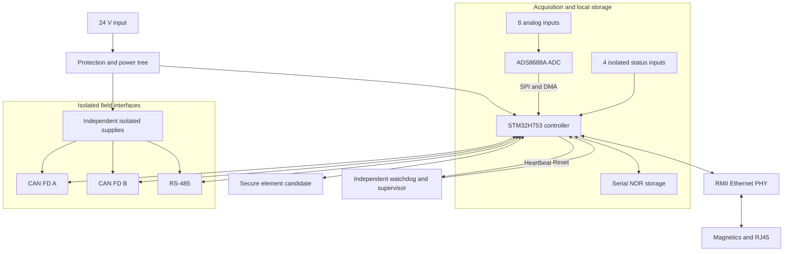
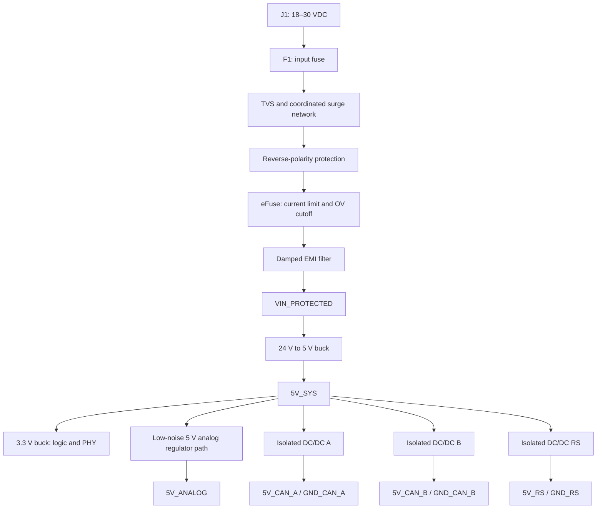
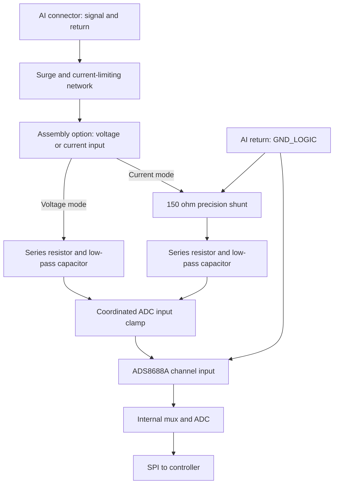
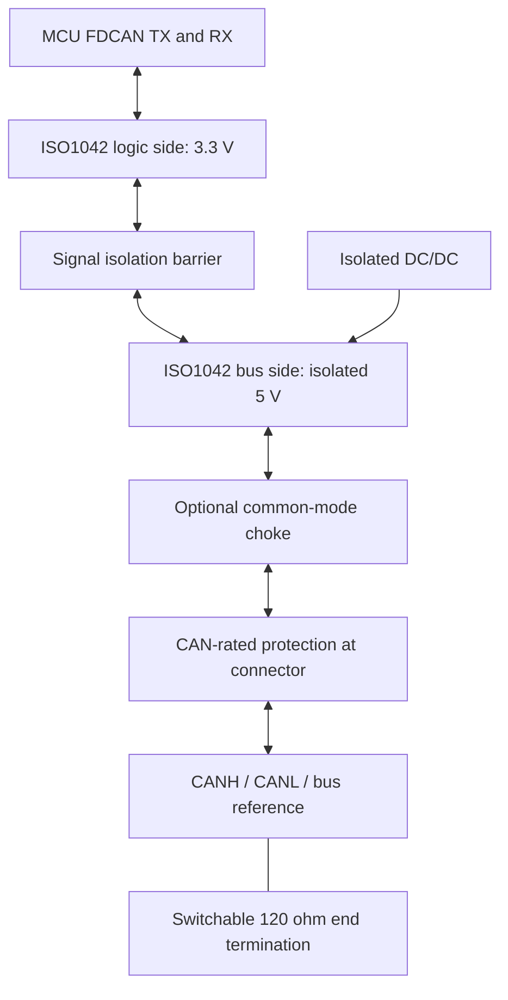
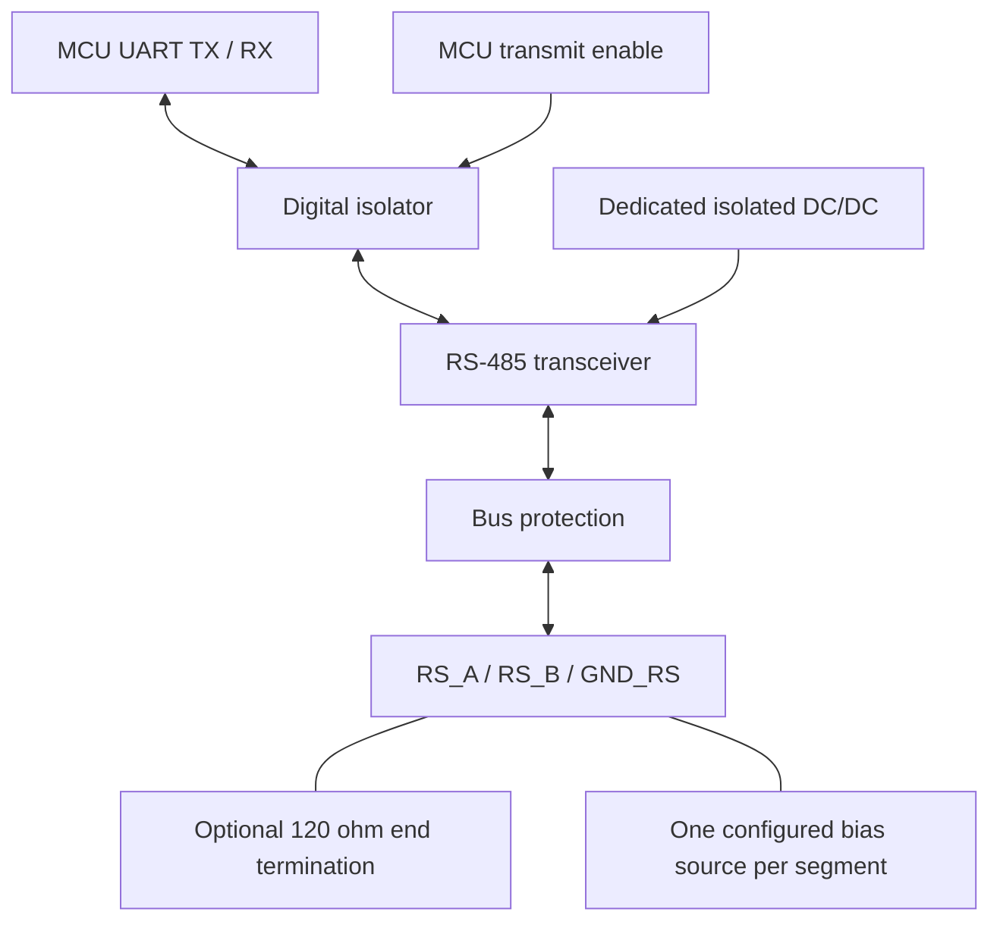
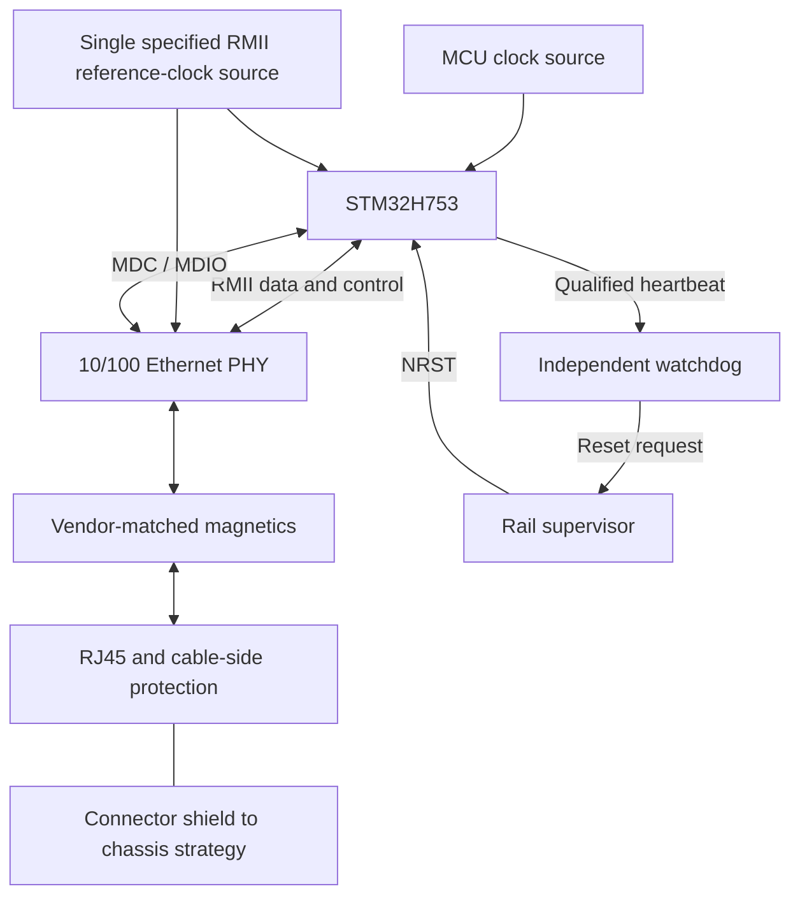
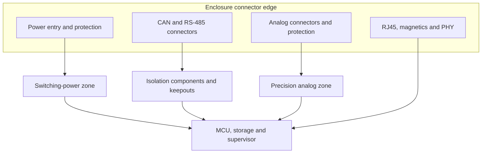
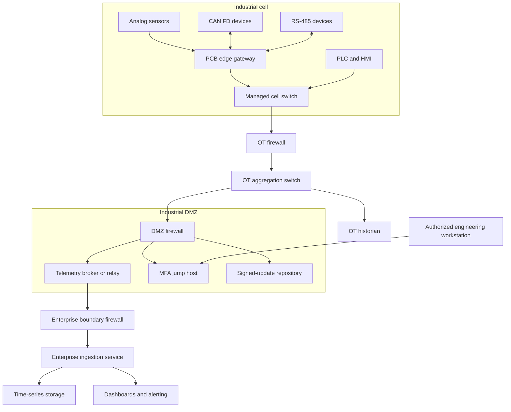
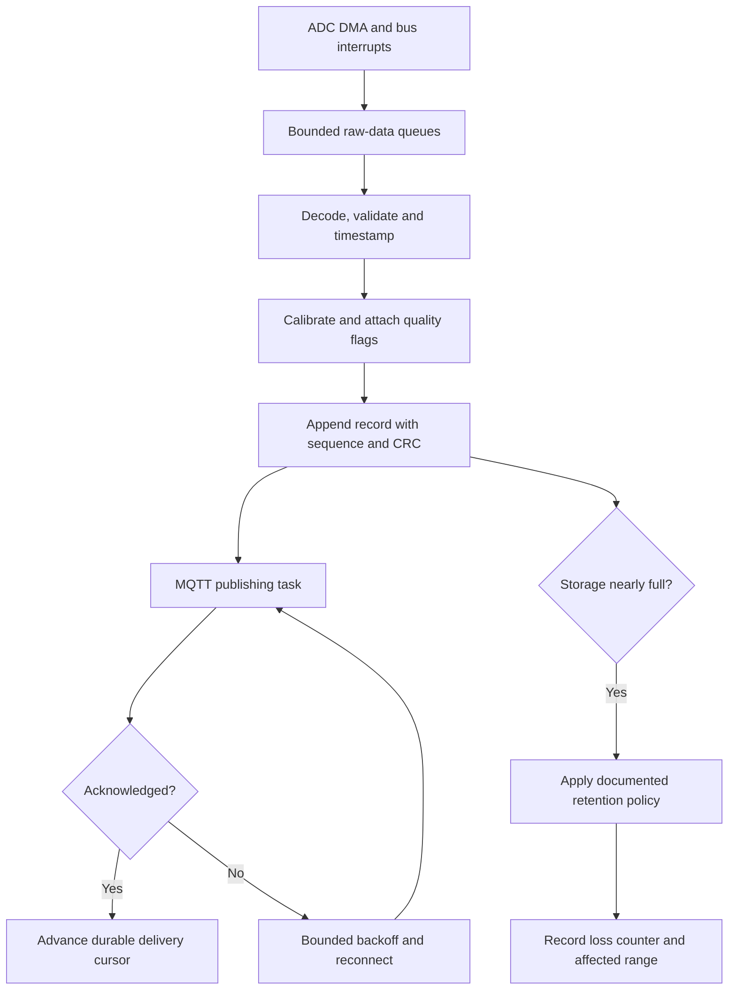
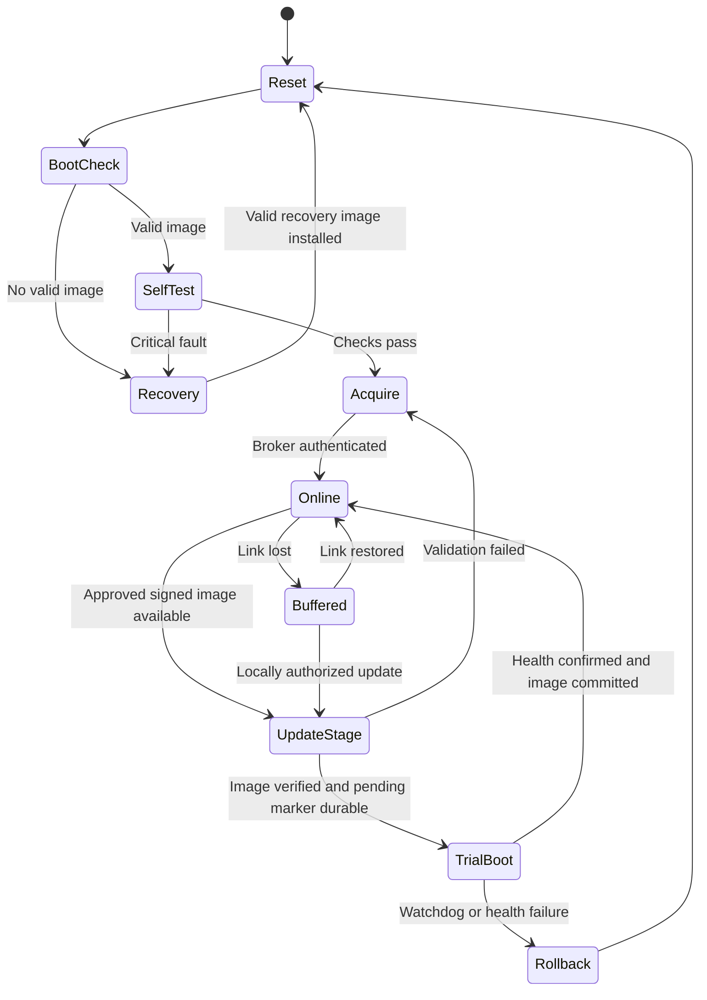

# Industrial Edge Gateway: Complex PCB, Circuit and Network Design

**Revision:** Concept A · **Date:** 2026-10-28  
**Format:** Markdown with Mermaid diagrams and connection tables

> This is a detailed conceptual engineering design, not a fabrication-ready schematic. Values marked “example” require simulation and bench validation. Mermaid drawings express connectivity and architecture; they do not replace electrical CAD symbols, pin-level ERC, PCB DRC, Gerbers or a verified BOM. This design is for low-voltage industrial monitoring, not safety control.

## 1. Design envelope

The gateway acquires analog measurements, collects two independent CAN buses and an RS-485 bus, buffers data locally, and publishes telemetry over Ethernet. A dedicated supervisor can reset an unresponsive main controller. Fieldbus domains are isolated from logic and from one another; analog channels share the logic ground and are **not isolated**.

| Item | Concept target | Qualification needed |
|---|---|---|
| Supply | 18–30 VDC, nominal 24 V | Installation surge and reverse-polarity profile |
| Main processor | STM32H753 family, package selected after pin allocation | Ethernet, two FDCAN interfaces, SPI/UART/DMA coexistence |
| Ethernet | One external 10/100 PHY over RMII | PHY reference design, magnetics, clock topology |
| CAN | Two isolated CAN FD ports | Cable length, topology, timing, EMC |
| Serial | One isolated half-duplex RS-485 port | Baud rate, bus bias, isolation power |
| Analog | Eight multiplexed 16-bit channels, ADS8688A candidate | Input conditioning, settling, protection, calibration |
| Storage | External serial NOR with firmware and telemetry partitions | Endurance, retention and power-fail behavior |
| Digital inputs | Four protected, isolated 24 V status inputs | Thresholds and input power dissipation |
| Board | Eight layers, approximately 160 × 100 mm | Enclosure, connector and thermal constraints |
| Input power budget | Approximately 9 W design allocation | Measured worst-case load and converter efficiency |

These are proposed system requirements, not measured performance. No functional-safety or system-level isolation certification is claimed.

## 2. System architecture

The MCU owns acquisition and bounded protocol processing. Networking must not block sampling: DMA buffers feed a queue, storage absorbs outages, and the MQTT task consumes records independently. A secure element may protect device keys, but secure boot still needs an MCU-compatible root of trust and a verified boot chain.

## 3. Power architecture and circuit

### 3.1 Distribution

A low-noise 5 V regulator cannot generally produce regulated 5 V from a nominal 5 V rail without headroom. Implement the analog branch using a suitable low-drop filter where ripple permits, or a separate higher preregulated rail followed by a 5 V LDO. The diagram labels the function; the converter topology is an open design decision.

### 3.2 Input connectivity

| Element | Connection | Design intent |
|---|---|---|
| J1.1 | VIN_RAW | Positive input |
| J1.2 | GND_LOGIC | Power return; not an isolated domain |
| F1 | VIN_RAW → VIN_FUSED | Coordinate fuse I²t with surge network and wiring |
| D1 | VIN_FUSED → GND_LOGIC, shunt | TVS standoff above maximum normal input; clamp below downstream limits at actual surge current |
| Q1/controller | VIN_FUSED → VIN_REVERSE_OK | Reverse input blocking with suitable MOSFET SOA |
| U1 eFuse | VIN_REVERSE_OK → VIN_LIMITED | OV cutoff, inrush control, short-circuit limit |
| L1/CIN | VIN_LIMITED → VIN_PROTECTED | Damped input filter; check converter input impedance stability |
| U2 buck | VIN_PROTECTED → 5V_SYS | Rated above worst residual transient, with startup margin |
| PG/reset | Power-good and rail monitor → reset supervisor | Release reset only when required rails are valid |

The input TVS is upstream of the reverse-protection block. A unidirectional TVS may conduct heavily during reverse input, so fuse operation and reverse-polarity tests must account for that behavior; a bidirectional choice changes the clamp analysis. Do not choose it from nominal voltage alone.

### 3.3 Illustrative steady-state budget

| Branch | Allocated output load | Conversion assumption | Equivalent 5 V demand |
|---|---:|---:|---:|
| 3.3 V logic, PHY and storage | 3.30 W | 90% | 3.67 W |
| Analog branch | 0.75 W | 85% overall branch efficiency | 0.88 W |
| Three isolated interfaces combined | 1.50 W | 75% | 2.00 W |
| Supervisor and auxiliary loads | 0.30 W | Direct from 5 V | 0.30 W |
| **Total from 5 V** | | | **6.85 W / 1.37 A** |

At 88% input-buck efficiency, estimated input power is `6.85 / 0.88 = 7.78 W`. With 15% allocation margin, use approximately `8.95 W`: `0.373 A at 24 V` or `0.497 A at 18 V`. Startup, bus faults, capacitor charging and temperature derating are additional constraints. A 5 V / 2 A converter is an initial candidate, not a validated selection.

## 4. Circuit diagram: eight-channel analog acquisition

### 4.1 Repeated channel topology

The return connections above are functional: the shunt connects between the current-sense node and ground; it is not a series resistor in the current loop. The connection table below is authoritative.

### 4.2 Example current-input channel connectivity

| Reference | Terminal A | Terminal B | Example value/function |
|---|---|---|---|
| J_AI0 signal | External transmitter output | AI0_RAW | Externally powered 4–20 mA loop |
| Protection network | AI0_RAW | AI0_SENSE | Series fault limiter; leakage and compliance reviewed |
| RSH0 | AI0_SENSE | GND_LOGIC | 150 Ω, 0.05%, low temperature coefficient, 0.25 W minimum candidate |
| RF0 | AI0_SENSE | AI0_FILTERED | 1 kΩ example |
| CF0 | AI0_FILTERED | GND_LOGIC | 10 nF example |
| Clamp network | AI0_FILTERED | Defined clamp references | Threshold, leakage, pulse energy and back-power analysis required |
| ADC AIN0P | AI0_FILTERED | — | Configure 0–5.12 V input range for current mode |
| ADC AIN0GND | GND_LOGIC | — | Connect as specified in device reference design |
| J_AI0 return | External loop supply return | GND_LOGIC | Common return; no channel isolation |

For 4–20 mA: `V = I × 150 Ω = 0.6–3.0 V`. At 20 mA, shunt dissipation is `0.02² × 150 = 60 mW`. At an illustrative 24 mA diagnostic overrange it is `86.4 mW`. A sustained accidental 24 V connection would imply `3.84 W` in an unprotected 150 Ω shunt, so surge clamps alone do not provide adequate miswire protection.

The illustrative RC pole is `1 / (2π × 1000 × 10 nF) ≈ 15.9 kHz`. This is an EMI-filter starting point, **not** a complete anti-alias filter for a low-rate measurement channel. Specify the signal bandwidth, analog stopband attenuation, channel scan rate and digital decimation before selecting the final filter.

For voltage mode, omit the shunt, use a separately reviewed protection/filter network, and configure the ADC for the appropriate bipolar range. Do not fit both assembly options indiscriminately. Sensor ground offsets must remain within the allowed input limits.

### 4.3 ADC support and sampling plan

Use the manufacturer's recommended reference-buffer capacitors, analog supply bypassing, digital supply voltage, reset wiring and SPI timing. The ADS8688A is multiplexed: its advertised 500 kSPS maximum is **aggregate**, not per channel [S1]. An initial operating target of eight channels at 10 kSPS each requires 80 kSPS aggregate, before diagnostic conversions and settling allowances.

Separate raw samples from engineering units. Calibration records contain channel mode, gain, offset, calibration temperature, revision and CRC. Detect open loop, under-range and over-range using explicitly calibrated thresholds; a near-zero signal alone does not identify every fault.

## 5. Circuit diagram: two isolated CAN FD ports

Repeat the following circuit for ports A and B with separate isolated power and ground nets.

| Net/function | Port A | Port B | Rule |
|---|---|---|---|
| Controller TX/RX | FDCAN1_TX/RX | FDCAN2_TX/RX | Resolve exact MCU pins after package selection |
| Logic supply/return | 3V3_LOGIC / GND_LOGIC | Same logic domain | Local bypassing |
| Isolated supply | 5V_CAN_A | 5V_CAN_B | Do not connect outputs together |
| Bus-side return | GND_CAN_A | GND_CAN_B | Separate from logic and each other |
| Differential bus | CAN_A_H/L | CAN_B_H/L | Controlled pair geometry and short stubs |
| Cable reference | GND_CAN_A | GND_CAN_B | Define installation grounding strategy |
| Shield | CHASSIS | CHASSIS | Bond at enclosure boundary as specified by EMC design |

An example split termination is two 60 Ω resistors in series across CANH/CANL, with their midpoint capacitively connected to that port's bus-side ground. Enable termination only at the two physical cable ends. Approximately 60 Ω measured across an unpowered complete bus can indicate two parallel 120 Ω terminators, subject to connected-device circuitry.

ISO1042 supports CAN FD operation up to 5 Mbps and requires an external isolated bus-side supply [S2]. Begin validation at 500 kbit/s arbitration and 2 Mbit/s data; final timing depends on oscillator tolerance, transceiver delay, cable length and topology. An isolator rating does not establish the assembled board's working-voltage rating.

## 6. Circuit diagram: isolated RS-485

Select a transceiver with suitable supply, common-mode range, failsafe behavior and data rate. A/B naming varies by vendor: define connector polarity from the chosen datasheet and test a known positive differential state.

For illustration, a 5 V pull-up and pull-down of 560 Ω each with **two** parallel 120 Ω terminators gives `Rload = 60 Ω` and ideal idle differential `5 × 60 / (560 + 60 + 560) ≈ 0.254 V`. This is not automatically adequate margin: include resistor tolerance, minimum supply, receiver loading, cable leakage, noise and thresholds. Fit external bias at one designated point only, or use a validated network relying on receiver failsafe behavior.

Return DE inactive through a hardware pull resistor when the MCU resets. Do not let bootloader pin states drive the bus. Isolate TX, RX and enable signals; isolating TX/RX alone leaves a galvanic path through an unisolated enable line.

## 7. Ethernet, processor and reset circuits

The clock drawing shows a shared reference function, not permission to parallel two outputs. Select a PHY-specific topology: external oscillator fanout, or a supported PHY clock output to the MCU. Validate load, jitter and startup timing.

| Circuit | Required details before layout |
|---|---|
| MCU power | Every supply pin, VCAP network, analog supply, internal regulator mode and local bypass per selected package |
| Boot | Defined boot state, accessible recovery path, debug connector and documented production locking sequence |
| Reset | Open-drain-compatible reset combination, valid pulse width, controlled release after rails stabilize |
| RMII | Exact alternate functions, clock direction, setup/hold budget, short reference-plane-continuous routes |
| PHY straps | Reset-time resistor states, LED loading interaction, address and mode |
| MDI | PHY-specified impedance, magnetics ratio, center taps and common-mode termination |
| Storage | SPI chip-select defaults, write protect, decoupling and interruption-tolerant records |
| Digital inputs | Series power resistor network, reverse protection, isolator thresholds and deglitch timing |

The STM32H743/753 reference manual documents two FDCAN modules with shared message RAM [S3]. Allocate that RAM explicitly between both active controllers; peripheral availability does not establish a conflict-free package pinout.

## 8. PCB floorplan and layer stack

### 8.1 Functional placement

This is a placement relationship diagram, not a scaled board drawing. Keep switching nodes and inductor fields away from the analog connector, ADC reference and Ethernet magnetics. Put ESD protection at the connector boundary with short return paths to its intended domain.

### 8.2 Proposed eight-layer arrangement

| Layer | Role | Constraints |
|---|---|---|
| L1 | Components, short signals, local power loops | Keep high-di/dt loops compact |
| L2 | Ground reference regions | Continuous logic ground locally; separate isolated-domain islands |
| L3 | Main routing | Route signals over their own domain's ground region |
| L4 | Power distribution | Deliberate plane shapes; avoid return-path assumptions across voids |
| L5 | Power and slow routing | Maintain isolation clearances on every layer |
| L6 | Secondary signal routing | Prefer adjacency to L7 ground |
| L7 | Ground reference regions | Same isolation boundaries as other copper layers |
| L8 | Low-speed signals and secondary components | Keep debug accessible and analog routes short |

The fabricator must define dielectric thicknesses, copper weights and trace geometries from its impedance solver. No universal trace width or spacing is specified here. Use the selected PHY's MDI differential-impedance target and timing requirements; RMII needs its own signal-integrity and timing review.

### 8.3 Grounding and isolation rules

1. GND_LOGIC is continuous beneath the MCU and analog signal routes. Control placement and current paths rather than creating an arbitrary analog/digital ground split.
2. GND_CAN_A, GND_CAN_B and GND_RS occupy distinct islands. Neither traces, planes, mounting hardware nor test fixtures may bridge their barriers unintentionally.
3. Determine creepage, clearance and any routed slots from intended working voltage, insulation category, material group, pollution degree, altitude and applicable product standard.
4. CHASSIS is a separate named net. Capacitive or resistive coupling to other domains is a deliberate, rated circuit decision, with leakage and EMC implications.
5. Route isolated power transformers/converters so their keepouts are respected on **all** copper and silkscreen-relevant fabrication layers.
6. Place a nearby ground stitching via at signal layer transitions only within the same domain; a stitching via must never short isolation islands.

## 9. Complex industrial network topology

### 9.1 Physical infrastructure

Arrows depict intended communication relationships, not implicit firewall permission. No PLC command path is enabled by this monitoring architecture. The gateway is a protocol endpoint; it must not bridge arbitrary Ethernet traffic onto fieldbuses.

### 9.2 Logical VLAN and addressing plan

All addresses are illustrative private ranges, not existing infrastructure.

| VLAN | Purpose | Example subnet | Allowed endpoints |
|---|---|---|---|
| 110 | Sensor gateways | 10.42.10.0/24 | Gateways and default gateway |
| 120 | PLC/HMI cell | 10.42.20.0/24 | Controllers and operator stations |
| 130 | OT services | 10.42.30.0/24 | Historian, internal DNS, time service |
| 140 | Device management | 10.42.40.0/24 | Approved management interfaces |
| 150 | Industrial DMZ | 10.42.50.0/24 | Broker, update repository, jump host |
| 160 | Engineering access | 10.42.60.0/24 | Managed engineering workstations |

VLAN separation is enforced by routed firewalls and switch policy. A VLAN alone is not an authorization boundary. The PCB has one Ethernet interface; any additional management interface or hardware redundancy would require a design change.

### 9.3 Explicit traffic policy

| Initiator → destination | Protocol | Purpose | Constraint |
|---|---|---|---|
| Gateway → DMZ broker | MQTT over TLS, TCP 8883 | Publish telemetry and receive permitted acknowledgments | Mutual authentication; per-device topic ACLs |
| Gateway → internal DNS | UDP/TCP 53 | Resolve approved services | Fixed resolvers only |
| Gateway → OT time source | UDP 123 | Time synchronization | Restricted source; detect large time jumps |
| Gateway → update repository | HTTPS, TCP 443 | Fetch signed firmware | Authenticated transport plus independent signature validation |
| Jump host → gateway | HTTPS, TCP 443 | Maintenance | Short approved maintenance window; audited identity |
| OT historian → DMZ broker | MQTT over TLS, TCP 8883 | Subscribe to authorized telemetry | Separate service identity |
| Enterprise ingestion → DMZ broker | MQTT over TLS, TCP 8883 | Subscribe for enterprise use | No unrestricted route into OT |
| Engineering workstation → jump host | Approved remote-access protocol | Maintenance entry | MFA and session audit |
| Any other inter-zone flow | — | — | Deny by default |

Stateful reply traffic is permitted only for established allowed sessions. Do not expose CAN transmit or firmware-debug functions through a general-purpose remote shell. If remote control is added later, define independent authorization, command freshness, interlocks and an operational hazard review.

## 10. Application data path and outage handling

Each record contains `device_id`, `boot_id`, `sequence`, monotonic timestamp, optional UTC timestamp, time-quality status, channel identifier, value, unit, quality flags and schema version. Use `(device_id, boot_id, sequence)` for downstream deduplication.

MQTT QoS 1 can redeliver messages; a transport acknowledgment does not necessarily mean the final database committed the record. Define the durability boundary explicitly. If database-level confirmation is required, add an authenticated application acknowledgment and retain records until that acknowledgment is durable.

At eight channels × 10,000 samples/s × an illustrative 8 bytes per packed sample, raw payload is `640,000 bytes/s`, approximately `5.12 Mbit/s`, before framing. A 64 MiB flash holds only about `104.9 seconds` of that raw stream before metadata and reserved space. Long outages therefore require aggregation, lower sample rates, or larger and suitably rated storage.

## 11. Firmware state machine and update transaction

Keep a recovery image or boot path that cannot be erased by ordinary application updates. A/B slots, metadata journaling, rollback policy and flash capacities must be allocated together. An anti-rollback counter must not be irreversibly advanced before the candidate image is confirmed, otherwise fallback to the last known-good version may become impossible.

An independent watchdog is useful only if its heartbeat proves critical tasks are progressing. Do not service it unconditionally from an interrupt while acquisition, storage or networking can remain deadlocked.

## 12. Interface and resource allocation

| Resource | Assigned function | Design constraint |
|---|---|---|
| Ethernet MAC/RMII | External PHY | Pin mux and clock validation |
| FDCAN1 / FDCAN2 | CAN A / CAN B | Shared message RAM plan; receive filters and overflow counters |
| SPI bus A | ADC | Deterministic sampling and DMA; device-specific frame timing |
| SPI bus B or supported serial memory interface | NOR storage | Avoid long erase blocking acquisition |
| UART | Isolated RS-485 | DMA, receive framing and bounded transmit turnaround |
| I²C | Secure element and low-rate diagnostics | Address map; bus recovery and timeout handling |
| Timer | Acquisition scheduling | Stable time base independent of wall-clock adjustments |
| GPIO interrupts | Four isolated digital inputs | Hardware thresholds and debounce |
| Debug | SWD and serial console | Development access and production recovery policy |

Exact MCU pin numbers are intentionally unspecified until one package and its alternate-function table have been checked. This avoids presenting a fictional pin map as a usable schematic.

## 13. Verification and release gates

| Stage | Required evidence | Failure response |
|---|---|---|
| Requirements | Defined bandwidth, accuracy, environment, isolation and network policy | Resolve before freezing components |
| Schematic | Full pin-level CAD, ERC, power and protection review | Correct errors before PCB routing |
| Power simulation | Startup, compensation, inrush, input-filter interaction, thermal estimates | Revise topology or values |
| Layout | DRC, impedance stack, return paths, isolation and connector review | Correct before manufacturing export |
| First power | Current-limited supply, all rails, ripple, sequencing, reset | Stop on excess current or unstable rail |
| Analog | Calibrated sweep, crosstalk, noise, temperature and miswire tests | Adjust front end and calibration model |
| Fieldbus | Termination, worst cable, loaded traffic, bus-off and unplug/replug | Revise timing or protection |
| Ethernet | Link modes, packet loss, clock margin and power cycling | Check PHY straps, timing and MDI |
| Firmware | Queue overflow, flash interruption, corrupted records and update rollback | Preserve recovery and expose errors |
| Network | ACL tests, identity failure, certificate expiry and outage buffering | Deny unauthorized flows and report faults |
| EMC/environment | Applicable emissions, immunity, ESD and thermal tests | Iterate layout, filtering or enclosure |
| Production | Programming, calibration, traceability and fixture test coverage | Block units that fail acceptance limits |

No electrical simulation, CAD ERC/DRC, thermal testing, physical prototype testing, or Mermaid rendering validation has been performed for this document. Numerical examples are analytical estimates only.

## 14. Deliverables needed for fabrication

This Markdown file supplies system topology, conceptual circuits, connection intent, example calculations and network diagrams. A production package additionally needs:

- Native electrical CAD project with verified symbols, footprints and complete pin-level sheets.
- Exact manufacturer part numbers, alternates, voltage/power derating and procurement BOM.
- Approved stackup, routed PCB, fabrication drawings, drill files and Gerber or IPC-2581 exports.
- Pick-and-place data, paste layers, assembly drawings and connector pinout labels.
- Simulation files, verification results, firmware release, programming and calibration procedures.
- Applicable product compliance evidence and independent design review closure.

## 15. Primary technical references

The cited manufacturer documents support candidate-device capabilities. Proposed circuits, component values, architecture and network policy are engineering examples, not vendor-validated reference designs.

- **[S1] Texas Instruments — ADS8688A datasheet:** https://www.ti.com/lit/ds/symlink/ads8688a.pdf — multiplexed converter architecture, aggregate throughput, input ranges and supply/reference requirements.
- **[S2] Texas Instruments — ISO1042 datasheet:** https://www.ti.com/lit/ds/symlink/iso1042.pdf — isolated CAN transceiver interfaces, CAN FD capability and supply-domain requirements.
- **[S3] STMicroelectronics — RM0433:** https://www.st.com/resource/en/reference_manual/rm0433-stm32h742-stm32h743-753-and-stm32h750-value-line-advanced-armbased-32bit-mcus-stmicroelectronics.pdf — processor peripheral configuration and shared FDCAN message RAM.

Open this file in a Markdown viewer with Mermaid support to display its diagrams. Viewers without Mermaid support will show the diagram source code.
