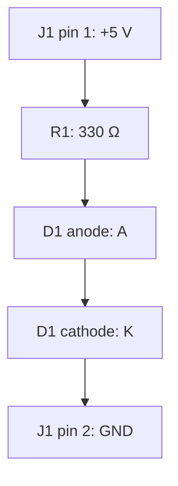

# PCB Circuit Diagram — 5 V LED Indicator 🔌

A simple two-terminal LED indicator with a series resistor. This standalone Markdown file includes a circuit schematic, conceptual PCB placement, a bill of materials, and a connection table.

**Design assumptions:** regulated 5 V DC supply; red LED with an assumed forward voltage of 2.0 V; 330 Ω series resistor.

## 1. Circuit schematic

The embedded SVG below is the actual schematic. Display requires a Markdown renderer that permits inline SVG. If your viewer hides it, the Mermaid connectivity diagram and connection table below describe the same circuit.

<svg xmlns="http://www.w3.org/2000/svg" width="760" height="360" viewBox="0 0 760 360" role="img" aria-labelledby="schematic-title schematic-description">
<title id="schematic-title">5 V LED indicator schematic</title>
<desc id="schematic-description">J1 pin 1 supplies five volts through a 330 ohm resistor and an LED to J1 pin 2 ground. LED anode faces the resistor, and cathode faces ground.</desc>
<rect width="760" height="360" fill="white"/>
<g fill="none" stroke="#17263c" stroke-width="3" stroke-linecap="round" stroke-linejoin="round">
<rect x="55" y="115" width="80" height="145" rx="8"/>
<circle cx="115" cy="145" r="5"/><circle cx="115" cy="230" r="5"/>
<path d="M120 145 H265 M355 145 H465 M525 145 H620 V280 H190 V230 H120"/>
<rect x="265" y="132" width="90" height="26"/>
<path d="M465 125 V165 L505 145 Z M515 125 V165 M505 145 H525"/>
<path d="M490 115 L510 95 M499 97 L510 95 L508 106 M515 115 L535 95 M524 97 L535 95 L533 106"/>
<path d="M620 280 V300 M600 300 H640 M606 309 H634 M613 318 H627"/>
</g>
<g fill="#17263c" font-family="Arial, sans-serif" font-size="18">
<text x="55" y="80" font-weight="bold">J1 — DC input</text>
<text x="72" y="151">1</text><text x="72" y="236">2</text>
<text x="156" y="125">+5 V</text><text x="150" y="265">GND</text>
<text x="264" y="100">R1 — 330 Ω</text>
<text x="448" y="195">D1 — red LED</text>
<text x="449" y="225">A</text><text x="518" y="225">K</text>
<text x="275" y="330">A = anode · K = cathode</text>
</g>
</svg>

### Connectivity diagram — Mermaid fallback

This shows electrical connections rather than standard circuit symbols. Requires Mermaid support.



## 2. Bill of materials

| Reference | Component | Suggested value / form | Quantity |
| --- | --- | --- | ---: |
| J1 | Two-pin input connector | 2.54 mm pitch through-hole header | 1 |
| R1 | Resistor | 330 Ω, ±5%, 0.25 W, axial through-hole | 1 |
| D1 | Red LED | 3 mm through-hole, assumed forward voltage 2.0 V | 1 |

Choose the actual footprints from the selected components' dimensions and datasheets.

## 3. Nets and pin connections

| Net | Connected terminals |
| --- | --- |
| `+5V` | J1 pin 1 ↔ R1 pin 1 |
| `LED_A` | R1 pin 2 ↔ D1 anode |
| `GND` | D1 cathode ↔ J1 pin 2 |

The resistor is not polarized. Verify the LED's anode/cathode and footprint pin numbers from its datasheet rather than assuming a universal LED pin-number convention.

## 4. PCB layout illustration — top view

Conceptual component placement and routing on a nominal **35 mm × 20 mm** board. Red lines represent illustrative top-layer copper. Pad sizes, spacing, and component outlines are not to scale; this is not a fabrication layout.

<svg xmlns="http://www.w3.org/2000/svg" width="760" height="390" viewBox="0 0 760 390" role="img" aria-labelledby="pcb-title pcb-description">
<title id="pcb-title">LED indicator PCB top view</title>
<desc id="pcb-description">Connector at left, resistor in the upper middle, LED at right. Three separate traces connect plus five volts to the resistor, resistor to the LED anode, and LED cathode to the ground terminal.</desc>
<rect width="760" height="390" fill="white"/>
<rect x="55" y="50" width="650" height="285" rx="12" fill="#145943" stroke="#0d3329" stroke-width="3"/>
<g fill="none" stroke="#ff826e" stroke-width="9" stroke-linecap="round" stroke-linejoin="round">
<path d="M125 135 H270"/>
<path d="M430 135 H545 V165 H600"/>
<path d="M600 225 V285 H185 V235 H125"/>
</g>
<g fill="none" stroke="white" stroke-width="2">
<rect x="92" y="99" width="67" height="172" rx="4"/>
<rect x="306" y="111" width="88" height="48" rx="5"/>
<path d="M270 135 H306 M394 135 H430"/>
<circle cx="600" cy="195" r="63"/>
<path d="M552 155 V235"/>
</g>
<g fill="#edc45e" stroke="#7a5d13" stroke-width="2">
<rect x="115" y="125" width="20" height="20"/>
<circle cx="125" cy="235" r="10"/>
<circle cx="270" cy="135" r="10"/>
<circle cx="430" cy="135" r="10"/>
<circle cx="600" cy="165" r="10"/>
<circle cx="600" cy="225" r="10"/>
</g>
<g fill="#10251d">
<circle cx="125" cy="135" r="4"/><circle cx="125" cy="235" r="4"/>
<circle cx="270" cy="135" r="4"/><circle cx="430" cy="135" r="4"/>
<circle cx="600" cy="165" r="4"/><circle cx="600" cy="225" r="4"/>
</g>
<g fill="white" font-family="Arial, sans-serif" font-size="18">
<text x="95" y="83">J1</text><text x="173" y="120">+5 V</text>
<text x="89" y="302">GND</text>
<text x="303" y="90">R1 330 Ω</text>
<text x="567" y="97">D1 LED</text>
<text x="626" y="169">A</text><text x="626" y="231">K</text>
<text x="268" y="314">Top view · conceptual routing</text>
</g>
<text x="175" y="370" fill="#17263c" font-family="Arial, sans-serif" font-size="18">Nominal board: 35 mm × 20 mm · drawing not to scale</text>
</svg>

### Placement summary

| Component | Approximate board region | Connection / orientation |
| --- | --- | --- |
| J1 | Left edge | Clearly mark pin 1 `+5V` and pin 2 `GND` |
| R1 | Upper middle | Connect between `+5V` and `LED_A` |
| D1 | Right side | Anode to `LED_A`; cathode to `GND` |

## 5. Electrical calculations

With the assumed LED forward voltage:

$$
I_{LED} \approx \frac{V_{supply}-V_F}{R}
= \frac{5.0-2.0}{330}
= 0.00909\,\mathrm{A}
\approx 9.1\,\mathrm{mA}
$$

$$
P_R = I^2R \approx (0.00909)^2\times330
\approx 0.0273\,\mathrm{W}
$$

A 0.25 W resistor has ample power margin under these nominal assumptions. Actual LED current varies with supply voltage, resistor tolerance, LED forward voltage, and temperature.

Plain-text equivalents for viewers without math support:

- LED current ≈ `(5.0 V − 2.0 V) / 330 Ω` ≈ **9.1 mA**.
- Resistor dissipation ≈ **27.3 mW**.

## 6. SPICE-style connectivity source

This illustrative netlist uses a generic diode model; it does not represent a characterized red LED. Replace `D_GENERIC` with the chosen LED's model for meaningful simulation. No simulation was run.

```spice
* 5 V LED indicator — illustrative connectivity only
V1 supply 0 DC 5
R1 supply led_anode 330
D1 led_anode 0 D_GENERIC
.model D_GENERIC D
.op
.end
```

## 7. Turning the illustration into a PCB

1. Enter J1, R1, and D1 into your PCB CAD schematic.
2. Connect the three nets exactly as listed above.
3. Assign footprints matching the selected physical components.
4. Place the connector near the board edge and mark power and LED polarity.
5. Route the three nets, then run electrical and design-rule checks against the chosen fabrication rules.
6. Verify pad-to-pin mapping and component clearances before generating manufacturing files.

**Scope:** educational circuit documentation and conceptual placement. This file contains no Gerber, drill, or editable PCB CAD files.
